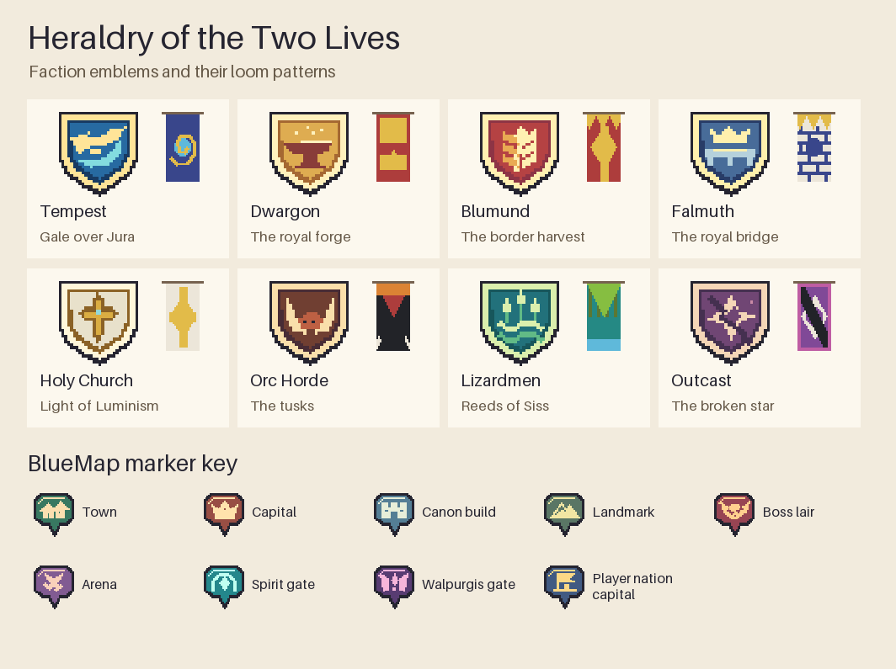

# Faction heraldry

The federation, human kingdoms, Church and monster peoples come from Tensura. Their eight emblems here are **our interpretation**. The official country entries describe places, peoples and institutions. They do not establish these eight flag designs or their colours. The Outcast Society belongs to the pack’s own story. Each shield is hand-drawn pixel art. Its banner adapts the same idea to shapes that a vanilla loom can weave.

| Faction | What the shield and cloth represent | Reference |
|---|---|---|
| Jura-Tempest Federation | A gold gust curls around a pale storm eye on blue. The eye recalls Rimuru’s slime form. The official entry describes a federation formed by different peoples of Jura. | [Official map, Tempest](https://www.ten-sura.com/map/#A-112) |
| Armed Nation of Dwargon | A red anvil on warm yellow recalls the forges and craft trade. The colours follow the pack’s gate banners. The loom makes the anvil from a bar, a triangle and a base. | [Official map, Dwargon](https://www.ten-sura.com/map/#A-30) · [Dwargon build](dwargon.md) |
| Kingdom of Blumund | A single ear of grain on red recalls the small agricultural country on Jura’s border. The colours continue the red and cream of the local royal banners. | [Official map, Blumund](https://www.ten-sura.com/map/#A-18) · [Blumund build](blumund.md) |
| Kingdom of Falmuth | A bridge beneath a crown represents a feudal kingdom prospering from transit trade. Blue and white come from the pack’s Marris design. | [Official map, Falmuth](https://www.ten-sura.com/map/#A-63) · [Marris build](marris.md) |
| Western Holy Church | A gold cross on ivory, with a blue centre on the shield, echoes the shields and pale banners in the pack’s Lubelius. The official map locates the Church headquarters there. | [Official map, Lubelius](https://www.ten-sura.com/map/#A-110) · [Lubelius build](lubelius.md) |
| Orc Horde | The pair of pale tusks frames an ochre snout against a dark field. The triangular dyes give the marchers’ cloth its jagged profile. Episode 14 supplies the Orc Disaster story. | [Official episode 14](https://www.ten-sura.com/anime/tensura/story/no14) |
| Lizardmen of Lake Siss | Three reed heads and a forked wave recall the wetlands around Lake Siss. Green stripes and a blue lower band turn that landscape into a loom recipe. | [Official map, Lake Siss](https://www.ten-sura.com/map/#A-49) · [Official episode 12](https://www.ten-sura.com/anime/tensura/story/no12) |
| Outcast Society | A diagonal break divides a pale star. Rejected reincarnators carry two halves of a common sign on purple cloth. The design and the faction are original to Two Lives. | [Pack master plan](../master-plan.md) · [Faction registry](../data/factions.toml) |

## Weaving a banner

Find the faction’s `base` in the [recipes](../data/heraldry.toml). Put that colour banner in a loom. For each entry in `layers`, add the named dye, choose the pattern, take out the result and put it back for the next layer. Read from top to bottom. For Tempest’s final spiral, also put a **Flow Banner Pattern** in the pattern slot. The other recipes use the loom’s standard patterns. For a command-made copy, run the faction’s complete `give` command as a player with permission. From the console, replace `@s` with the player’s name. Minecraft 1.21.1 stores these layers in the `minecraft:banner_patterns` item component. [Mojang’s component format](https://www.minecraft.net/en-us/article/minecraft-java-edition-1-20-5) · [Tricky Trials release notes](https://www.minecraft.net/en-us/article/minecraft-java-edition-1-21)

The vanilla client’s pattern definitions and the pack’s existing local banner palettes were checked. The Tensura jar contains its own `tensura:dwargon` banner pattern, and the Gazel throne NBT uses layered banners. Those are separate existing assets. All eight recipes use vanilla patterns, and all shield and marker pixels were drawn for the pack. The small cloth illustrations on the sheet are diagrams. Minecraft renders the woven banner with its own textures.

## Files and map markers

Run `python tools/gen_heraldry.py` to rebuild the images, or append `--check` to compare the decoded pixels. The generator uses Pillow and the eight IDs in the reputation registry. Each 32 × 32 game emblem has a 64 × 64 nearest-neighbour companion under `pack/kubejs/assets/ttl/textures/heraldry/`. For example, `ttl:textures/heraldry/dwargon_32.png` identifies the small Dwargon shield. [Generator](../../tools/gen_heraldry.py)

BlueMap's nine transparent 32 × 32 markers distinguish a settlement, an established capital, a built canon site, a general landmark, a boss lair, an arena, a Spirit gate, a Walpurgis gate and a player nation’s capital. The crown designates an established capital. The flag on a plinth marks a player nation’s seat. Marker images describe the kind of place, while faction shields identify its allegiance.

The generator writes map icons under `pack/config/bluemap/web/assets/ttl/` and identical copies to `pack/bluemap/web/assets/ttl/`. The latter is the directory the pack installs into the configured webroot. BlueMap 5.7’s web bundle uses `assets/poi.svg` for its default POI. Its WebFilesManager extracts the bundled archive to the webroot; our `assets/ttl/` files have their own names. For a custom POI, assign the relative URL (for example, `icon: "assets/ttl/spirit_gate.png"`) and `anchor: { x: 16, y: 29 }` so the point meets the ground coordinate. The marker key supplies the artwork for player nations; a moving or newly founded capital needs an actual marker producer. [BlueMap marker documentation](https://bluemap.bluecolored.de/wiki/customization/Markers.html) · [Pack web server settings](../../pack/config/bluemap/webserver.conf)
