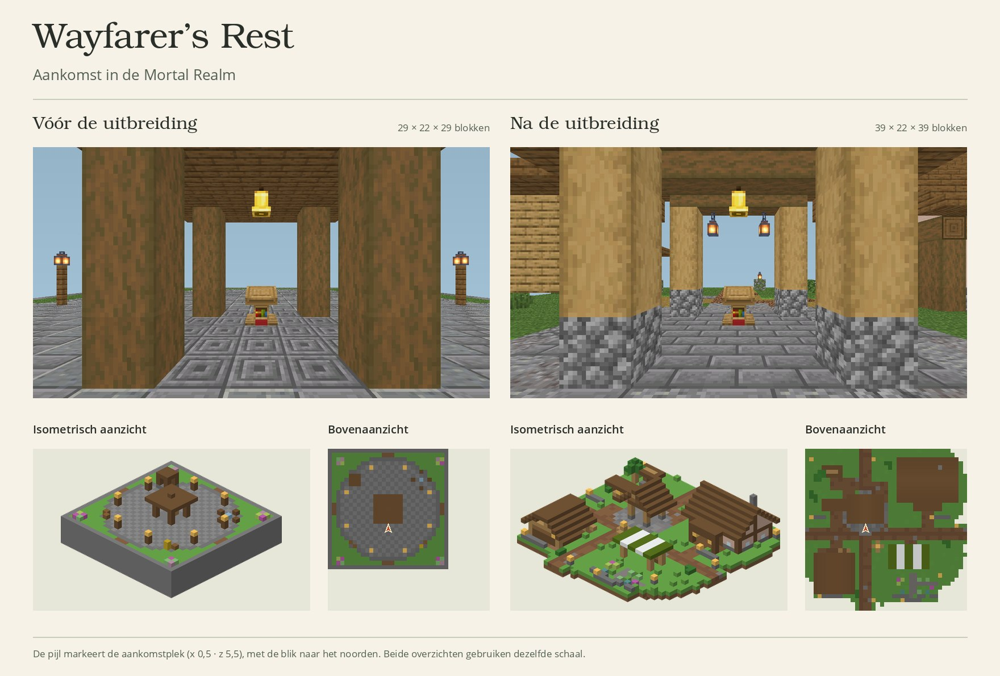

# Wayfarer's Rest

A bell marks the crossroads at the centre of the Mortal Realm. A traveller arriving south of it sees the lectern framed by the two front posts. A turn to the right brings the coaching inn into view. This is where a player begins their first, human life. Wayfarer's Rest is an original OCS settlement. The Voice, the first-life setting and the bell shrine come from the pack's own story. [Life 1 quest chapter](../quests/chapter_0_mortal_life.toml)

The inn's common room has a shared table, two beds and a screened hearth. A covered south porch looks back towards the square. Across the road, travellers can lead horses into either of two open bays or tie them at the hitching rail. A cloth seller has set up beneath a striped awning beside a small dye garden. The buildings give the player places to walk to before choosing a road out of the hamlet. [Structure source](../../blueprints/mortal_spawn.py)

The template spans **39 blocks east–west, 39 north–south and 22 vertically**, including its buried foundation and overhead clearance. Its northwest corner is at world x/z **(−14, −14)**; the bell stands at **(0, 0)**. Players arrive at **(0.5, 5.5)** in `ttl:mortal_realm`, on the south side of the square. The traveller board lists `/ttl guide`. A four-sided fingerpost marks the roads. [Placement and sign text](../../pack/kubejs/server_scripts/ttl/life/mortal_spawn.js)

## Design references

- London's George Inn had timber-framed ranges around a coaching yard. At Stowe's New Inn, the carriage entrance led to a courtyard with service buildings behind. Our interpretation puts a low timber porch on the lodging house and gives the stable a separate frontage across shared open ground. The change of surface from stone paving to worn earth marks the entrance to the horse bays. [George Inn, Historic England](https://historicengland.org.uk/listing/the-list/list-entry/1378357) · [New Inn at Stowe, Historic England](https://historicengland.org.uk/listing/the-list/list-entry/1211787)
- Hypixel's Main Lobby places a guide close to spawn and gives different parts of the hub their own landmarks. On MCC Island the hub connects several destinations while leaving space to explore on foot. Here the existing bell and lectern give the first arrival a bearing. The inn's roof, stable bays and cloth awning distinguish the places around it at walking height. [Hypixel's Main Lobby update](https://hypixel.net/threads/main-lobby-new-activities-achievements-and-more.4887629/) · [MCC Island, Noxcrew](https://mcchampionship.com/island/)
- Vanilla Java 1.21.1 has a 10 × 7 × 10 plains meeting point with a bell and water, and an 8 × 5 × 15 variant with a bell and white and yellow wool. Wayfarer's Rest keeps the bell from its original 29 × 29 square and uses green and white wool for a dyer's stall. The narrow canopy lets players see the counter from the road. [Vanilla village structure catalogue](https://minecraft.wiki/w/Village/Structure)

## Structure inventory and credit

The plaza, outbuildings and furnishings are authored in the pack's blueprint. The repository already contains market-town builds in Blumund and Marris, plus imported goblin-village and throne-room assets credited for other locations. The old Wayfarer's Rest supplied the bell shrine, roadside lectern and four-way crossing. [Blumund](../../blueprints/blumund.py) · [Marris](../../blueprints/marris.py) · [Pack credits](../../CREDITS.md)

The following structures were inspected in the pinned jars for reference. All coordinates, block arrangements and furnishings in this hamlet are original to the pack.

| Source | Template inspected | Comparison |
| --- | --- | --- |
| Minecraft Java 1.21.1, Mojang | `village/plains/town_centers/plains_meeting_point_1` and `plains_meeting_point_2` | The well and striped market roof show how few blocks are needed to identify a village meeting place. |
| Towns and Towers 1.13.11, CC BY-NC-ND 4.0 | `kaisyn:village/snowy_slopes_inn/town_centers/snowy_slopes_meeting_point_1` | Its 21 × 12 × 15 timber meeting point pairs spruce framing, a bell and lanterns. The inn here has its own plan and porch. |
| Iron's Spells 'n Spellbooks 3.16.3, All Rights Reserved | `irons_spellbooks:villages/oak/priest_house` | A bell and lectern also occur in this tall village building. The crossroads keeps both at a small, open shrine. |
| Tensura: Reincarnated 2.0.1.5, All Rights Reserved | `tensura:dwarf_village/plaza/dwarf_village_fountain` | This 5 × 3 × 5 water feature illustrates the scale of a plaza furnishing. The human settlement has its own roadside well. |

## Arrival and sightlines

The paired views use the same standing eye height and north-facing camera at x/z (0.5, 5.5). The overviews show the four roads and the sheltered yard beyond the first player's field of view. The terrain outside the template, sign lettering and night lighting are applied by the game.

