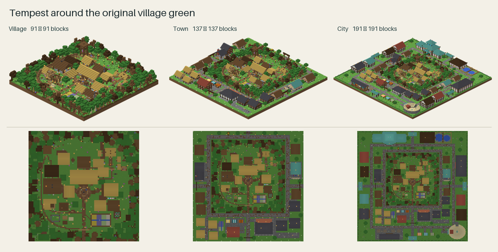

# Growing up around the village green

After the Orc Disaster, the hard problem facing Rimuru is finding homes and work for the people who survived. At town scale, visitors should be able to follow the flow of materials from a wagon to a workshop to a finished house. The capital has a different problem: feeding, bathing, housing and entertaining guests from abroad. Its avenues lead visitors through a trading city to the council and the entrance to Ramiris’s attraction. [The Jura Forest Alliance, anime](https://www.ten-sura.com/anime/tensura/story/no15) · [Fuse, light novel 3](https://yenpress.com/titles/9781975301224-that-time-i-got-reincarnated-as-a-slime-vol-3-light-novel) · [Rimuru City, Tensura Wiki](https://tensura.fandom.com/wiki/Rimuru_City)

## Which era is on screen?

| Reference | What it contributes |
| --- | --- |
| [Anime season 1, episode 20](https://www.ten-sura.com/anime/tensura/story/no20) and [light novel 4](https://yenpress.com/titles/9781975301156-that-time-i-got-reincarnated-as-a-slime-vol-4-light-novel) | By the time Rimuru can leave for Shizu’s students, the settlement and its connections can sustain him away from home. The exact course of each trade street is our interpretation. |
| [Season 2 banquet arc](https://www.ten-sura.com/anime/tensura/story/no51) and [light novel 6](https://yenpress.com/titles/9781975301194-that-time-i-got-reincarnated-as-a-slime-vol-6-light-novel) | Tempest speaks on an international stage. Its council needs a place to receive outsiders as well as hear local business. |
| [Festival preparations, light novel 8](https://yenpress.com/titles/9781975313005-that-time-i-got-reincarnated-as-a-slime-vol-8-light-novel), [manga chapter 104](https://tensura.fandom.com/wiki/Festival_Preparations_(chapter)), [season 3 dungeon planning](https://www.ten-sura.com/anime/tensura/story/no66) and [festival eve](https://www.ten-sura.com/anime/tensura/story/no72) | The festival and dungeon opening come later than season 2. The city phase deliberately brings those later attractions into one visitable capital. |
| [Founder’s Festival](https://tensura.fandom.com/wiki/Tempest_Founder%27s_Festival) and [the Dungeon](https://tensura.fandom.com/wiki/Dungeon) | Ramiris and Rimuru make the dungeon a destination for adventurers. The landmark represents the public entrance and its approach; the playable Labyrinth has its own dimension and arena. |

## Quest and NPC coordinates

The village arrival is the origin for both later plans. East is positive X. South is positive Z. Y offsets are measured from the walking surface stored by the existing village placer. The village’s geometric middle is twelve blocks north of world (0, 0). Using its middle as the arrival would move every quest target. [Village blueprint](../../blueprints/tempest.py) · [NPC spots](../data/npcs.toml) · [Story quest web](../quests.md)

| Place | World x, z | What stays accessible |
| --- | --- | --- |
| Arrival and green | 0, 0 and 0, −7 | Route from the signpost to the cooking fire, well and council. |
| Longhouse | door at 0, −15 | Benimaru at −1, −22 and Shion at 0, −27. The guild and adventurer stand-ins also use the old hall. |
| Kaijin’s forge | −26, −12 | West-road anvil and the dwarves’ adjacent workshop. |
| Shuna’s weaving hut | 22, −8 | The original working loom and its west-facing entrance. |
| Rigurd’s hut and old-quarter fire | 22, −39 and 22, −30 | Chapter 2’s goblin quarter. |
| Lookout | −29, −43 | Souei’s platform stands ten blocks above arrival height. |
| South gate and Outcast road | 0, 23 and 0, 52 | The old gate remains an inner landmark. The road and standing space continue south to the contact. |

## Placing the rings later

The common reference is **arrival (0, 0)**. If the recorded walking height is Y, each structure corner has Y-coordinate `Y − 5`. Slab numbers are zero-based and run south along Z. Use the offsets in each blueprint’s `PARTS` list. The existing 91 × 91 village has an asymmetric Z range around arrival.

| Phase | Overall size X × Y × Z | Blueprint arrival | World range X / Z | Earlier footprint omitted from every slab |
| --- | --- | --- | --- | --- |
| Village | 91 × 40 × 91 | (45, 5, 57) | −45…45 / −57…33 | Initial settlement |
| Town | 137 × 40 × 137 | (68, 5, 68) | −68…68 / −68…68 | Entire village, including its terrain and air |
| City | 191 × 40 × 191 | (95, 5, 95) | −95…95 / −95…95 | Entire 137 × 137 town |

Begin with the placed village, then add town, then city. The empty interior in a ring preview corresponds to coordinates omitted from the NBT. Existing blocks, residents, signs and containers survive there. A future placer must also restrict terrain grading, tree removal and protection to the intended columns; clearing the rectangular bounding box would undo that guarantee. Neither growth phase registers a generic-placement manifest. [Growth contract](../architecture/world-state.md) · [Town blueprint](../../blueprints/tempest_town.py) · [City blueprint](../../blueprints/tempest_city.py)

The pinned library contains ready-made goblin structures, including the campfire, arch, chief hut and tower. The village already uses those pieces. Their redistribution permission is unresolved; the new ring templates contain original block arrangements. Tensura block IDs refer to the installed mod. Towns and Towers and Iron’s Spells were inspected as architectural references. [Original village inventory and licences](tempest.md) · [Pack credits](../../CREDITS.md)

## Our interpretation of the two districts

**Town.** The west grain gate and northern iron gate join the town to its neighbours. At the western forge annex (−60, −22), a Tensura woodcutter stands beside the timber yard. Across town, at (+59, −22), Shuna’s blue-roofed weaving hall has room to dry cloth. South of the village, small thatched cottages share a lane, orc masons stack cut stone in their working yard, and delegates meet in the council court (+19, +52). All coordinates here are world X, Z. The north gate at (0, −66) marks the road to Dwargon; the west gate at (−64, 0) marks the road to Blumund.

**City.** A paved promenade links the audience palace, guild, west-side inn, bath gardens and festival stage. Guest beds above the inn’s dining room give long-distance visitors somewhere to stay. Ramiris’s entrance court combines spectator seating with a vestibule of cream and dark Tensura labyrinth brick. Its sealed inner doorway is an architectural destination. Wiring travel or phase changes belongs to the runtime work. The position of each building, street width, architecture and materials are our interpretation. [Anime audience scene](https://www.ten-sura.com/anime/tensura/story/no67) · [Dungeon and Storm Dragon](https://tensura.fandom.com/wiki/Labyrinth_and_Storm_Dragon)

