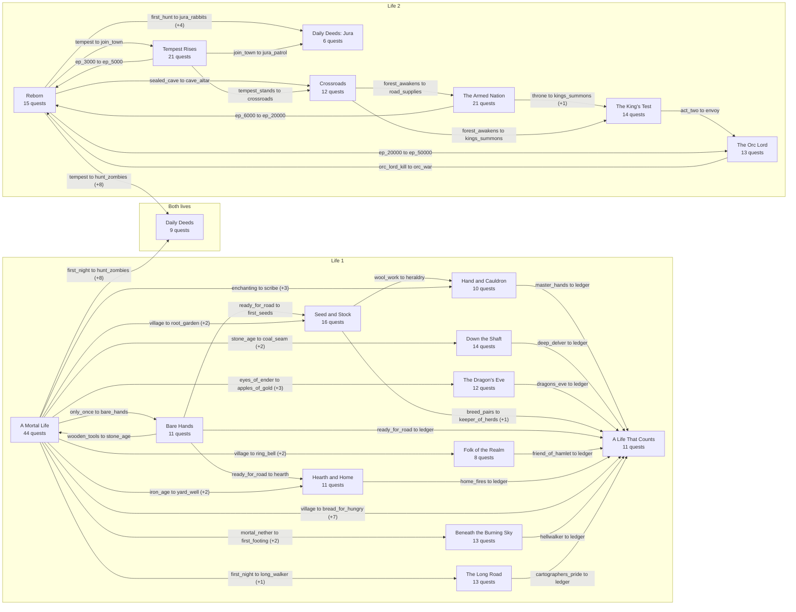
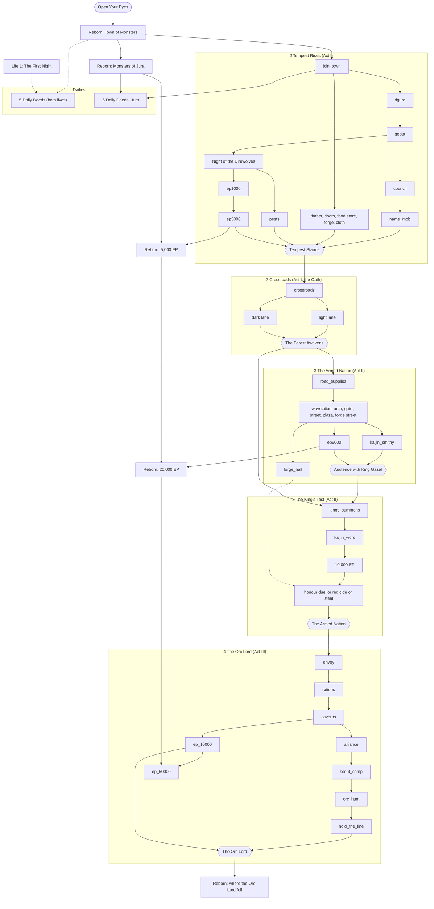

# Quests — design, format and sources

The quest book is FTB Quests (NeoForge 2101.1.39, with FTB XMod Compat 21.1.14 and Tensura Compat: FTB 2.0.0.4).
It is written in TOML (`design/quests/*.toml`, one file per chapter) and generated by `tools/gen_quests.py`
into `pack/config/ftbquests/quests/`, which packwiz ships to clients and the server like any other config.
(Master plan D14 said YAML; TOML was chosen to match `design/data/*.toml` and keep the tools stdlib-only.)

## Editing quests

1. Edit or add a chapter in `design/quests/<chapter>.toml` (fields below).
2. `python tools/gen_quests.py` (writes the book and `kubejs/server_scripts/ttl/generated/quests.js`).
3. `python tools/validate.py` fails while the book is stale.
4. In game after a deploy: `/ttl quests check` (every generated quest loaded), or `tools/server.sh test quests`.

Never edit the generated SNBT or open the book in FTB edit mode on the server: the next deploy overwrites it.
Quest and task ids are stable hashes of the keys (`ttl/<chapter>/<quest>/task/<n>`): renaming a quest key or
reordering its tasks resets that progress for everyone (give a task a `key` to make it order-proof).

### Chapter

| Field | Meaning |
| --- | --- |
| `key` | lowercase id; also the chapter file name |
| `title`, `subtitle`, `text` | shown on the chapter (text: blank line = new paragraph) |
| `icon` | item id |
| `order` | position in the chapter list (unique integer; FTB sorts by it, negative works). The Life 1 chapters use -11 (A Mortal Life) to -1 so that they sit before the Life 2 chapters without renumbering them; chapters added for later acts take 9 and up |
| `life` | `1` = Life 1: items and entities from `minecraft:` and the two Sophisticated storage mods only (`LIFE1_NAMESPACES` in the generator, checked against `design/data/mortal_banned.toml`), no Tensura tasks (enforced); `2` = Life 2; `"both"` = shared by both lives, so the same rules as `1` (enforced) |
| `hide_until_deps_complete` | quests stay hidden until their dependencies are done (story chapters) |

### Quest (`[[quests]]`)

| Field | Meaning |
| --- | --- |
| `key`, `title`, `subtitle`, `icon` | id (unique in the chapter) and looks |
| `deps` | keys of quests that must be done first; `"<chapter>/<quest>"` points at a quest of another chapter (see Story extensions) |
| `min_deps` | at least this many of `deps` must be done (FTB `min_required_dependencies`), default all: a quest after two lanes uses `min_deps = 1` |
| `path` | `"light"` or `"dark"`: a story lane quest, see Story extensions |
| `lane`, `col` | layout: row (negative = above) and column; column defaults to deepest dependency + 1 |
| `shape`, `size` | `circle` … `gear`; size 1.5 for milestones |
| `optional` | does not block chapter completion |
| `repeatable`, `cooldown` | FTB Quests `can_repeat` / `repeat_cooldown`: once every reward is claimed the quest resets; `cooldown` is in seconds (86400 = daily) and needs `repeatable`. A repeatable quest may not have a plain item task: use `consume = true` (below) or it completes again at once |
| `text` | description (blank line = new paragraph; `&6` colour codes work) |
| `karma` | Life 1: appended as "Next life: …" — how the deed counts for the rebirth (keep in step with `design/data/karma.toml`) |
| `lore` | one line in the Realm's own voice, shown in grey italics between the text and the karma line (every quest of chapters 0a-0j has one) |
| `tasks` | list, see below |
| `rewards` | `item` (`item`, `count`), `xp` (`xp` points), `xp_levels`, `stage`, `command` (the last two: Story extensions). Nothing else: quests never grant skills, races or evolutions (`design/manas-integration.md` §5(d)) |

Task types: `item` (item, count; checks the inventory and never consumes unless `consume = true`, which makes it a hand-in submitted in the quest screen), `kill` (entity, count), `dimension`, `structure` (id or `#tag`),
`biome`, `advancement` (+ optional `criterion`), `stat` (custom stat id, value), `stage` (KubeJS stage, via
FTB XMod Compat; `team_stage = true` reads the FTB team's stages instead of the submitting player's; the name must be `ttl.<…>`), `checkmark`, `xp`, `location` (dimension, `at = [x, z]`, `radius`: a full-height box),
and Life 2 only: `ep` (`tensura_ftb:existence_value`, default `existence = "EP"`) and `ability`
(`tensura_ftb:ability`, ability id, status AVAILABLE/LEARNT/MASTERED). Any task may have a `title`.

**Mortal dimensions:** vanilla advancements that test a dimension (`story/enter_the_nether`, `story/enter_the_end`,
`end/root`…) never fire in `ttl:mortal_nether` / `ttl:mortal_end`. Use `dimension` tasks there. Item, kill,
structure, biome, stat and most other advancements work in every dimension.

## Story extensions (WP-S5, `design/architecture/story-characters.md` §3, §6.3)

All optional; a chapter that uses none of them generates exactly as before.

**`path = "light" | "dark"`** on a quest makes it a lane quest. The generator adds a first task, a `stage` task on
`ttl.path.<x>` (task key `path`, so the other tasks keep their ids whether or not the quest has a path), turns on
`require_sequential_tasks` (nothing else progresses before the path task) and, unless `path_hidden = false`, makes the
quest `invisible` until that one task is done: a dark player never sees the light lane, and the stage task still
auto-submits while the quest is hidden. Before the Oath neither lane shows. The stage is per player but quest progress is per
FTB team, so a party must share one path (WP-S2 locks it); with `path_hidden = false` the lane stays visible and merely
cannot be finished by the other path.

**Cross-chapter `deps`**: `deps = ["tempest_rises/stands", "local_key"]`. The id hash already includes the chapter key, so
it is `qid(<chapter>, <quest>)`. The generator checks the target exists (any chapter, any file order) and refuses dependency
loops across chapters; a cross-chapter dep does not move the quest on the grid (column counts same-chapter deps only). FTB Quests
resolves dependencies after all chapter files are read, so the chapter order on disk does not matter. A quest key cannot
contain `/`.

**Rewards**

| Reward | Fields | Notes |
| --- | --- | --- |
| `stage` | `stage`, `remove = false`, `team = false`, `auto = "invisible"` | FTB `gamestage` reward. Auto-claimed and silent by default. Only `ttl.story.*` and `ttl.quest.*` may be set or removed (`REWARD_STAGE_PREFIXES`); `ttl.life*`, `ttl.tier.*`, `ttl.race.*`, `ttl.boss.*`, `ttl.faction.*`, `ttl.path.*` belong to other systems. `team = true` writes a team stage (pair it with a `team_stage` task) |
| `command` | `command`, `permission_level = 2`, `silent = false`, `feedback = ""`, `as_player = true` | FTB `command` reward. Runs as the claiming player (it always does: `CommandReward.claim` uses the player's command source; `as_player = false` does not exist and is refused). `permission_level` only raises that source's level; `/ttl ...` subcommands need op level 2, hence the default 2 (use 0 for a plain command). FTB expands `{p}` `{x}` `{y}` `{z}` `{chapter}` `{quest}` `{team}` `{team_id}` `{member_count}` `{online_member_count}` and then runs `String.format`, so `%` is refused. Commands mentioning skill, race, evolve, awaken, unique, legendary, registry, op, deop or stop are refused (rule: quests never grant those). Not auto-claimed: the player presses the claim button |
| any | `auto = "default" \| "disabled" \| "enabled" \| "no_toast" \| "invisible"` | FTB `RewardAutoClaim`; `default` is the book's `default_autoclaim_rewards` (disabled) |

## The web (quest-book connectivity)

One book, one web: every chapter hangs on another through cross-chapter `deps`, every quest can be unlocked, and the only two ways in are
Only Once (Life 1) and Open Your Eyes (Life 2). `python tools/quest_graph.py` prints the chapter map below from the TOML and
`python tools/quest_graph.py --check` (run by `validate.py`; the same checks are in `tests/test_gen_quests.py`, `QuestWebTests`) fails on a quest that can
never unlock (its dependencies loop, or fewer than `min_deps` of them are unlockable), a quest with no dependency that is not one of the two entries, or a
chapter outside the web.

### Life 1: a spine and ten chapters that converge

Chapter 0 (A Mortal Life) is the spine, Only Once to the Mortal Dragon. Ten chapters hang off it; each ends in a capstone milestone (gear shape) and
all of them feed "The Ledger" (any five of nine, `min_deps = 5`), which with the Mortal Dragon, "A Full Life" (30 days) and "Come Home" opens the finale
"A Life That Counted". Dashed lines are `min_deps` joins (only some of the dependencies are needed).

```mermaid
flowchart TD
  only_once([Only Once]) --> bare_hands
  subgraph first_days["0a Bare Hands"]
    bare_hands --> workbench --> wooden_tools --> cobble_pile --> furnace --> charcoal --> torchlight
    workbench --> first_chest
    wooden_tools --> first_weapons --> first_kill
    torchlight --> ready_for_road
    first_chest --> ready_for_road
    first_kill --> ready_for_road
  end
  subgraph spine["0 A Mortal Life (the spine)"]
    stone_age([Wood and Stone]) --> first_night([The First Night]) --> iron_age([Iron Age]) --> diamonds([Diamonds]) --> mortal_nether([The Mortal Nether]) --> fortress([Fortress]) --> blaze_rods([Blaze Rods]) --> eyes_of_ender([Eyes of Ender]) --> stronghold([Stronghold]) --> mortal_end([The Mortal End]) --> dragon{{The Mortal Dragon}}
    first_night --> days_2([Two Days]) --> days_7([A Week]) --> days_15([Half a Moon]) --> days_30([A Full Life])
    iron_age --> village([People of the Realm])
    diamonds --> enchanting([Words of Power])
    blaze_rods --> brewing([Local Brewery])
  end
  wooden_tools --> stone_age
  only_once --> stone_age
  ready_for_road --> hearth
  ready_for_road --> first_seeds
  subgraph homestead["0b Hearth and Home"]
    hearth --> windows --> decorate --> lamplighter
    hearth --> storeroom
    windows --> yard_well --> stone_wall
    decorate --> guest_beds
    lamplighter --> home_fires
    stone_wall --> home_fires
    guest_beds --> home_fires
    storeroom --> better_chest --> home_fires
  end
  iron_age --> yard_well
  subgraph fields["0c Seed and Stock"]
    first_seeds --> first_harvest --> bake_bread --> smokehouse --> larder --> harvest_home
    first_seeds --> tame_friend --> harvest_home
    first_seeds --> angler --> harvest_home
    first_harvest --> hen_house --> harvest_home
  end
  village --> root_garden --> larder
  subgraph delving["0d Down the Shaft"]
    coal_seam --> copper_find --> iron_hoard --> gold_streak --> redstone_dust --> deepslate_depths --> deep_delver
    coal_seam --> old_shafts --> rail_line --> deep_delver
    iron_hoard --> lava_bucket --> obsidian_forge --> deep_delver
    deepslate_depths --> geode --> spyglass --> deep_delver
  end
  stone_age --> coal_seam
  iron_age --> iron_hoard
  subgraph roads["0e The Long Road"]
    long_walker --> green_lands --> high_country --> cartographers_pride
    long_walker --> coast --> wrecks_and_ruins --> cartographers_pride
    high_country --> outpost --> cartographers_pride
    long_walker --> ruined_portal --> cartographers_pride
  end
  first_night --> long_walker
  subgraph folk["0f Folk of the Realm"]
    ring_bell --> talk_around --> emerald_purse --> master_trader --> friend_of_hamlet
    ring_bell --> give_work --> friend_of_hamlet
  end
  village --> ring_bell
  subgraph arts["0g Hand and Cauldron"]
    scribe --> heraldry --> master_hands
    scribe --> cartographer --> master_hands
    scribe --> mason_saw --> master_hands
    brew_often --> powder_store --> bitter_brew --> master_hands
  end
  enchanting --> scribe
  brewing --> brew_often
  subgraph nether["0h Beneath the Burning Sky (hidden until the portal)"]
    first_footing --> soul_valley --> bastion --> gilded_deal --> hellwalker
    first_footing --> fungal_forests --> pork_of_the_nether --> hellwalker
    bastion --> pork_of_the_nether
    first_footing --> quartz_vein --> glowstone_cluster --> brewing_goods --> hellwalker
  end
  mortal_nether --> first_footing
  subgraph end_road["0i The Dragon's Eve (hidden until Eyes of Ender)"]
    apples_of_gold --> bowmaker --> full_plate --> dragons_eve
    apples_of_gold --> enderman_guard --> dragons_eve
    apples_of_gold --> pillar_blocks --> dragons_eve
    dragons_eve --> end_gateway --> end_city --> shulker_hunt
  end
  eyes_of_ender --> apples_of_gold
  dragon --> end_gateway
  subgraph life["0j A Life That Counts"]
    bread_for_hungry --> light_for_watch --> keep_the_peace --> good_name
    bread_for_hungry --> arrows_for_guard --> good_name
    bread_for_hungry --> wool_for_cold --> good_name
    keeper_of_herds --> good_name
    good_name --> come_home --> legend
    ledger --> legend
  end
  village --> bread_for_hungry
  ready_for_road & home_fires & harvest_home & deep_delver & cartographers_pride & friend_of_hamlet & master_hands & hellwalker & dragons_eve -.-> ledger
  dragon --> legend
  days_30 --> legend
```

(The diagram shows the main lines; optional quests and the smaller joins are in the TOML. Run the tool for the full chapter map.)

Rules the web follows:
- **Entry**: each new chapter starts at the spine quest that makes it make sense (Wood and Stone opens the mines, the village opens trade and deeds, the portal opens the Nether
  chapter, Eyes of Ender opens the End checklist). The Nether and End chapters are `hide_until_deps_complete`: they stay a blank page until then.
- **The spine is never gated by a side chapter**, with one exception that cannot hurt: Wood and Stone needs the wooden tools of chapter 0a (you cannot have a stone pickaxe without them).
  FTB Quests only advances a task while the quest's dependencies are done, so a side-chapter dependency in front of `mortal_end` or `dragon` would stop the portal visit or the
  dragon kill from counting. "The Dragon's Eve" is therefore a checklist, not a gate.
- **Capstones** (gear shape) are checkmarks. `min_deps` joins keep the heavy ones (the Ledger needs five of nine; Deep Delver, Cartographer's Pride, Harvest Home, Hellwalker,
  Master of Hand and Cauldron and A Good Name each skip their hardest branch) from becoming a chore list.
- **Leaves**: optional quests, and a few non-optional ones that nothing depends on (the daily and Jura jobs, repeatable by design), end with their own reward. Every non-optional
  Life 1 quest leads to the finale (`QuestWebTests`).
- **Life 1 to Life 2** is the soul, not a dependency: dying is the normal way out of Life 1, and a quest an unfinished Life 1 player has not completed must not block Life 2.
  `reborn/eyes_open` is a stage task (`ttl.life2`) and the book's second entry.

### Life 2: the story order

Why this order (it differs from the chapter numbers, on purpose): the story core already fixes it. `story.toml` maps the acts to chapters (Act I = 1, 2, 7; Act II = 3, 8; Act III = 4, 9),
acts complete in sequence, the Crossroads text ends "the next chapter is the road to the Dwarf King", and chapter 8 needs both the audience (3) and Act I (7). So Crossroads follows Tempest Rises,
the Armed Nation follows Act I, the Orc Lord follows the King's Test, and chapters 9 and up (not written yet) follow the Orc Lord. If Yasuke prefers Dwargon and the Orc Lord straight after Tempest
Rises, it is one dependency each: `armed_nation/road_supplies` and `orc_lord/envoy` (chapter 2's old finale text said both roads were open). The dailies unlock at the first
night (Life 1) or the first visit to Tempest (Life 2), whichever a soul meets first (`min_deps = 1`); each Jura job unlocks with the chapter 1 or 2 quest that teaches it.
The EP ladder is ordered across chapters: 1,000 and 3,000 (chapter 2), 5,000 (chapter 1), 6,000 (chapter 3), 10,000 (chapters 4 and 8), 20,000 (chapter 1), 50,000 (chapter 4).

## Chapters

Cross-chapter links of the quests-web work package (18/11/2026), in the Life 2 chapters (see "The web"): Tempest Rises starts at Reborn's Town of Monsters (`reborn/tempest`);
Crossroads follows Tempest Stands (unchanged); The Armed Nation starts after The Forest Awakens (`crossroads/forest_awakens`); The King's Test is unchanged (audience plus Act I) and its dark "Steal the
Schematics" now also needs the forge hall visit (`armed_nation/forge_hall`); The Orc Lord starts after the King's Test (`kings_test/act_two`); Reborn's 5,000 / 20,000 EP and Where the Orc Lord Fell wait for
the EP quests and the Orc Lord kill of the later chapters, and The Cave Stirs (chapter 7) needs Reborn's Sealed Cave; chapter 4's 50,000 EP needs Reborn's 20,000; `armed_nation/gold_coin` is optional.

**0. A Mortal Life** (Life 1, 44 quests). Main line: Only Once (stage `ttl.life1`) → Wood and Stone → The First
Night → Iron Age → Diamonds → The Mortal Nether → Fortress → Blaze Rods → Eyes of Ender → The Stronghold →
The Mortal End → The Mortal Dragon. Branches mirror the karma axes: Valor (kinds of foe, illagers, Nether foes,
trial chambers; optional great foes Elder Guardian, Wither, Warden), Longevity (2 / 7 / 15 / 30 days = the tier
day gates), Order (village, trading, breeding, iron golem, zombie doctor, raid; "The Other Road" explains Chaos),
Craft (armour, anvil, diamond gear, netherite, smithing), Faith (enchanting, library, scholar, brewing, biomes).
Every quest ends with a "Next life:" line. Rewards are small vanilla items and XP. Web: Wood and Stone also needs the wooden tools of chapter 0a; the finale chain (0j) continues after the Mortal Dragon.

**Life 1 expansion, chapters 0a-0j** (119 quests, `design/quests/chapter_0a_*.toml` ... `chapter_0j_*.toml`, orders -10 to -1; quests-web work package). A grounded
mortal-medieval world: vanilla items, entities, advancements, biomes, structures and statistics, plus the two Sophisticated storage mods (a pedlar's backpack and a better chest in chapter 0b;
both are in the pack, not in `mortal_banned.toml`). No Tensura content, no skills, no uniques; rewards are bread, torches, coal, arrows, a few emeralds, XP bottles, at most a golden apple or a diamond.
Every quest has a `lore` line and an honest `karma` line: many deeds are not scored by the karma engine (farming, cooking, building a house), and the line says so instead of pretending; the ones that are
scored say which axis (design/data/karma.toml). Item tasks are generic results (a chest, glass panes, a smoker) because the large biomes decide which trees you have; no quest asks for a specific
potion (an item task cannot tell one potion from another), a depth (there is no Y-level task) or a mob farm.

| Chapter | Quests | What it teaches | Enters from | Capstone |
| --- | --- | --- | --- | --- |
| 0a Bare Hands (`first_days`) | 11 | log to table to tools, stone, furnace, charcoal, torches, a chest, a bow, first blood | Only Once | Ready for the Road |
| 0b Hearth and Home (`homestead`) | 11 | hearth, windows, storeroom, backpack, decoration, well, lanterns, a wall, guest beds | Ready for the Road | Home Fires |
| 0c Seed and Stock (`fields`) | 16 | seeds, wheat, bread, root crops, pumpkins, hens, a pet, fishing, milk, wool, cake, bees, smokehouse, larder | Ready for the Road | Harvest Home |
| 0d Down the Shaft (`delving`) | 14 | coal, copper, mineshaft, iron, rails, gold, redstone and lapis, deepslate, geode, spyglass, lava, obsidian, underground biomes | Wood and Stone | Deep Delver |
| 0e The Long Road (`roads_ruins`) | 13 | walking, biome tours, ruined portal, temples, witch hut and igloo, trail ruins, wrecks, buried treasure, outposts, mansion | The First Night | Cartographer's Pride |
| 0f Folk of the Realm (`folk`) | 8 | the bell, talking to villagers, job sites, an emerald purse, a hundred trades, other villages, lightning rods | People of the Realm | Friend of the Hamlet |
| 0g Hand and Cauldron (`arts`) | 10 | paper and books, the lectern, banners, maps, the stonecutter, brewing, reagents, armour trims | Words of Power (and Local Brewery) | Master of Hand and Cauldron |
| 0h Beneath the Burning Sky (`nether_road`) | 13 | netherrack roads, fungus forests, soul sand, basalt, bastions, piglin bartering, hoglins, striders, quartz, glowstone, ghast tears | The Mortal Nether (hidden until) | Hellwalker |
| 0i The Dragon's Eve (`end_road`) | 12 | golden apples, pumpkin and bucket against endermen, arrows, blocks, full armour; after the dragon the gateway, end city, shulkers, chorus, elytra | Eyes of Ender (hidden until) | The Dragon's Eve |
| 0j A Life That Counts (`a_life_that_counts`) | 11 | hand-ins of bread, torches, arrows and wool for a village, keeping the peace, herds, raids, coming home; the finale | People of the Realm | The Ledger, A Life That Counted |

"A Life That Counted" (finale) needs the Mortal Dragon, "A Full Life" (30 days), The Ledger (any five of nine capstones) and "Come Home" (stand at Wayfarer's Rest, `ttl:mortal_realm` 0, 0): it mirrors the
Legend tier (a great foe, 30 days, enough karma), but only the karma engine decides the tier, at death. The hand-ins of chapter 0j are `consume = true` and honest that the book cannot see a gift:
they are not Order karma. Exploration quests say that the Mortal Realm uses the large-biomes preset, so biomes are four times as wide.
Unverified in game: that the Mortal End has the vanilla outer islands and end cities for the post-dragon quests (they are optional), that a bastion generates in the Mortal Nether (it uses the vanilla Nether
noise settings and biome preset, so it should), and the exact structure frequency under large biomes.

**1. Reborn** (Life 2 opening, 15 quests, revealed step by step). Open Your Eyes (stage `ttl.life2`) → The Town
of Monsters (Tempest, 0,0) → Rigurd's Tribe (old goblin village) → The Direwolf Pack; The Sealed Cave →
Hipokute Herbs; Monsters of Jura → Existence Points (5,000 EP) → Magic Sense (optional ability task) /
20,000 EP; The Dwarven Road (Dwargon gate) → Magic Ore; Lake Siss → The Lizardmen's Caverns → Where the Orc
Lord Fell (optional). Places come from the canon landmarks (`pack/config/ttl/canon_regions.json`, ~3.89 blocks
per reference pixel, same conversion that puts Dwargon's gate at 310, -1060). Rewards: food, XP, low potions,
a few Tensura coins; no skills.

**2. Tempest Rises** (Life 2, 21 quests, revealed step by step). Join the town on the green (0,-7) → Rigurd's hut →
Gobta's campfire → the council longhouse → naming a monster (advancement `tensura:name_a_mob`). Build and bring:
oak logs, a woodcutter, cobblestone, oak doors (hand-ins for Mildo), a food store (wheat, porkchops), iron and coal for
Kaijin's forge with a smithing bench, string and wool for Shuna. Defend: the Night of the Direwolves (kill 6, at the
south gate) and Pests of the Forest (giant ants, black spiders). Skills and strength: any ability
(`tensura:real_adventure`), Physical Attack Resistance AVAILABLE then LEARNT, EP 1,000 / 3,000. Finale "Tempest Stands" is a
checkmark. Positions are real offsets in the Tempest blueprint (blueprint (45, 57) = world 0, 0).

**3. The Armed Nation** (Life 2, 21 quests). Provisions → dwarf village on the road (250,-740, radius 150) → checkpoint
arch → gate inspection (435,-1005) → tunnel and south street → market plaza (435,-1066) → forge street → Kaijin's smithy
(423,-1084) → audience at King Gazel's throne (435,-1106; he is a seated invulnerable NPC, so it is a location task).
Branches: trade (advancements `delightful_trade`, `my_precious`), optional dwarf manual (Aura Sword) and tome (Wind
Cutter), forge hall, engineers' workshop, smithing bench and schematic, silver → magic ore → low magisteel (needs a
kiln), EP 6,000 gate to the throne. Positions come from blueprints/dwargon.py (gate arrival (74,120) = world (435,-1000)).

**4. The Orc Lord** (Life 2, 13 quests). Lizardmen's stilt village (700,344) → rations (hand-in) → the caverns (926,398) →
alliance (checkmark: no state to read) → scout the orc camp (1106,539) → kill 10 orcs → hold the battlefield (20 more)
→ finale: kill a `tensura:orc_lord` (needs one alive in the camp), then the optional epilogue "Eat or Be Eaten"
(advancement `tensura:eat_or_be_eaten`, defeat an Orc Disaster). EP 10,000 gates the finale; 50,000 and 100,000 are optional.
Optional ruin of the Kijin village (1460,-959, position unverified).

**5. Daily Deeds** (shared by both lives, 9 repeatable quests, 24 h cooldown, hidden until Life 1's The First Night or Life 2's Town of Monsters, `min_deps = 1`): kill zombies, skeletons, spiders; hand in
logs, cobblestone, coal, wheat; stand in a dark forest or river biome. Vanilla only, rewards are food, arrows, torches and XP.
**6. Daily Deeds: Jura** (Life 2, 6 repeatable quests, each unlocked by the quest that teaches it): kill horned rabbits, giant ants, direwolves; hand in hipokute grass
and magic ore shards; patrol Tempest. Rewards: bronze coins, a low potion, food, XP.

**7. Crossroads** (Life 2, Act I of the story, 12 quests, WP-S6). Spine: Crossroads (stand at Tempest's south gate; the reward
`ttl story oath` opens the Oath menu) → two lanes of four quests → The Forest Awakens (`min_deps = 1`). Light lane "Rigurd's Trust"
(`path = "light"`): Rigurd's hut → Gobta's Great Boast (5 horned rabbits) → Hear Me, Direwolves (advancement) → A Seat at the Fire (hand in 8
cooked beef). Dark lane "The Outcast's Mark" (`path = "dark"`): the Outcast contact on the south road → The Cull (8 direwolves) → The Society's
Toll (6 bronze coins) → The Horde's Envoy (old goblin village). Optional side pair at the Sealed Cave: the claim button starts the Supermassive Slime
(`ttl story fight`), then a stage task on `ttl.defeated.supermassive_slime`. The Oath itself, its reputation deltas and Act I belong to the
story core; the chapter never sets a path.

**8. The King's Test** (Life 2, Act II, 14 quests, WP-S6). After chapter 3's audience and chapter 7's finale (cross-chapter `deps`): The King Looks Up
(stage task `ttl.story.act1` + the royal terrace) → The Exile's Smithy → A King's Equal (10,000 EP), then two lanes of five quests. Light "honour duel":
Terms of Honour (reward `ttl story flag {p} honour_duel`, auto-claimed so it cannot be skipped) → Challenge the King (claim = `ttl story fight
gazel_dwargo`) → The Honour Duel (stage `ttl.defeated.gazel_dwargo`; the flag makes the kill free and is spent by it) → A Pact of Smiths (hand-ins at Kaijin's
smithy) → The King's Word (Tempest green). Dark, one join (`min_deps = 1`): Steal the Schematics (forge hall, engineers' workshop, 8 paper) **or** Take the
Throne → Regicide (same fight, no flag: Dwargon -60, flag `regicide`), then The Spoils at the Outcast contact. Finale The Armed Nation (`min_deps = 1`):
the reward `ttl story act {p} 2` records Act II and applies its lane deltas (light Dwargon +15; dark Dwargon -20, Outcast +10). A claimed "start the
fight" reward cannot be claimed again: if it fails (cooldown, the King already out) the same fight starts from `/ttl story fight gazel_dwargo` or Gazel's
dialog button. Reward `ttl story ...` commands use `{p}`, not `@p`: `@p` is the nearest player and could pick a party member standing at the same spot.

**9. Two Hundred Thousand** (Life 2, Act III, 16 quests, WP-S7). After chapter 8's finale and chapter 4's marsh (cross-chapter `deps`: `kings_test/act_two`,
`orc_lord/hold_the_line`, `orc_lord/ep_10000`): The War Council (stage `ttl.story.act2` + the council longhouse), then two lanes of seven quests. Light "defend the
alliance" (`path = "light"`): Gabiru's Pride (hand in low potions at the caverns) -> The Great Clash (15 orcs on the battlefield) -> Face the Orc Lord (claim = `ttl story fight
orc_lord`, radius 40 at the camp) -> Geld Falls (stage `ttl.defeated.orc_lord`) -> The One Who Devours All (claim = `ttl story fight orc_disaster`) -> The Disaster Falls ->
Spare the Orcs (24 baked potatoes; the claim sets the flag `orcs_joined`). Dark "devour the king" (`path = "dark"`): The Horde's Welcome (the camp) -> Raid the Caverns (12
`tensura:lizardman`) -> Take the Horde (the Orc Lord fight) -> Devour the King (the kill; flag `horde_leader`) -> The Champion Turns (the Disaster fight) -> The Champion Falls ->
The Horde Kneels (32 rotten flesh). Finale The Orc War (`min_deps = 1`): `ttl story act {p} 3` (light: Lizardmen +20, Tempest +10; dark: Orc Horde +40, Lizardmen -20).
The fight-start quests use radius 40 because `ttl story fight` needs the soul within 96 blocks of the arena and the camp landmark can sit up to 64 blocks from its nominal spot.

**10. The Whirlpool** (Life 2, Act IV, 14 quests, WP-S7). After chapter 9's finale: A Calamity Stirs (stage `ttl.story.act3` + the green) -> A Match for the Sea (20,000 EP),
an optional pilgrimage to Treyni's shrine (about 2,000 blocks east), then two lanes of five. Light (`path = "light"`): Honey for a Demon Lord (hand in 8 honey bottles in Milim's
domain, the City of the Forgotten Dragon, about 2,500 blocks east) -> The Shore Camp (6 low potions on the lake's western shore) -> Face the Whirlpool (claim = `ttl story fight
charybdis`, radius 60 around the arena centre 635, 145) -> The Whirlpool Calamity (stage `ttl.defeated.charybdis`) -> The Victory Feast (Tempest green). Dark (`path = "dark"`): The
Unsigned Letter (Outcast contact) -> The Harlequins' Toll (3 silver coins at the shore) -> Wake the Calamity (claim = the fight plus the flag `charybdis_woke`) -> Survive the
Whirlpool (the kill) -> The Puppet's Pay (Outcast contact). Finale Calamity (`min_deps = 1`): `ttl story act {p} 4` (light Tempest +15; dark Outcast +20). Phobio is the
Wikipedia spelling of the beast prince (the design briefs write Fobio); he is text only (no mod has him).

Known limit: quest progress carries to Life 2 (master plan D4), so a Life 1 quest left open can still be finished
in Life 2. Karma is closed at death, so this only hands out the small vanilla reward.

## Life 1 extras (`pack/kubejs/server_scripts/ttl/quests/`)

- `whispers.js` — milestone whispers: a private Voice of the World line, once per life each, at most one per minute:
  first day, the Mortal Nether, the Mortal End, a great foe, a dark soul, every tier the live karma preview reaches
  ("If your life ended now, your soul would be judged: Hero."), 7 and 30 days. Existing lives are baselined silently.
- `primer.js` — *A Wayfarer's Primer*, a written book given once per Life 1: what is judged, the six axes, the tier
  gates (built from `TtlData.karma`, so it follows `karma.toml`), and a pointer to the quest book.
- `check.js` — `/ttl quests check | tick 
 | expect 
 said <id> | expect 
 primer yes|no` (ops, tests).

## Sources

Format (verified against the jars, not only docs):
- `ftb-quests-neoforge-2101.1.39.jar` disassembled with `javap`: `BaseQuestFile` (folder `config/ftbquests/quests`,
  `data.snbt`, `chapters/`, `lang/`, file VERSION 13), `TranslationManager` (`lang/<locale>.snbt`, keys
  `<type>.<16-hex id>.<title|quest_subtitle|quest_desc|chapter_subtitle>`), `TaskTypes`/`RewardTypes` (type names),
  each task's `readData` (field names, e.g. location `position`/`size` int arrays, kill `entity`/`value`).
- `ftb-library-neoforge-2101.1.40.jar` `SNBTParser`: lines starting with `#` or `//` are comments.
- `tensura_ftb-neoforge-2.0.0.4.jar`: task/reward ids `tensura_ftb:{ability,existence_value,race,awakening,spirit}`,
  rewards `ability`/`random_ability` (never used, §5(d)); ExistenceType enum (EP, MAGICULE, AURA, …).
- FTB Quests release notes (CurseForge, NeoForge 2100.1.0): text moved to `lang/en_us.snbt` per locale —
  https://www.curseforge.com/minecraft/mc-mods/ftb-quests-forge/files/5453223 ;
  third-party description of the 1.21 layout: https://www.curseforge.com/minecraft/mc-mods/quest-lang-files
- Minecraft Wiki, written book component syntax (1.20.5–1.21.4: pages are JSON text strings) and advancement
  triggers (`changed_dimension` names the vanilla dimension keys).

Story extensions (verified 18/11/2026 against `ftb-quests-neoforge-2101.1.39.jar` with `javap -c`; `tests/test_gen_quests.py`
re-checks every field name against the jar when it is present):
- `CommandReward` (`type` string `command`): `writeData`/`readData` keys `command`, `permission_level` (int, 0 omitted),
  `silent`, `feedback_message` (legacy `elevate_perms` is read as level 2). There is no `player_command` field: `claim()` builds
  `player.createCommandSourceStack()`, applies `withPermission(level)` only when level > 0, `withSuppressedOutput()` when silent, and runs
  `performPrefixedCommand`; the `{key}` placeholders (`PATTERN = [{](\w+)}`) are formatted with `String.format`.
- `StageReward` (`gamestage`): `stage`, `remove`; the common `Reward` keys `team_reward` (boolean, absent = default), `auto`
  (`RewardAutoClaim` ids default/disabled/enabled/no_toast/invisible; an absent key reads back as `default`, so the generator writes
  `invisible` explicitly), `exclude_from_claim_all`, `ignore_reward_blocking`, `disable_reward_screen_blur`.
- `StageTask` (`gamestage`): `stage`, `team_stage`. It auto-submits on the player tick through `TeamData.canStartTasks`, which checks
  dependencies and cooldown, not visibility, so it completes inside an invisible quest.
- `Quest`: `invisible` (hidden until completed) with `invisible_until_tasks` (visible once N tasks are done: `Quest.isVisible`),
  `require_sequential_tasks` (`Task.checkTaskSequence`: a task submits only when the one before it is complete),
  `min_required_dependencies` (`Quest.checkDependencies`), `dependencies` (ids resolved through `BaseQuestFile.get`).
- `BaseQuestFile.readDataFull`: every chapter file is read into objects first and `readData` runs afterwards over all of them, so a
  dependency on a quest in a chapter file that sorts later still resolves (an unresolved dependency would be dropped silently).

Chapters 2-6 (verified 18/11/2026 against Tensura 2.0.1.5 and tensura_ftb 2.0.0.4):
- Item, block, entity and skill ids come from `assets/tensura/lang/en_us.json` of the Tensura jar; the skills used
  (`aura_sword`, `wind_cutter`, `physical_attack_resistance`) are also in its `data/tensura/tags/manascore_skill/skills/`
  tags (dwarf manual/tome trades, resistances). Advancement ids are `data/tensura/advancement/*.json` (`name_a_mob` fires on
  `tensura:name`, `real_adventure` on `tensura:ability_obtained`, `eat_or_be_eaten` on killing `tensura:orc_disaster`,
  `delightful_trade` on `tensura:trade`, `my_precious` on a gold coin in the inventory).
- `tensura_ftb:ability` (`AbilityTask`, decompiled): AVAILABLE = the player has the skill instance, LEARNT = mastery >= 0,
  MASTERED = `isMastered`.
- FTB Quests `Quest.writeData` (`javap`): `can_repeat` (Tristate boolean) and `repeat_cooldown` (int, seconds: `TeamData` multiplies
  by 1000 ms). Repeat happens in `resetProgressIfRepeatable` when all rewards are claimed.
- Tempest and Dwargon positions: `blueprints/tempest.py`, `blueprints/dwargon.py`, `life/tempest.js`, `life/dwargon.js`
  (see the header of each chapter file for the conversion), landmark positions: `design/data/landmarks.toml`.
- Not verifiable here: whether an orc lord is alive in the orc camp when a player arrives; the exact centre of landmarks
  that `/place structure` shifts up to 64 blocks (hence the large radii); the Kijin ruin's canon position.

Chapters 7-8 (WP-S6, 18/11/2026; places and ids verified against Tensura 2.0.1.5, the story core and `bosses.toml`):
- Canon beats: *That Time I Got Reincarnated as a Slime* season 1 (Wikipedia episode list, checked 18/11/2026): ep. 1 "The Storm Dragon, Veldora" (the Sealed
  Cave), ep. 2-3 "Meeting the Goblins" and "Battle at the Goblin Village" (the goblins and direwolves named and evolved: Rigurd's trust, the riders on the
  Tempest Star Wolves), ep. 4 "In the Kingdom of the Dwarves" (Kaijin), ep. 5 "Hero King, Gazel Dwargo" (Kaijin's trial and exile; Gazel sends a ninja after
  Rimuru), ep. 10-11 (the Orc Lord's shadow, Gabiru and Gobta's duel) -
  https://en.wikipedia.org/wiki/That_Time_I_Got_Reincarnated_as_a_Slime_season_1 . Light novel volume numbers were not verified: the quest texts cite the
  anime only.
- Our interpretation, flagged in the quest texts: the Outcast Society (the pack's own faction, master plan D7), the Horde's envoy before the Orc War, the Supermassive
  Slime as Veldora's leftover magicule, the honour duel (inspired by the mod's own throne-room line "Oh? You want to have a training fight?", lang
  `tensura.message.dwarf.king.greet.positive_start`), the pact between the smiths, the Outcast contact's spot on the south road (0, 52) and the Outcast interest in
  Dwargon's forge plans.
- Ids from the Tensura jar (lang and `data/tensura/advancement`): items `goblin_club`, `bronze_coin`, `silver_coin`, `silver_ingot`, `horned_rabbit_spawn_egg`; entities
  `horned_rabbit`, `direwolf`; advancement `hear_me_direwolves`. Boss ids come from `design/data/bosses.toml` (`supermassive_slime`, `gazel_dwargo`), flags
  and acts from `design/data/story.toml` (`honour_duel`, `regicide`, act 2). The mod's own advancement `tensura:hero_king` ("Defeat Gazel Dwargo") exists but
  only fires for an untamed Gazel, so the quests read `ttl.defeated.gazel_dwargo` (set by `bosses/boss.js` for every credited winner) instead.
- Places: Tempest offsets from `blueprints/tempest.py`, Dwargon from `blueprints/dwargon.py` (see the headers of chapters 2, 3, 7, 8).

The web and the Life 1 expansion (18/11/2026, quests-web work package). Web searches turned up few chapter-by-chapter outlines of other packs' quest books (most of them live
in each pack's own `config/ftbquests` files), so only the structural ideas below were taken from them; the quests themselves are our own, built on vanilla's advancement tree and statistics:
- Prominence II: a short opening "getting started" chapter that hands out starter gear before the long main story, and a quest book that is optional but there from the first minute (what 0a Bare Hands copies:
  small, fast, rewarding) - https://jangro.com/2023/10/04/prominence-ii-2-fabric-minecraft-1-20-1-getting-started and the fan reference https://prominence-2.duckdns.org/references/quest-rewards (a fan source: verify before relying on it).
- Vault Hunters (wiki "Your First Vault"): an explicit preparation checklist before the hard place (a water bucket, iron before diamond, a shulker box for the loot, reward for entering) - https://wiki.vaulthunters.gg/Your_First_Vault
  (0i The Dragon's Eve is a checklist, not a gate, for the same reason that page lists what to bring and does not forbid going without it).
- RLCraft early-game advice (light the base so nothing spawns, clear a cave before you light it, expect to die): https://rlcraft.wiki.gg/wiki/Early_Game_Tips_and_Tricks and https://progameguides.com/minecraft/rlcraft-beginners-guide-tips-and-crafting/
  (0a and 0b: torches, hearth, walls; the honest karma lines say that survival keeps you alive and days alive are Longevity).
- Life in the Village 3 (a low-tech, town-and-exploration vanilla+ pack; a reviewer notes that its early quests have good descriptions and the later ones fewer): https://www.curseforge.com/minecraft/modpacks/life-in-the-village-3
  (0b, 0c, 0f and 0j: village and homestead chapters, description-led quests, a calm tone; every new quest has a text, a lore line and a karma line so the book does not thin out late).
- Better Minecraft (the original is an exploration-first pack with only a short set of starter quests): https://jangro.com/2023/01/17/better-minecraft-fabric-1-19-2-getting-started (0e The Long Road: a short guide, then "go and look").
- Dawncraft and its community patch Better DawnCraft (chapters of quests that unlock gear, skills and village interactions; the patch adds 100+ quests): https://www.modpackindex.com/modpack/60940/better-dawncraft (the idea of many modest quests in themed chapters).
- Existing sources of this file still apply (Araxer's Staged Survival, One Heart Start, Monktech 2: a main line, optional branches, hidden reveals).

Facts checked against the game files (not taken from the web): vanilla advancement ids, structure ids and structure tags (`#minecraft:village`, `mineshaft`, `shipwreck`, `ocean_ruin`, `ruined_portal`), biome ids, custom statistic ids and item and entity names come
from the 1.21.1 client data jar (`client-1.21.1-20240808.144430-extra.jar`: `data/minecraft/advancement`, `worldgen/structure`, `tags/worldgen/structure`, `worldgen/biome`, `assets/minecraft/lang/en_us.json`);
the Sophisticated Backpacks / Storage items (`sophisticatedbackpacks:backpack`, `sophisticatedstorage:chest`) come from their jars' recipes and `pack/config/sophisticatedcore-common.toml` (`enabledItems`); that the Mortal Nether uses the
vanilla Nether noise settings and multi-noise preset comes from `pack/kubejs/data/ttl/dimension/mortal_nether.json`; the Realm's spawn (0, 0 in `ttl:mortal_realm`) from `design/lore/mortal_spawn.md`; FTB Quests sorts chapters by `order_index`
with `Comparator.comparingInt` (`BaseQuestFile.readDataFull`, `javap`), so negative orders are fine.
Our interpretation (flagged in the quest lines): all lore lines, the honest "not scored" karma lines, the Ledger / Legend finale (mirrors the Legend tier of `karma.toml`), and the Life 2 chapter order (the story core's act mapping rather than the chapter numbers).
Chapters 9-10 (WP-S7, 18/11/2026; ids verified against Tensura 2.0.1.5 `assets/tensura/lang/en_us.json`, places against `design/data/landmarks.toml`, `design/builds/*.toml` and `design/data/bosses.toml`):
- Canon beats: *That Time I Got Reincarnated as a Slime* season 1 (Wikipedia episode list, checked 18/11/2026): ep. 10 "The Orc Lord" (the ogres become kijin, Gelmud behind the horde), ep. 11
  "Gabiru Is Here!" (Gobta beats Gabiru; Treyni asks Rimuru to end the Orc Lord), ep. 12 "The Gears Spin Out of Control" (the Starved skill; Gabiru takes the chieftain's seat), ep. 13 "The
  Great Clash", ep. 14 "The One Who Devours All" (Geld devours Gelmud and becomes the Orc Disaster; the orcs are freed from Starved), ep. 15 "The Jura Forest Alliance" (lizardmen, goblins
  and orcs; Gabiru exiled), ep. 16 "Demon Lord Milim Attacks" (honey, friendship), ep. 17 "The Gathering" (Vesta's full potions; Clayman sends the harlequin Tear), ep. 18 "Evil Creeps Closer"
  (Tear and Footman persuade Phobio to let Charybdis possess him; the seal breaks), ep. 19 "Charybdis" (the megalodons and Charybdis; Milim ends it and spares Phobio; Carrion's pact; the
  harlequins exposed), ep. 20 "Yuuki Kagurazaka" (the victory celebration) - https://en.wikipedia.org/wiki/That_Time_I_Got_Reincarnated_as_a_Slime_season_1 . Light novel: the English volume list
  has volume 3, chapter 5 "Charybdis" (https://en.wikipedia.org/wiki/List_of_That_Time_I_Got_Reincarnated_as_a_Slime_volumes); the Orc Lord arc's novel volume was not verified (that page
  lists the Orc Disaster in manga volume 5, chapter 23), so the quest texts cite the anime only.
- Our interpretation, flagged in the quest texts: the Horde's and the Outcast Society's agents on the dark road, the raid on the caverns, the spared orcs joining Tempest as a quest outcome (the
  anime has them join after the war), the lake shore as the place the party faces Charybdis, the unsigned letter (Yuuki's hand is our guess), the harlequins' toll, and the quests'
  hand-ins. Gabiru has no entity: the dark lane's raid kills ordinary `tensura:lizardman` mobs; a Gabiru proxy boss (owner decision O3) is a separate `[[boss]]` entry in `bosses.toml`, not built here.
- Ids: entities `orc`, `lizardman`, bosses `orc_lord`, `orc_disaster`, `charybdis` (bosses.toml); items `low_potion`, `silver_coin`, `bronze_coin`, `charybdis_scale` (icon only). `entity.tensura.megalodon`
  also exists (the anime's escort of Charybdis) but no quest uses it: where it spawns was not verified.
- Places: Tempest offsets from chapter 2; the orc camp, battlefield, caverns from chapter 4; the Charybdis arena (635, 145, radius 96) from `bosses.toml` - canon_map.txt shows the forest (J) giving way
  to marsh (W) and lake (`~`) on that row from x about 430 to 600, so it is the lake's western reach at the forest edge; Milim's domain is the build `forgotten_dragon_city` (version 3, lore pass 18/11/2026: survey start 2340, 905, Milim at
  blueprint 60, 25, so about 2340, 812; the survey may move it up to 128 blocks, hence centre 2340, 830 radius 140) and Treyni's shrine the build `treyni_shrine` (1988, -223). The architecture doc's 1780, 684 for Milim predates the 14,000-block map.

Quest-line ideas:
- Hardcore / staged packs: Araxer's Staged Survival (8 gated chapters,
  https://www.curseforge.com/minecraft/modpacks/araxers-staged-survival/install), One Heart Start: Vanilla
  (light quests around 3 bosses, https://www.modpackindex.com/modpack/8680/one-heart-start-vanilla),
  Hardcore Skyhaven (single life, https://www.curseforge.com/minecraft/modpacks/hardcore-skyhaven/install),
  Monktech 2 (chapters hidden until the previous main quest, https://www.modpackindex.com/modpack/159531/monktech-2).
  Taken: a single main line to one boss, side branches that are optional, longevity milestones, hidden story reveals.
- Vanilla's own progression (advancement tree Story → Nether → End) for the main line.
- Tensura story beats for Chapter 1 (light novel / anime vol. 1–2): the Sealed Cave and Veldora, hipokute herbs and
  full potions, Rigurd's goblins and the direwolf night, the trip to Dwargon (Kaijin, King Gazel), magic ore,
  Lake Siss, the lizardmen (Avalos, Gabiru) and the Orc Lord war. Places from `design/lore/` and
  `pack/config/ttl/canon_regions.json`.

### Life 2 saga, chapters 11–13

| Chapter | Canon sources | Our interpretation and playable gates |
| --- | --- | --- |
| 11 · Mask and Blade | Kabal, Elen and Gido travel with Shizu; Leon bound Ifrit to her. The attack on Tempest coincides with Hinata’s ambush. Rimuru returns to a devastated town and questions Mjurran before assigning blame. [Anime ep. 6](https://www.ten-sura.com/anime/tensura/story/no6) · [ep. 7](https://www.ten-sura.com/anime/tensura/story/no7) · [ep. 30](https://www.ten-sura.com/anime/tensura/story/no32) · [ep. 31](https://www.ten-sura.com/anime/tensura/story/no33) · [Fuse, novel vol. 5](https://yenpress.com/titles/9781975301163-that-time-i-got-reincarnated-as-a-slime-vol-5-light-novel) | The party recounts Shizu’s much earlier story in the Blumund guild. The green hosts Shizu and Ifrit as separately callable bosses. Both oaths face Hinata. Light defends the south gate against Folgen and turns down a harvest; dark signs Edmaris’s orders and challenges his three otherworlders in Marris. The light Rimuru spar is optional because the normal credited fight costs 40 Tempest reputation. This version stages the invasion through its commander. |
| 12 · Walpurgis | The council hears Clayman’s accusation. Milim reveals her deception, Carrion is alive, and after Clayman falls Carrion and Frey yield their seats. Rimuru joins the eight. The anime sends Shuna to the castle while Rimuru attends the council elsewhere. [Anime ep. 45](https://www.ten-sura.com/anime/tensura/story/no48) · [ep. 46](https://www.ten-sura.com/anime/tensura/story/no49) · [ep. 47](https://www.ten-sura.com/anime/tensura/story/no50) · [ep. 48](https://www.ten-sura.com/anime/tensura/story/no51) · [Fuse, novel vol. 6](https://yenpress.com/titles/9781975301194-that-time-i-got-reincarnated-as-a-slime-vol-6-light-novel) | Our four council witnesses stand at Clayman’s castle. Light wins Carrion’s alliance and Luminous’s blessing; dark collects Carrion’s debt, demands recognition in Lubelius and betrays Clayman. Both fight the named arch-daemon proxy. The Mimic Echo in the Spirit Dwelling is optional. |
| 13 · Harvest Festival | Rimuru’s Harvest Festival and the resurrection precede Walpurgis. Raphael analyzes Unlimited Imprisonment, and Tempest celebrates Veldora’s return. [Anime ep. 35](https://www.ten-sura.com/anime/tensura/story/no37) · [ep. 36](https://www.ten-sura.com/anime/tensura/story/no38) · [ep. 37](https://www.ten-sura.com/anime/tensura/story/no40) | We place the player’s awakening after the council. Charybdis credit opens Veldora’s cave trial. On light, submit two lanterns, Veldora’s victory and Luminous’s trial; on dark, submit two chains, Veldora’s victory and Clayman’s defeat. The capstone additionally reads the player’s native True Hero or True Demon Lord state. The final entry checks the claimant’s own Act VI, Veldora and path-specific victory, and native awakening before recording the title and Act VII. A teammate who qualifies later can retry their completed book reward with `/ttl story capstone`. |

**Implementation references.** The SHA-512-verified Tensura Compat FTB 2.0.0.4 jar registers the task `tensura_ftb:awakening`. Its `AwakeningTask.readData` reads `status`. On submission, `HERO` calls `isTrueHero()` and `DEMON_LORD` calls `isTrueDemonLord()`. Tensura 2.0.1.5’s player commands are `/evolve hero` and `/evolve demonLord`. The former requires a Hero Egg and a qualifying combatant in the hero-boss tag, fought while it has less than half health, at least 400,000 maximum EP and no subordinate owner. The latter reads the world’s soul requirement and the player’s Demon Lord Seed, then starts the Harvest Festival. Additional naming restrictions apply when the hardcore race rule is enabled. The NEB 2.0.0.3 jar adds Carrion, Luminous and the ogre Rimuru encounter to the hero-boss tag. Veldora’s story victory tests a separate requirement. Eligible players can inspect and claim available Legendaries through the existing `/ttl absorb free` and `/ttl absorb claim <skill>` commands. A full registry provides no automatic capstone draw or substitute payout.

**Placement and costs.** The fixed arena coordinates come from `bosses.toml`. Locations tied to structures use the 14,000-block survey origins and allowances for the 64–160-block searches. Actual fights resolve the placed build through `TtlBoss.arenaOf`; calling a fight from beyond the 96-block approach yields the actual center. Chapter 11’s optional Atonement submits 12 bread, eight white wool and four iron ingots for the existing flag. The vote to change oath remains a player action, `/ttl story flip`. Light Act V’s +10 Church reputation and dark Act V’s −40 Tempest/+30 Falmuth are separate from boss kill reputation. Both paths receive equivalent quest XP at corresponding required and optional nodes.

FTB Quests 2101.1.39 writes a successful boolean task to `TeamData` and auto-claims an individual reward for each online teammate. Its command reward consumes the claim even when the invoked command refuses. The story therefore remembers a pending Act VII reward per soul until that player meets the personal conditions. An unfinished team cannot open the retry by typing the player command.
