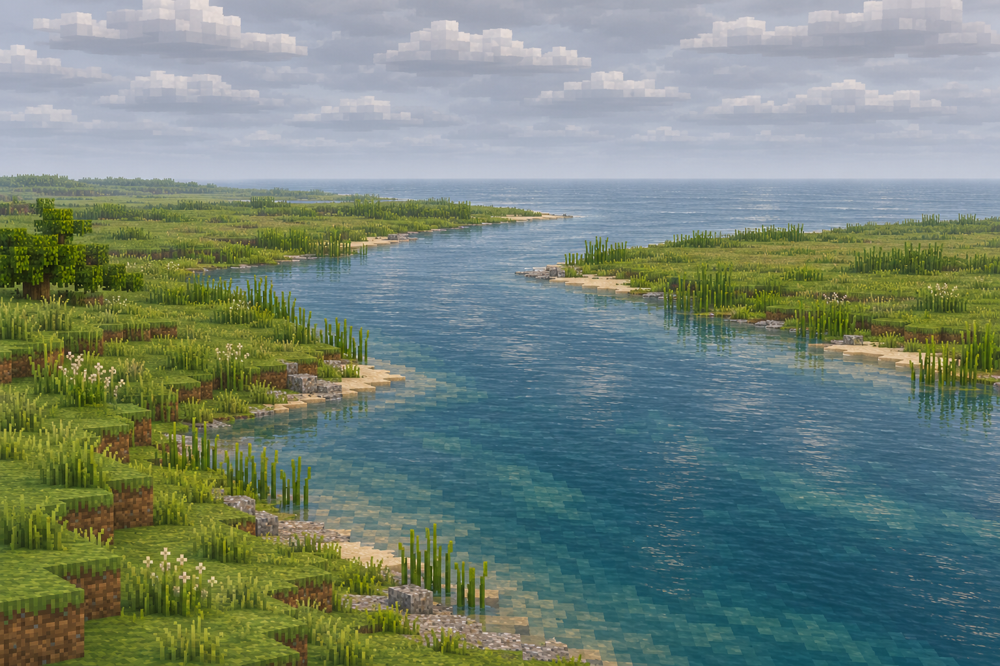

# Ameld mouth / one authored coastal outlet (`ameld_mouth`): concept art

- **Brief:** Northern upstream bank looking south-southeast toward the single channel and open sea. Early snapshot immediately after Kijin naming, anime S1E10.
- **Canon / source scope:** The river wiki describes a northern mountain-to-ocean network; exact branch topology/bearings remain C03 source review. The current Siss-to-sea reach and outlet position are explicitly authored interpolation (DES-002), not a surveyed canonical delta. Older Lerfing river prose is not the own-world terrain source.
- **Our interpretation and revision:** Remove the old many-channel delta, red mesas, farms, ruins, houses and towers. One shallow channel, low reeds, small bank-edge sand/gravel tongues, open sea horizon and weather are our interpretation. No harbour, large islands, distributary network, new settlement or landmark structure is added.
- **Terrain and fit:** The radius8 coast pin lies beside the final authored18-block-wide reach at mouth level63. Keep it one current outlet vignette; the illustration does not relocate the coast, enlarge the river, define the whole canonical river network or certify exact bank/flow simulation.
- **Current reservation:** centre(2150,1250), radius8.0, kind`coast`, margin24. Exact coordinates/radii are server interpretations (SITE records in the main ledger), not surveyed canon. All58 site attributes match current map review`0f154fc`; this art branch stacks on`187d28d` and does not carry later map/source commits. Use [map PR74](https://github.com/Yasuke2000/ocs-two-lives/pull/74), not retired Lerfing coordinates.
- **Palette / approach:** Low reed/grass banks, restrained sand/gravel and quiet open coastal water; no cultivated fields are prescribed. Camera direction, apparent dimensions and exact materials are illustrative; no mod IDs or blueprint bounding boxes are asserted. A visible entrance/viewpoint is not a newly registered site.
- **Era limits:** Immediately after Kijin naming. Exact weather, vegetation, water-step details, vent activity and gallery state are authored interpretation rather than verified early close-up evidence. C03 river topology and C05 mountain bearing remain open.
- **References:** [Secondary river wiki](https://tensura.fandom.com/wiki/Great_Ameld_River) · [project place brief](../../chatgpt/places/ameld_mouth.md) · [reference review and confidence](natural-landmark-reference-review.csv). The official broad map and cached official Ameld glossary were reinspected; no independently verified anime close-up of these exact source/mouth/volcanic precincts was found. No playback timestamp is claimed.
- **Provenance:** Built-in image_gen edits of two original project river candidates and new original volcanic-landmark generation. Existing legacy materials remain intact; no official/anime image, mod texture or third-party map/build was supplied to image generation. Exact prompt below and in [prompt collection](natural-landmark-prompts.json). Lossless PNG packaging preserves every decoded RGB pixel of the selected output; original/output/legacy-input hashes are in [manifest](natural-landmark-asset-manifest.json).
- **Acceptance scope:** Representative concept only. Source fidelity of the complete natural landform/gallery, structure fit, geometry, foundation/roof/water handling and runtime-era placement require their own review. This delivery edits no SVG, blueprint, tools, runtime or server files.

## Exact prompt

Edit this ORIGINAL project Minecraft delta painting into the SINGLE AUTHORED AMELD RIVER MOUTH, not a huge invented distributary delta. Keep painterly voxel water and modest natural reeds/sand/grass, but REMOVE ALL central/distant ruins/castles, houses, watchtowers, farms, fences, cultivated yellow fields and red/orange mesa/canyon walls. Replace far background with low subdued green reed banks and the OPEN SEA on the south-southeastern horizon. Merge the many branching water channels into ONE roughly18-block-wide shallow river opening naturally into the sea. A few very small bank-edge sand/gravel tongues may shape the shore, but no large chain of islands or separate delta branches. Camera from a northern/upstream bank looking south-southeast down the final river reach, so the single water corridor widens perceptually into quiet open saltwater. Ground is low and gently graded, no giant cliffs, port, boats, quay, bridge, signal tower or mapped settlement. This exact Siss-to-sea mouth is the server's authored interpolation; it is not a primary-source surveyed delta or new canon hydrography. Early natural coastal marsh mood, neutral overcast light and a slight sea haze, no battle aftermath or characters. Preserve buildable cubic silhouettes and grounded river banks;1536x1024 RGB, one coherent original scene, no text/labels/UI/panels/logos/watermark.
