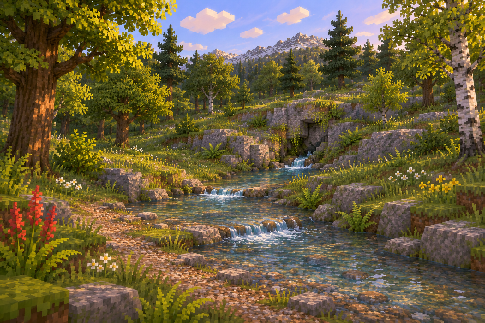

# Ameld headwater / authored foothill spring (`ameld_source`): concept art

- **Brief:** Southern downstream bank looking north toward a modest emerging headwater channel. Early snapshot immediately after Kijin naming, anime S1E10.
- **Canon / source scope:** The cached official interactive-map glossary directly says the Ameld passes through Jura and enters Siss (OFF-001). The indexed river wiki places its source at Canaat's foot; direct wiki fetch returned402. These sources do not survey this exact spring or certify a close-up anime frame.
- **Our interpretation and revision:** Remove the legacy giant nest/bones, broad pool, heavy foreground snow and oversized waterfall/cave mouth. Rock seep, short flat water steps, pebbles, bank plants and exact spring setting are our interpretation. No shrine, settlement, dragon or new separate lake is prescribed.
- **Terrain and fit:** The radius8 pin sits at the start of the authored10-block-wide river with head level91. It does not reserve a temple or measure the whole valley. The current staged river profile/bank geometry governs terrain, not the apparent scale or fall heights in the picture. C03 continuity/topology limits remain.
- **Current reservation:** centre(200,-1240), radius8.0, kind`clearing`, margin24. Exact coordinates/radii are server interpretations (SITE records in the main ledger), not surveyed canon. All58 site attributes match current map review`0f154fc`; this art branch stacks on`187d28d` and does not carry later map/source commits. Use [map PR74](https://github.com/Yasuke2000/ocs-two-lives/pull/74), not retired Lerfing coordinates.
- **Palette / approach:** Grey foothill rock, pebbles, modest mixed woodland and clear shallow stepped water; precise plants/banks are interpretation. Camera direction, apparent dimensions and exact materials are illustrative; no mod IDs or blueprint bounding boxes are asserted. A visible entrance/viewpoint is not a newly registered site.
- **Era limits:** Immediately after Kijin naming. Exact weather, vegetation, water-step details, vent activity and gallery state are authored interpretation rather than verified early close-up evidence. C03 river topology and C05 mountain bearing remain open.
- **References:** [Official episode context](https://www.ten-sura.com/map) · [project place brief](../../chatgpt/places/ameld_source.md) · [reference review and confidence](natural-landmark-reference-review.csv). The official broad map and cached official Ameld glossary were reinspected; no independently verified anime close-up of these exact source/mouth/volcanic precincts was found. No playback timestamp is claimed.
- **Provenance:** Built-in image_gen edits of two original project river candidates and new original volcanic-landmark generation. Existing legacy materials remain intact; no official/anime image, mod texture or third-party map/build was supplied to image generation. Exact prompt below and in [prompt collection](natural-landmark-prompts.json). Lossless PNG packaging preserves every decoded RGB pixel of the selected output; original/output/legacy-input hashes are in [manifest](natural-landmark-asset-manifest.json).
- **Acceptance scope:** Representative concept only. Source fidelity of the complete natural landform/gallery, structure fit, geometry, foundation/roof/water handling and runtime-era placement require their own review. This delivery edits no SVG, blueprint, tools, runtime or server files.

## Exact prompt

Edit this ORIGINAL project Minecraft spring image to match a modest AMELD HEADWATER VIGNETTE at the southern foot of Canaat. Preserve painterly voxel rock/grass textures and a clear readable shallow stream, but REMOVE the giant dragon nest/bone shapes on the distant mountain, excessive front snow fields, enormous cave mouth, tall waterfall wall and broad source pool. Show a small natural seep/rock cleft feeding ONE continuous roughly8-to10-block-wide headwater channel through modest grey rocky foothill ground. A few short flat water steps with one-block lips are fine; no giant waterfall, separate lake or new tributaries. Mature mixed woodland begins on the lower margins, with only a restrained distant glimpse of higher grey Canaat ridges to the north. No huge icy alpine canyon around the low source site, glaciers, temple, shrine, bridge, cabins, city, sign, marker stone, named dragon or giant nest. The r8 map pin identifies a source location, not a shrine/structure footprint. View from a southern/downstream bank looking back north toward the emerging brook, gentle natural banks and rough pebbles/ferns. Exact spring, vegetation and water-step arrangement are original interpretation; not a surveyed anime close-up. A tranquil early post-Kijin landscape, no named people or later faction flags.1536x1024 opaque RGB, one coherent original painterly Minecraft environment, no text/UI/logo/panels/watermark.
