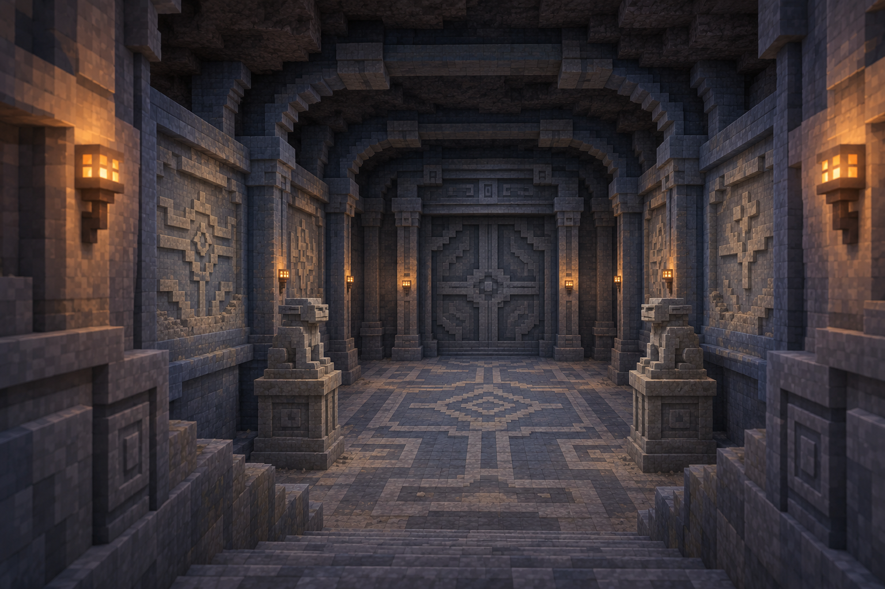

> **Current owner decision:** Amrita is to be nested beneath Clayman's castle;the independent eastern reservation is superseded. [Approved target/technical adoption](../../../world/amrita-approved.md). Existing serialized coordinates and the public-shaft blueprint are migration inputs,not the selected final geography. Exact depth,extent and initial access remain unverified.

# Ancient Amrita / dormant subsurface gallery (`amrita`): concept art

- **Brief:** Descending corridor into a representative dry gallery and closed sealed door. Early snapshot immediately after Kijin naming, anime S1E10.
- **Canon / source scope:** Directly read LN10 prologue distinguishes ancient defended ruins from the surface city and the older Soma homeland. Official episode81/route86 synopsis places Amrita beneath the former castle; stills1/3/5 provide mural, cavern and warded-door context. They do not measure the gallery, entrance or initial access.
- **Our interpretation and revision:** Blue-grey ribs, dry patterned floor, abstract reliefs, inert guardian shapes, closed door, practical lights and all dimensions are original interpretation. No anime mural or ward pattern is reproduced. No shaft, public mound, skylight, opened ward, loot or later expedition is instantiated.
- **Terrain and fit:** Current eastern radius63 carve circle is the C07 game reservation, not a source-verified separate surface entrance. This source-led subsurface vignette does not resolve the marker/access/nesting conflict, underground depth, full footprint or build fit. See current map's C07 review before placement.
- **Current reservation:** centre(3800,-500), radius63.0, kind`carve`, margin48. Exact coordinates/radii are server interpretations (SITE records in the main ledger), not surveyed canon. All58 site attributes match current map review`8ea1e96`; this art branch stacks on`80f0b54` and does not carry later map/source commits. Use [map PR74](https://github.com/Yasuke2000/ocs-two-lives/pull/74), not retired Lerfing coordinates.
- **Palette / approach:** Blue-grey stone, worn abstract reliefs, dry patterned paving and subdued practical sconces; all exact motifs are original. Camera direction, apparent dimensions and exact materials are illustrative; no mod IDs or blueprint bounding boxes are asserted. A visible entrance/viewpoint is not a newly registered site.
- **Era limits:** No fixed named early resident roster, trial reenactment, later alliance or reconstructed Tempest city is depicted. Clayman remains in power; the orc crisis remains unresolved. Existing place-brief references to later names/alliances do not establish initial state.
- **References:** [Official episode context](https://www.ten-sura.com/anime/tensura/story/no86) · [project place brief](../../chatgpt/places/amrita.md) · [reference review and confidence](demon-seats-reference-review.csv). Official route45/48/86/92 stills and the secondary castle frame were visually inspected and remain cached outside the repo. No playback timestamp is claimed.
- **Provenance:** Built-in image_gen original generation from source-qualified written prompts. Existing legacy materials remain untouched; no official/anime image, mod texture or third-party map/build was supplied to image generation. Exact prompt below and in [prompt collection](demon-seats-prompts.json). Lossless PNG packaging preserves every decoded RGB pixel of the selected output; original/output/legacy-input hashes are in [manifest](demon-seats-asset-manifest.json).
- **Acceptance scope:** Representative concept only. Source fidelity of the full settlement/labyrinth, structure fit, geometry, foundation/roof/water handling and runtime-era placement require their own review. This delivery edits no SVG, blueprint, tools, runtime or server files.

## Exact prompt

Original Minecraft environment concept of ANCIENT AMRITA'S SUBSURFACE RUIN beneath Clayman's castle, not a separate surface town entrance. Landscape1536x1024 opaque RGB, one coherent painterly voxel interior, no text, inscriptions that form readable writing, captions/UI/logos/watermark/panels. Camera from a narrow descending stone corridor looking into one restrained compressed ancient gallery with blue-grey stone ribs, a dry patterned floor, partially worn relief panels with original abstract non-letter motifs, two simple inert stone guardian plinths/statues at the sides, and a heavy CLOSED sealed doorway beyond. Continuous dark rock roof, no surface mound, open shaft, skylight, sunlight beam, aboveground courtyard, exposed castle view, giant underground lake or new waterfall. Low reflected cool light with a few subdued warm practical sconces so block forms are readable. Old but structurally imposing defended ruin: modest dust and worn stone, not a tourist dungeon or a mass-collapsed tomb. The precise columns, alcoves, guardian forms, floor pattern, door and gallery are original server interpretation; do not reproduce an anime mural or magical-circle design. The official later anime shows ruin/warded-door context and the source places it under the castle; DO NOT instantiate the later expedition, opened public access, treasure harvest, glowing activated ward, combat, characters or encounter monsters. Present an unoccupied dormant representative gallery of about69x75 blocks, not the whole ancient city, exact underground depth or entire lateral footprint. Continuous grounded stonework, no floating ruins, loot chests, royal symbols or named occupants. Post-Kijin-era ancient fabric, closed undisturbed atmosphere.

Current source decisions: [Amrita C07](https://github.com/Yasuke2000/ocs-two-lives/blob/chatgpt/world-map/world/amrita-placement-review.md) · [Frost Palace C22](https://github.com/Yasuke2000/ocs-two-lives/blob/chatgpt/world-map/world/frost-palace-source-review.md). These decisions do not change this art branch's active site attributes.
