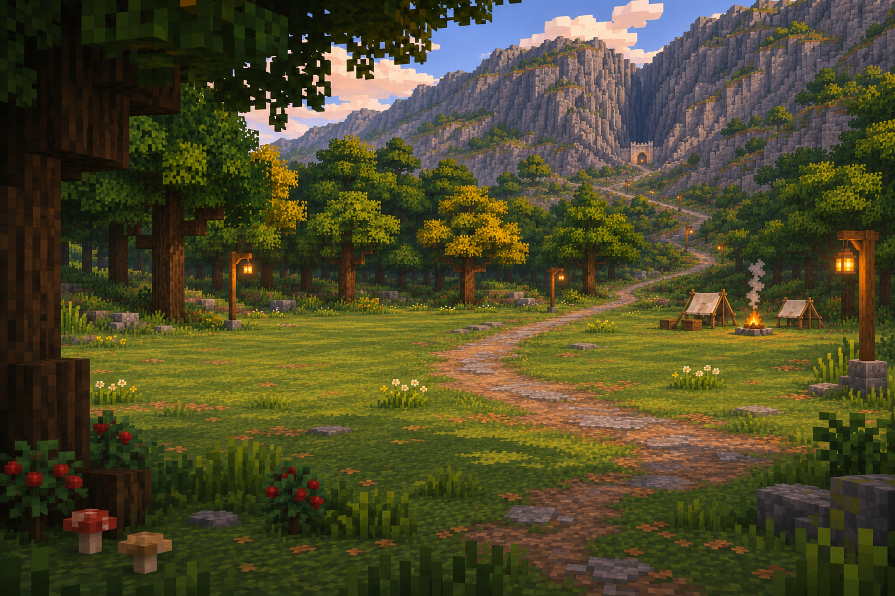

# Life 2 arrival / dry forest-rim clearing (`arrival`): concept art

- **View / snapshot:** North toward the distant dwarven mountain approach. Immediately after Kijin naming, anime S1E10.
- **Canon and source limits:** This is a server arrival rule, not a canon reincarnation location. Official episode4 establishes the Dwargon visit; its still3 supplies limited pale rock/gate context. The pinned secondary gate image supplies the small pale gate within a much larger mountain, without a verified exact episode locator.
- **Our interpretation / correction:** The invented brook, formal stair boulevard and large surface fortress are removed. Dry grass, mixed worn track, framing canopy and distant recessed gate are authored. The current route crosses arrival at(0,-1000); the old brief's separate30-block-eastern road is retired geometry.
- **Terrain and fit:** Radius60 is the parent clearing; the radius8 camp is at(+15,+15) relative to it. The image is perspective, not a measured placement plan. Keep the required48-block safe radius; actual mobs, ground, lighting and spawn protection need runtime review.
- **Current reservation:** centre (0, -1000), radius 60.0, kind `clearing`, margin 48. Exact coordinates/radii are server interpretations, not canon measurements. All 58 site attributes match current main map `e619fb7`. This branch stacks on art commit `d8a6355` and retains older map/source files; use [map PR74](https://github.com/Yasuke2000/ocs-two-lives/pull/74) for current terrain.
- **Palette:** Grass, grey rock, rough timber and dull canvas; warm practical lamps. No water/portal/new building in the arrival area. Materials are visual proxies, not unverified mod IDs.
- **Era:** No fixed named resident, golem/student visit, later federation insignia or encounter outcome is depicted. The orc crisis is unresolved. Other brief references to later structures/residents do not prove initial state.
- **References:** [Project place brief](../../chatgpt/places/arrival.md) · [source/design review](jura-approach-reference-review.csv) · [current era policy](../../../world/era.md). Legacy imported-map coordinates do not govern this concept.
- **Provenance:** Built-in image_gen edits only our earlier original candidate. Exact current edit prompt below and in [prompt collection](jura-approach-prompts.json); the earlier first-generation prompt is unavailable. No copyrighted image, mod texture or third-party build was an input. The legacy candidate stays intact. [Manifest](jura-approach-asset-manifest.json) records selected-output and own-input hashes; lossless PNG packaging preserves every selected decoded RGB pixel.
- **Acceptance:** Representative visual reference only. Full site/structure/source fit, foundation/roof/water handling, lighting, residents, runtime access and in-game acceptance remain open. No SVG, blueprint, technical tool, runtime or deployment change is made by this art delivery.

## Exact current edit prompt

Edit this original Minecraft arrival concept into a source-qualified EARLY POST-KIJIN server-arrival view. Preserve its coherent voxel painterly style, warm daylight, natural forest-edge clearing and overall camera. Landscape 1536x1024 opaque RGB, no text/UI/panels/logos. Remove the entire invented brook, waterfall, pond, wet stones and all water in the foreground/clearing; replace with continuous DRY gently uneven grass, leaf litter and a few embedded stones. Keep an open modest level arrival area, not a plaza or magical summoning circle. A narrow worn mixed earth/gravel/stone route crosses the clearing near the viewer and winds uphill north into the mountain foothills; the current source road passes through the arrival reservation, NOT a separate thirty-block-eastern stair highway. Replace the enormous white hilltop surface fortress, castle wall, gold crests, blue banners and long formal stair boulevard with a SMALL DISTANT pale fortified gateway recessed into a MASSIVE CONTINUOUS GREY MOUNTAIN CLEFT roughly550 blocks uphill; mountain rock must dominate and enclose it, no aboveground walled palace. Two very small plain canvas lean-to tents and a low campfire cluster just off the route to the right about15 blocks southeast; subordinate to the open clearing, not a village. Forest canopy frames both sides and lies behind the camera/south, no giant trees blocking the usable landing. No named people, creatures, settlement skyline, lava, portal, stream or lake. This clearing/camp/route geometry is server invention, not a canonical reincarnation spawn. Do not copy an anime frame.
