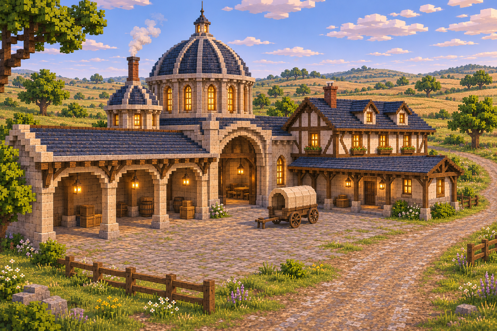

# Ballachia / neutral covered cart court (`ballachia`): concept art

- **View / snapshot:** Covered roadside precinct and slate-blue dome; precise camera is interpretation. Immediately after Kijin naming, anime S1E10.
- **Source scope:** Official episode65/route69 confirms the later Orthrus/Masayuki context. Its selected still3 shows a covered wagon, not a surveyed Ballachia exterior. The project brief describes a secondary establishing-frame dome/colonnade lead; that frame was not independently retrieved here. Manga chapter108 is a manga lead, not a light-novel chapter.
- **Our interpretation:** Broken chains, cages, memorial, rescue departure and heraldic emblems are removed. The covered arcade, dome, plain cart and lodgings remain original architectural interpretation; no later liberated-yard state is imposed.
- **Terrain and fit:** The76×66 project box and radius68 reserve represent one precinct, not the entire kingdom. Background water/capital skyline is omitted; exact ownership/use and S1E10 architectural state remain unverified.
- **Current reservation:** centre (-2450, -450), radius 68.0, kind `clearing`, margin 48. These are server coordinates/radii, not canon measurements. All58 site attributes match main map `13f4cfb`. This art branch stacks on `f335f38` and retains older map/source files; [PR74](https://github.com/Yasuke2000/ocs-two-lives/pull/74) governs current geography.
- **Era:** No named character, liberation memorial, post-film cure, later federation insignia, event outcome or fixed initial resident is shown. Project roles/props are not proof of S1E10 country development.
- **References:** [Source/design review](western-states-reference-review.csv) · [project place brief](../../chatgpt/places/ballachia.md) · [era policy](../../../world/era.md). Retired imported-map coordinates do not govern this concept.
- **Provenance:** Built-in image_gen edit of our original Ballachia candidate; earlier first-generation prompt unavailable. No copyrighted frame,texture,third-party map/build was an image input. Existing legacy materials remain untouched. [Exact prompts](western-states-prompts.json) and [manifest](western-states-asset-manifest.json) record current instruction,selected output hashes and own-input hash. Lossless packaging preserves every selected decoded RGB pixel.
- **Acceptance:** Representative visual reference only. Whole-country/source/early-state/structure fit,ground/roof/water/lighting and runtime placement remain open. This art delivery changes no SVG,blueprint,technical tool,runtime or deployment.

## Exact current edit prompt

Edit this own original Minecraft Ballachia concept for an early POST-KIJIN snapshot. Keep a coherent painterly voxel architectural view, landscape1536x1024 opaque RGB. Retain a modest original covered colonnade, long eaves, slate-blue ribbed dome and tall narrow warm windows as project architectural interpretation; reduce the very large ceremonial scale to a representative roadside precinct, not an entire palace/capital. Remove the broken chains, iron cages/prison bars, memorial pedestal, freed-traveller departure staging, all heraldic banners/crests and any rescue symbols. Those belong to a later Orthrus episode, not the early snapshot. Replace them with a neutral quiet covered cart court, plain lodging eaves, restrained crates and one ordinary unmarked canvas cart. Remove the background lake/river and remote town/castle skyline; show dry rolling western countryside with low hedges/trees and no invented major watercourse. Paving meets grass/soil naturally, no square elevated floating platform, no cliff. No slaves, people, named characters, cult symbols, statues, later Tempest flag or active quest. No text/UI/logos/multiple panels. Exact precinct design is ours, not verified anime exterior geometry.
