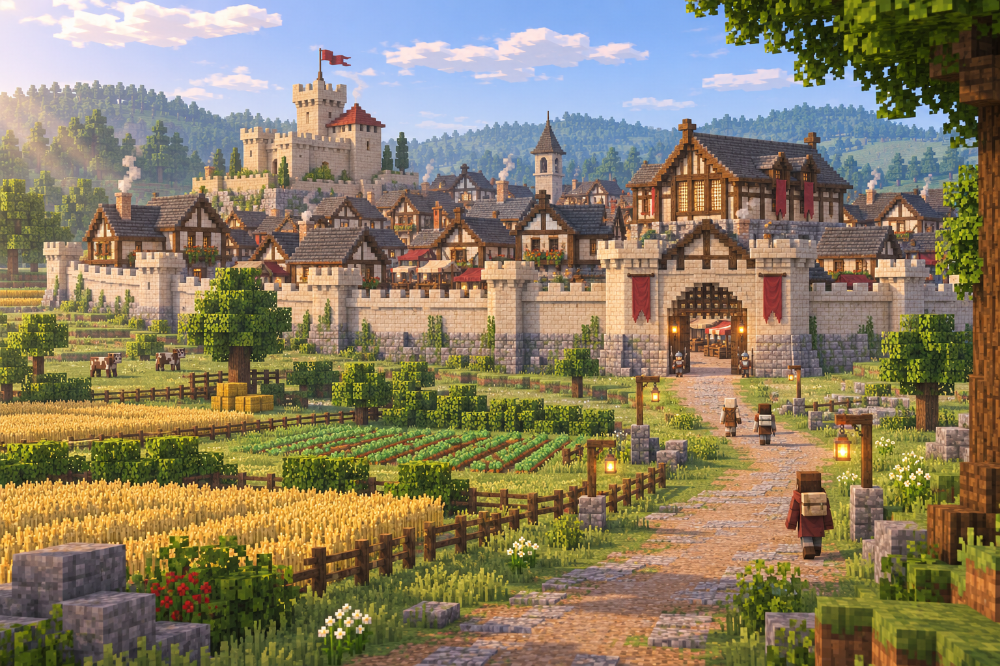

# Rondo / Londo, Blumund (`blumund`): concept art

- **Brief:** Eastern country approach looking west-northwest. One coherent environment view at the post-Kijin baseline.
- **Canon / scope:** Blumund is a small kingdom next to Jura; the broad reference shows a compact pale-walled town in green country. [Source/context1](https://www.ten-sura.com/map) · [Source/context2](https://tensura.fandom.com/wiki/Kingdom_of_Blumund).
- **Our interpretation:** Gate design, street layout, guild/keep silhouettes, farm parcels and red/cream palette are our interpretation; no royal residence floor plan is established.
- **Block notes:** Pale masonry, cobblestone, oak/dark oak, cream plaster and muted red cloth. Buildable cubic silhouettes, stairs/slabs and grounded foundations; artistic light is a cue, not verified block lighting or an in-game render.
- **Terrain:** Low rolling farmland near the forest approach. No new lake or moat is asserted by this image.
- **Current reservation:** centre(-1500,-620), radius97.0, kind`clearing`, margin48. These are authored server coordinates from map commit`fc36e38`, not canon measurements.
- **Facing / surroundings:** Eastern country approach looking west-northwest. This camera and orientation are our interpretation. Read [production SVG](../../../world/map.svg), [era policy](../../../world/era.md) and the [place brief](../../chatgpt/places/blumund.md); legacy imported-map coordinates do not govern this image.
- **Reference inspection:** Pinned secondary londo.webp was visually inspected; low resolution and unverified episode/timestamp limit architectural inference. Secondary reference files came from the pinned [TensuraMap commit](https://git.fish/KartoffelChipss/TensuraMap/src/commit/ec4d0e3db2ba4b229d412a273bbcdd19f45425b6). No episode or timestamp attribution is upgraded here.
- **Geometry limit:** this is original concept art, not a blueprint, surveyed site plan, generated Minecraft terrain or runtime acceptance. Perspective and nearby set dressing cannot override the SVG, dry build plates or source qualifications.
- **Provenance:** built-in image_gen, original written brief, 1536x1024 RGB PNG. No copyrighted reference image was supplied as generation input. The dwarf-village correction edits only our generated image. Lossless PNG packaging, where used, preserves every RGB pixel.

## Prompt

Original buildable Minecraft environment concept, small capital Rondo/Londo of Blumund in Tensura, early story just after the Kijin naming. Landscape 1536x1024 opaque RGB PNG, one coherent scene, no words, captions, UI, watermark or inset views. View from an eastern country approach looking west-northwest toward a compact late-medieval market town on gently rolling temperate farm country. A modest pale-stone curtain wall and gate enclose a tight mix of timber/plaster houses and simple steep shingle roofs; a small royal keep and one substantial guild hall rise above the roofs, no grand metropolis. Fields, low hedges and scattered trees lead to the gate, distant wooded hill silhouettes. The broad anime visual reference is a compact pale-walled town amid green cultivated land; invent an original oblique block-built composition and architecture instead of copying a frame. In the authored server terrain this town is west of Jura, so forest can appear on the approach edge, but do not add a giant lake or canal just because an old imported-map page mentioned one. Reserved clearing radius97 blocks, town exterior should feel compact and human-scaled. Cobblestone, pale masonry, oak/dark oak framing, cream plaster, muted red cloth accents are an authored palette. Cubic blocks and stair/slab-built roofs, weathered but grounded foundations, a few tiny travelers for scale, warm morning painterly voxel lighting. No guns, railways, festival machinery or Tempest alliance banners. This is an architectural interpretation; exact streets, heraldry and gate plan are not surveyed canon.
