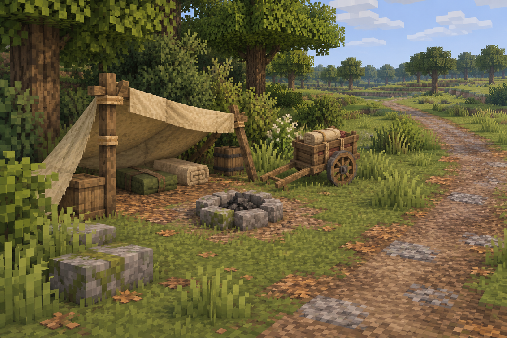

# Blumund road traveller rest (`blumund_road`): concept art

- **View / snapshot:** Small canvas lean-to and cart beside a worn road in rolling countryside. Immediately after Kijin naming, anime S1E10.
- **Facing / ground:** Camera faces roughly east along the route toward Jura/Tempest; the camp stands on a dry grass-and-earth shoulder.
- **Source scope:** This side-quest camp is a server adaptation. Official maps establish the broader western country/Jura relationship; no verified anime campsite, prescribed equipment or initial named party is claimed.
- **Our interpretation:** Plain canvas, two bedrolls, small cart, barrel and cold fire ring are authored close-up props. No settlement, border fort, new watercourse or political marker is introduced.
- **Terrain and fit:** Radius8 defines a pin-sized reservation. The pictured compact group is representative; the road and surrounding countryside continue outside it. Exact object sizes, traffic and early road surfacing remain design/runtime questions; C18 distinguishes mandatory road metadata from initial construction.
- **Current reservation:** centre(-1340,-520),radius8.0,kind`clearing`,margin24. Coordinates/radii are authored server values, not canonical measurements. All58 attributes match map commit48b0846. This art branch stacks on558b032 and retains older map/source files; [map PR74](https://github.com/Yasuke2000/ocs-two-lives/pull/74) governs current terrain.
- **Era:** No named initial resident, later federation insignia, completed future event or fixed active encounter is depicted. Camps and roles remain server adaptations. [Era policy](../../../world/era.md).
- **References:** [Source/design review](jura-route-reference-review.csv) · [project brief](../../chatgpt/places/blumund_road.md). Imported-map coordinates/audit imagery are historical context.
- **Provenance:** Built-in image_gen new original generation from a source-qualified written brief. No copyrighted anime frame,map,texture or third-party build was an image input. The legacy original is preserved. [Exact prompts](jura-route-prompts.json) and [manifest](jura-route-asset-manifest.json) record selected output hashes. Lossless PNG packaging preserves every selected decoded RGB pixel.
- **Acceptance:** Representative visual design only; exact source/era/voxel fit,terrain/tree/shelter placement,lighting,water/roof handling,residents and runtime acceptance remain open. No world,tool,mod,pack,blueprint,apply or deploy change in this art delivery.

## Exact generation prompt

Generate an original close landscape concept of a tiny traveller rest beside the Blumund-to-Jura road, for a16-block-diameter server quest pin. A small low plain canvas lean-to, a compact two-wheeled timber handcart with rolled cloth, one modest cold stone fire ring and a couple of bedrolls fit comfortably in a patch about10 blocks across, slightly off a narrow worn earth/gravel track. Rolling green ground, scrubby forest edge to one side and a restrained tree-lined distance; no towering mountains. Natural asymmetrical placement, grass and leaf litter interrupt the hard lines. Empty camp, no characters, named merchant, posted text, national insignia, grand guard gate or village. No lake, stream, harbour, bridge, city or castle. Daylight with muted sage, tan canvas and weathered timber. The little rest is authored server scenery within the wider Blumund road landscape, not a canonical named campsite or the entire kingdom. Landscape 1536x1024 opaque RGB. Original polished Minecraft voxel environment concept, coherent block scale, natural atmospheric light, detailed but buildable materials. No captions, lettering, logo, UI, collage, map or frame. Baseline immediately after six Kijin are named, anime S1E10; no later Tempest metropolis or federation flags. This is a server interpretation, not a reproduction of anime art.
