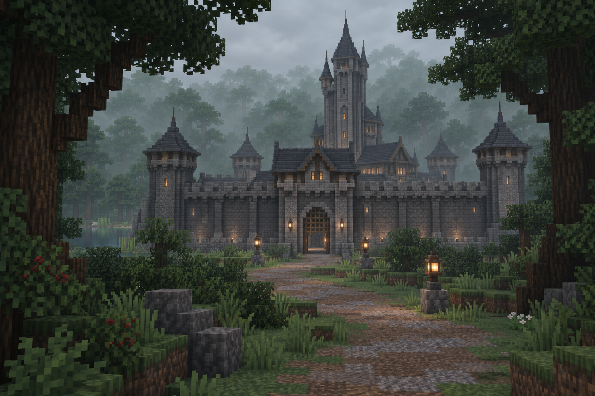

# Clayman's intact forest castle (`clayman_castle`): concept art

- **Brief:** Southern forest approach toward a compact dark fortress with dry entry lane. Early snapshot immediately after Kijin naming, anime S1E10.
- **Canon / source scope:** Official episode45/route48 synopsis establishes the castle approach and later obstructing fog. The inspected secondary amrita.webp frame shows a dark spired castle within wooded/wet terrain, with exact episode attribution unverified. The official stills are character/action context, not a measured fortress plan.
- **Our interpretation and revision:** Keep, wall, towers, roofs, subdued mist, lamp placement and small western water glimpse are authored architecture/scenery. No giant pierrot mask, gallows, undead encounter, raid aftermath or functional Walpurgis portal is asserted.
- **Terrain and fit:** The circle reserves a compact180-block-diameter precinct. Source castle and Amrita underground relationship remain distinct from an independent eastern access mound. Exact foundations, water glimpse and full castle fit must follow actual terrain/build review.
- **Current reservation:** centre(3300,-600), radius90.0, kind`clearing`, margin48. Exact coordinates/radii are server interpretations (SITE records in the main ledger), not surveyed canon. All58 site attributes match current map review`8ea1e96`; this art branch stacks on`80f0b54` and does not carry later map/source commits. Use [map PR74](https://github.com/Yasuke2000/ocs-two-lives/pull/74), not retired Lerfing coordinates.
- **Palette / approach:** Dark grey stone/tuff, restrained slate roof forms, muted timber and practical warm lamps against mature dark woodland. Camera direction, apparent dimensions and exact materials are illustrative; no mod IDs or blueprint bounding boxes are asserted. A visible entrance/viewpoint is not a newly registered site.
- **Era limits:** No fixed named early resident roster, trial reenactment, later alliance or reconstructed Tempest city is depicted. Clayman remains in power; the orc crisis remains unresolved. Existing place-brief references to later names/alliances do not establish initial state.
- **References:** [Official episode context](https://www.ten-sura.com/anime/tensura/story/no48) · [project place brief](../../chatgpt/places/clayman_castle.md) · [reference review and confidence](demon-seats-reference-review.csv). Official route45/48/86/92 stills and the secondary castle frame were visually inspected and remain cached outside the repo. No playback timestamp is claimed.
- **Provenance:** Built-in image_gen original generation from source-qualified written prompts. Existing legacy materials remain untouched; no official/anime image, mod texture or third-party map/build was supplied to image generation. Exact prompt below and in [prompt collection](demon-seats-prompts.json). Lossless PNG packaging preserves every decoded RGB pixel of the selected output; original/output/legacy-input hashes are in [manifest](demon-seats-asset-manifest.json).
- **Acceptance scope:** Representative concept only. Source fidelity of the full settlement/labyrinth, structure fit, geometry, foundation/roof/water handling and runtime-era placement require their own review. This delivery edits no SVG, blueprint, tools, runtime or server files.

## Exact prompt

Original buildable Minecraft environment concept of CLAYMAN'S INTACT CASTLE in Jistav, early snapshot immediately after Kijin naming. Landscape1536x1024 opaque RGB, one coherent painterly voxel scene, no text/UI/logos/watermark/panels. View from a southern forest approach toward a compact dark-grey fortress precinct: grounded curtain wall, modest gatehouse, four restrained corner towers and a narrow central keep with a few pointed slate roofs, all compressed within roughly180-block-diameter authored reserve. Tall mature dark woodland partly encloses it; low green-grey mist softens distant trees without hiding all construction. Inspired by a secondary anime view's dark spired castle within broad wooded terrain, but entirely original camera, architecture and silhouette details. Do not recreate a copyrighted shot. A small glimpse of separate still water may sit off to the WEST side beyond the wall, not a new huge moat/river across the approach. Keep the entry path dry and grounded, no deep chasm, giant bridge, isolated mesa or new mountain. Clayman is still in power; castle undamaged and intact. No Shuna raid, undead army, named characters, chained people, skull/gallows decorations, giant pierrot face, invented faction banners, Tempest flags, later occupation, battle or Walpurgis portal. Exact keep layout/materials are a server interpretation, not canon-certified. Restrained dark stone/tuff, slate roofs, muted timber and tiny practical warm lights, cool overcast forest atmosphere; readable cubic blocks/stairs/slabs and real foundations.

Current source decisions: [Amrita C07](https://github.com/Yasuke2000/ocs-two-lives/blob/chatgpt/world-map/world/amrita-placement-review.md) · [Frost Palace C22](https://github.com/Yasuke2000/ocs-two-lives/blob/chatgpt/world-map/world/frost-palace-source-review.md). These decisions do not change this art branch's active site attributes.
