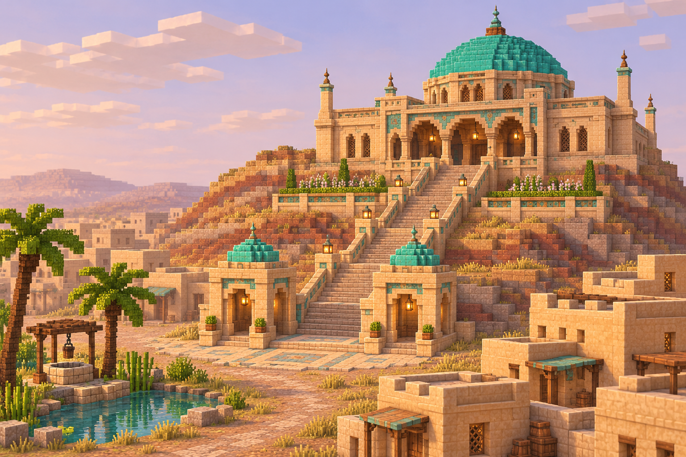

# Coleus / Herbaria hill-palace precinct (`coleus`): concept art

- **Brief:** Southwestern town approach looking northeast up the palace stair. Post-Kijin design baseline; one coherent representative precinct.
- **Canon / context:** The official outline places the independent country between Ingrassia and Lubelius. The official INEI production panorama supplies a domed palace on a dry rocky hill, inclined monumental approach, lower town and foreground water/vegetation; OFF-COL-001/002.
- **Our interpretation:** The smaller block-built hill, three visible domes, terraces, loggia, planting, stair proportions and close camera framing are our interpretation. Architecture at the earlier S1E10 snapshot is unverified; no OVA residents or succession event is installed.
- **Block notes:** Sandstone/ochre stone, turquoise tile proxy, aged copper, dark timber and a few planted accents; sparse dry-country vegetation. Cubic silhouettes and stair/slab construction; this is an illustration rather than a verified block model or light audit.
- **Terrain:** Dry sandstone/ochre hill supplied by the existing blueprint, adjoining compact lower town. Foreground water is a perspective design cue only: preserve the separately authored southwest oasis in the SVG and never flood the radius73 build plate or move its real shore to match this painting. V is a terrain selector, not Damargania sovereignty.
- **Current reservation:** centre(-3520,-860), radius73.0, kind`clearing`, margin48. These are server-authored coordinates. All58 site attributes in this art branch were compared with map commit`a997f81` and are identical. Active geography is the reviewed`fc36e38` geometry; this branch does not incorporate the later inert-comment/source review.
- **Reference inspection:** Official INEI2000x1000 panorama visually reinspected outside the repository. No official image was used as image-generation input. The new composition compresses the architectural core instead of reproducing the official city panorama. Exact palace state at the initial snapshot remains open.
- **References:** [Official outline](https://www.ten-sura.com/anime/coleus/outline) · [Official production-concept announcement](https://www.ten-sura.com/news/anime/coleus/news/post/8574) · [Current placement/source review](../../../docs/research/tensura-world-2026-11-19/coleus-placement-review.md).
- **Geometry / era limit:** perspective, apparent size, water set dressing and tiny anonymous figures do not override the SVG or prove the initial NPC roster, foundations, site fit, material IDs, lighting, access grades or runtime era gating. The reserved circle is a design core, not the full size of a canonical city.
- **Provenance:** original built-in image_gen output. No copyrighted anime frame, map, mod asset or third-party build supplied as image input. Siltrosso edits only our earlier original image. Where PNG compression was repackaged, decoded RGB pixels were verified identical to the original generated output.

## Exact current prompt

Original buildable Minecraft environment concept for the palace precinct of Herbaria in the independent Kingdom of Coleus, Tensura. Landscape1536x1024 opaque RGB PNG, one coherent three-quarter view, no words, lettering, logo, UI, watermark or inset panels. Show a small ochre sandstone palace raised on a compact dry banded rocky hill, long inclined stair climbing in short buildable flights from two small turquoise-domed entrance pavilions to a shaded central loggia and main stepped turquoise dome, a few slim corner pinnacles. Two restrained terraced garden strips, lower flat-roofed sandstone town houses peeking around the foot, sparse dry grasses and a few palms only near a SEPARATE small oasis well outside the palace build plate at the left edge. Source-inspired broad cues are a high domed hill-palace, incline, lower town and foreground water/vegetation from official Coleus production art; invent an original close oblique composition and architecture, do not copy that painting. Orient as a southwest approach looking northeast/uphill; the authored oasis is southwest of the current palace reservation. The current radius73-block reservation is a small architectural core, not the whole canonical city. Hill should be a block-build pedestal of modest height, about30-40 blocks rise, organically merging into the dry ground, not a giant 300-block mountain or flat floating plinth. Restrained ochre/cyan/aged copper palette, cubic blocks and stair/slab-built curves, architectural silhouette readable and buildable, warm dusty morning light, painterly voxel style. Early post-Kijin baseline: architectural continuity before the later OVA is unverified, so do not include OVA princes, Rimuru, demonic attacks, succession banners or any event outcome. No city-scale lake flooding the hill, no snow, no jungle, no copied anime/map art, no exact official heraldry.
