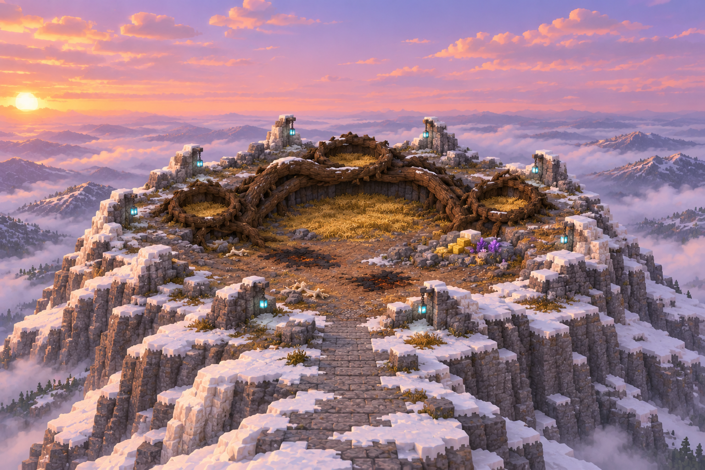

# Dragon's Nest / compact summit roost (`dragons_nest`): concept art

- **View / snapshot:** Southern approach onto the highest nearby crest; lower ridges fall away beyond it. Immediately after Kijin naming, anime S1E10.
- **Canon and source limits:** Indexed Canaat/Magic Continent wiki articles associate the nest with the highest peak and dragons increasing in strength with altitude (WIK-CAN-033). LN12ch2/4 citations remain unread. No verified anime nest exterior or exact canonical dimensions are claimed.
- **Our interpretation / correction:** High castle walls, watchtowers, giant trophy skeleton and luminous altar are replaced by low irregular rock fins, a timber/straw roost bowl, smaller hollows and a low perch. Snow, small hoard, bone fragments/scorch marks and dim lamps remain authored project dressing.
- **Terrain and fit:** The73×73 blueprint context and radius64 reserve are compressed server interpretations, not the full canonical nest. No higher nearby backdrop should turn it into a valley fort. Summit skirt, clearance, roof/height limits, habitat and runtime encounters still need review.
- **Current reservation:** centre (350, -2000), radius 64.0, kind `clearing`, margin 48. Exact coordinates/radii are server interpretations, not canon measurements. All 58 site attributes match current main map `e619fb7`. This branch stacks on art commit `d8a6355` and retains older map/source files; use [map PR74](https://github.com/Yasuke2000/ocs-two-lives/pull/74) for current terrain.
- **Palette:** Snow, stone/tuff/calcite, dark wood and straw, restrained gold/amethyst and dim cyan lamp accents. No dragon/egg/royal resident roster. Materials are visual proxies, not unverified mod IDs.
- **Era:** No fixed named resident, golem/student visit, later federation insignia or encounter outcome is depicted. The orc crisis is unresolved. Other brief references to later structures/residents do not prove initial state.
- **References:** [Project place brief](../../chatgpt/places/dragons_nest.md) · [source/design review](jura-approach-reference-review.csv) · [current era policy](../../../world/era.md). Legacy imported-map coordinates do not govern this concept.
- **Provenance:** Built-in image_gen edits only our earlier original candidate. Exact current edit prompt below and in [prompt collection](jura-approach-prompts.json); the earlier first-generation prompt is unavailable. No copyrighted image, mod texture or third-party build was an input. The legacy candidate stays intact. [Manifest](jura-approach-asset-manifest.json) records selected-output and own-input hashes; lossless PNG packaging preserves every selected decoded RGB pixel.
- **Acceptance:** Representative visual reference only. Full site/structure/source fit, foundation/roof/water handling, lighting, residents, runtime access and in-game acceptance remain open. No SVG, blueprint, technical tool, runtime or deployment change is made by this art delivery.

## Exact current edit prompt

Edit this original Minecraft Dragon's Nest concept into a COMPACT SUMMIT ROOST, keeping snow/grey mountain material mood and painterly cubic style. Landscape1536x1024 opaque RGB. Current image looks like a huge medieval fortress in a valley: replace the high defensive curtain wall, battlements and tall lantern watchtowers with LOW irregular natural rock/calcite fins and broken boulders, at most1-3 blocks above the roost lip. Eight small weathered stone fins may carry tiny dim cyan practical lanterns as an explicit project design, not a defended castle. Keep one broad dark timber/root roost bowl with modest straw lining, three much smaller resting hollows, a LOW rock perch and only a small restrained scatter of gold/amethyst tucked among rocks; remove the towering luminous central altar and giant displayed skeleton/ribcage trophy. A few tiny weathered bone fragments and subdued dark scorch patches are project dressing only; no dragon eggs or occupants. The entire representative roost reads as roughly73x73 blocks, blending into a rough narrow SUMMIT CAP with one simple five-block-wide southern approach across solid stone, NOT an engineered bridge or grand paved boulevard. Change backdrop: no mountains towering above this roost, no nearby tree line or valley walls. The cap must visibly sit at the highest nearby crest with lower descending ridges and distant cloud/mist beneath the horizon; keep trees only far below. No additional city, floating island, lava lake, portal, banners, symbols, named dragon lords, humanoids, dragons or encounter event. Source only establishes a high summit association through secondary wiki leads; exact appearance is our blueprint interpretation, not a verified anime exterior. No text/UI/panels/logos.
