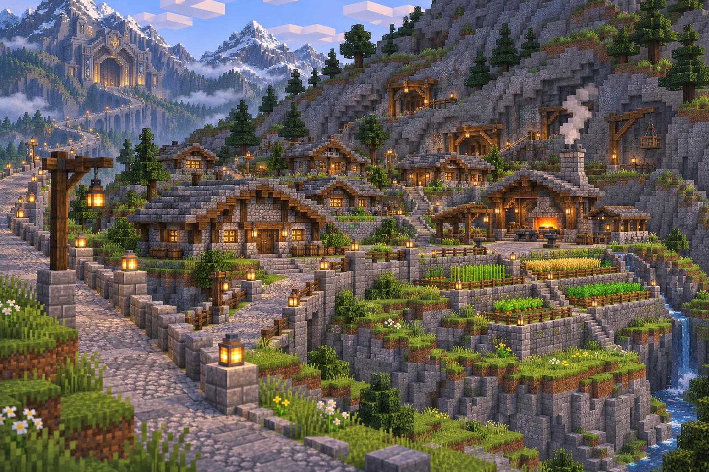

# Dwarf village on the road to Dwargon

## Designed site

- Anchor: `dwarf_village`; region `D`; proposed centre **(350, -1200)**; SVG y is Minecraft z.
- Site kind: `village`; reserved radius **120 blocks**, diameter 240; exclusion margin 64 blocks.
- Relief footprint: lowland / local designed terrace; woodland: open ground / habitat from region book.
- Approach / facing: **north**. This is our interpretation unless the lore specifies it. Underground rooms use local interior approaches, not separate surface gates.
- The site disc is not a measured blueprint bounding box. Final ground y, cliff cover, lake rim and build fit belong to Claude’s converter and site overrides.

## Scene and terrain integration

Tensura's own dwarf village structure: stone and timber houses and farm plots on the grass at the foot of the grey mountain. It must sit grounded on the slope, not float above it.

Surroundings and the view across the boundary follow [D in the region book](../../../world/regions.md). Keep the build on the reserved dry plate (except the designated water arena), let roots, buttresses, paths and vegetation blend into the local terrain, and keep the designed road corridor open. No isolated square platform or floating foundation. Buildings, palettes and local layout in the concept are **our interpretation**, not a replacement blueprint.

## Block palette

`minecraft:tuff`, `minecraft:stone_bricks`, `minecraft:gravel`, `minecraft:spruce_planks`, `minecraft:copper_bulb`. These are existing vanilla Minecraft 1.21.1 IDs; decorative variants must be verified before implementation. Use a restrained three-to-six-material palette per building.

## Sources and interpretation

- [Place brief](../../chatgpt/places/dwarf_village.md) and [existing lore](../../../design/lore/world.md). Legacy imported-world positions in those documents are not this map’s coordinates.
- [official world guide](https://www.ten-sura.com/map), [episode 4, still 1](https://www.ten-sura.com/4GfGdAp7/wp-content/themes/tensura_portal/anime/tensura-portal-anime-tensura/assets/images/story/no4/img1.jpg), [episode 4, still 2](https://www.ten-sura.com/4GfGdAp7/wp-content/themes/tensura_portal/anime/tensura-portal-anime-tensura/assets/images/story/no4/img2.jpg).
- Concept produced with the built-in image-generation tool from an original written brief; no official frame, mod texture or paid map was used as image input.

EN: Concept of Dwarf village on the road to Dwargon in its designed terrain.
NL: Concept van Dwarf village on the road to Dwargon in het ontworpen landschap.
