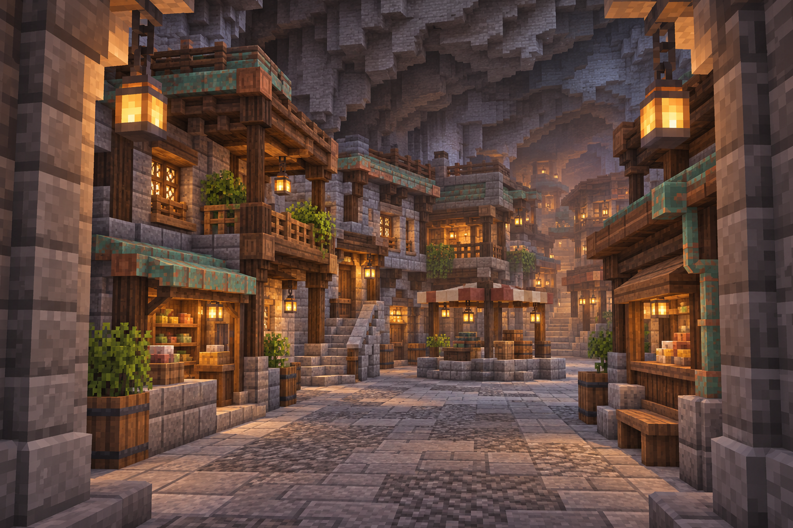

# Dwargon inner city / registered city-centre pin (`dwargo`): concept art

- **Brief:** View northward from inside the southern passage into a compressed cavern-city trading precinct. Early snapshot immediately after Kijin naming, anime S1E10.
- **Canon / source scope:** The existing researched Dwargon lore and owner's inside-Canaat design establish the cavern-city context. Official episode4 synopsis directly places Rimuru's search for artisans in Dwargon; episode4 still3 shows travellers against a rocky fortified entrance. That still does not show the inner city. The registered ID dwargo denotes the city-centre pin, not an independently sourced second capital.
- **Our interpretation and revision:** Replace the older duplicate exterior-gate candidate with an original internal street/plaza vignette under a continuous natural rock vault. Shop fronts, balconies, stairs, indirect lighting and all exact urban arrangement are our interpretation; no full anime city plan is claimed.
- **Terrain and fit:** The radius8 circle is an interior map pin within the larger Dwargon carve reservation. It does not promise that an entire city fits into16 blocks, prescribe a separate surface pad or authorize a new gate, river, mountain or sovereign location.
- **Current reservation:** centre(0.0,-1650.0), radius8.0, kind`clearing`, margin24. Exact coordinates/radii are server interpretations (SITE records in the main ledger), not surveyed canon. All58 site attributes match current map review`24897fa`; this art branch stacks on`464d2eb` and does not carry later map/source commits. Use [map PR74](https://github.com/Yasuke2000/ocs-two-lives/pull/74), not retired Lerfing coordinates.
- **Palette / approach:** Grey stone/tuff, dark timber, restrained aged-copper trim, muted market cloth and warm lanterns. Camera direction, apparent dimensions and exact materials are illustrative; no mod IDs or blueprint bounding boxes are asserted. A visible entrance/viewpoint is not a newly registered site.
- **Era limits:** No fixed named early resident roster, trial reenactment, later alliance or reconstructed Tempest city is depicted. Kaijin has already left the city; the orc crisis remains unresolved. Existing place-brief references to later names/alliances do not establish initial state.
- **References:** [Official episode context](https://www.ten-sura.com/anime/tensura/story/no4) · [project place brief](../../chatgpt/places/dwargo.md) · [reference review and confidence](dwargon-interior-reference-review.csv). Official episode4/5 stills were visually inspected and remain cached outside the repo; the arena uses the explicit project brief. No playback timestamp is claimed.
- **Provenance:** Built-in image_gen original generation for dwargo; edits of older original project concepts for the other three. Older candidate remains untouched; no official/anime image, mod texture or third-party map/build was supplied to image generation. Exact prompt below and in [prompt collection](dwargon-interior-prompts.json). Lossless PNG packaging preserves every decoded RGB pixel of the selected output; original/output/legacy-input hashes are in [manifest](dwargon-interior-asset-manifest.json).
- **Acceptance scope:** Representative concept only. Source fidelity of the full city/interior hall, structure fit, geometry, foundation/roof/water handling and runtime-era placement require their own review. This delivery edits no SVG, blueprint, tools, runtime or server files.

## Exact prompt

Original Minecraft environment concept of DWARGON'S INNER CAVERN CITY, a different view from its exterior gate. Landscape1536x1024 opaque RGB PNG, one coherent restrained painterly voxel illustration, no text, signs with writing, UI, logos, panels or watermark. Camera from just INSIDE the southern gate passage, looking north down a short stone trade street into a representative interior precinct. A continuous great irregular grey rock ceiling encloses the whole city above compact multistorey stone-and-timber shop fronts, supported balconies, a few stairs and a modest central trading square. Show only a compressed urban vignette with more streets fading into warm haze beyond; it is not the whole canonical city or an8-block-radius building. Rock vault remains readable as a mountain interior, not a second outdoor mountain gate, isolated mine shaft, immense cathedral nave or identical repeated tall pillars. Modest warm lanterns and indirect cool ambient cave light; no visible blue sky, sun, outdoor snow ranges, huge open skylight, waterfall, river, moat or lava. No monumental throne building dominating the square; royal interior is a separate vignette within the same city. Strong grounded masonry foundation, several connected inhabited shop fronts, no floating platforms or implausible huge cliff bridges. Trade hub atmosphere without named residents, Kaijin standing in his old shop, royal banners, invented emblems, modern industry, airships or later Tempest diplomatic symbols. Dwarf scale with comfortably walkable alleys and block-built tuff/grey stone/dark wood, aged copper accents. Exact plan, lighting, doors and architecture are original server interpretation of a city inside Canaat; no copied anime composition.
