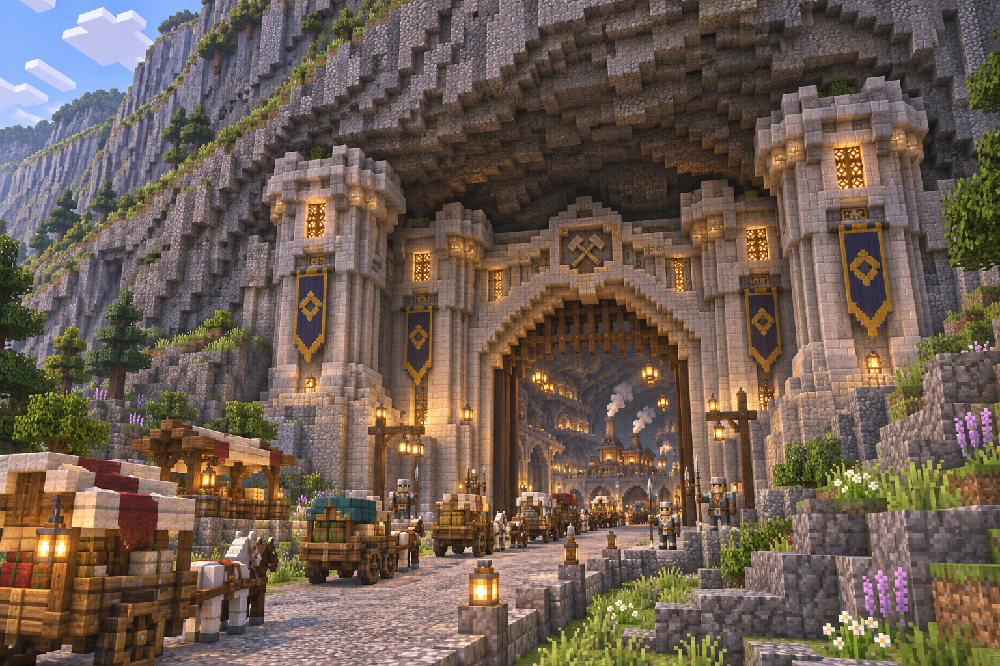

# Dwargon main gate

## Designed site

- Anchor: `dwargon`; region `D`; proposed centre **(0, -1550)**; SVG y is Minecraft z.
- Site kind: `carve`; reserved radius **60 blocks**, diameter 120; exclusion margin 48 blocks.
- Relief footprint: canaat-massif; woodland: open ground / habitat from region book.
- Approach / facing: **south**. This is our interpretation unless the lore specifies it. Underground rooms use local interior approaches, not separate surface gates.
- The site disc is not a measured blueprint bounding box. Final ground y, cliff cover, lake rim and build fit belong to Claude’s converter and site overrides.

## Scene and terrain integration

Owner: Dwargon stands INSIDE the mountain. From south to north: outer road with a checkpoint arch and road tower, queue lanes with guard booths, a white gate wall with four towers in a cleft cut into the escarpment, a tunnel, a canyon-like south street with wall homes on balconies at three heights, ladders and plank bridges under a skylight crack, a round plaza with fountain and market stalls, the forge street with Kaijin's smithy, a great stair, the royal terrace and King Gazel's throne room (red runner, red nether-brick throne, copper bulb ceiling). The mountain's rock is grey: gravel, clay, tuff, cobble.

Surroundings and the view across the boundary follow [D in the region book](../../../world/regions.md). Keep the build on the reserved dry plate (except the designated water arena), let roots, buttresses, paths and vegetation blend into the local terrain, and keep the designed road corridor open. No isolated square platform or floating foundation. Buildings, palettes and local layout in the concept are **our interpretation**, not a replacement blueprint.

## Block palette

`minecraft:tuff`, `minecraft:stone_bricks`, `minecraft:gravel`, `minecraft:spruce_planks`, `minecraft:copper_bulb`. These are existing vanilla Minecraft 1.21.1 IDs; decorative variants must be verified before implementation. Use a restrained three-to-six-material palette per building.

## Sources and interpretation

- [Place brief](../../chatgpt/places/dwargon.md) and [existing lore](../../../design/lore/dwargon.md). Legacy imported-world positions in those documents are not this map’s coordinates.
- [official world guide](https://www.ten-sura.com/map), [episode 4, still 1](https://www.ten-sura.com/4GfGdAp7/wp-content/themes/tensura_portal/anime/tensura-portal-anime-tensura/assets/images/story/no4/img1.jpg), [episode 4, still 2](https://www.ten-sura.com/4GfGdAp7/wp-content/themes/tensura_portal/anime/tensura-portal-anime-tensura/assets/images/story/no4/img2.jpg).
- Concept produced with the built-in image-generation tool from an original written brief; no official frame, mod texture or paid map was used as image input.

EN: Concept of Dwargon main gate in its designed terrain.
NL: Concept van Dwargon main gate in het ontworpen landschap.
