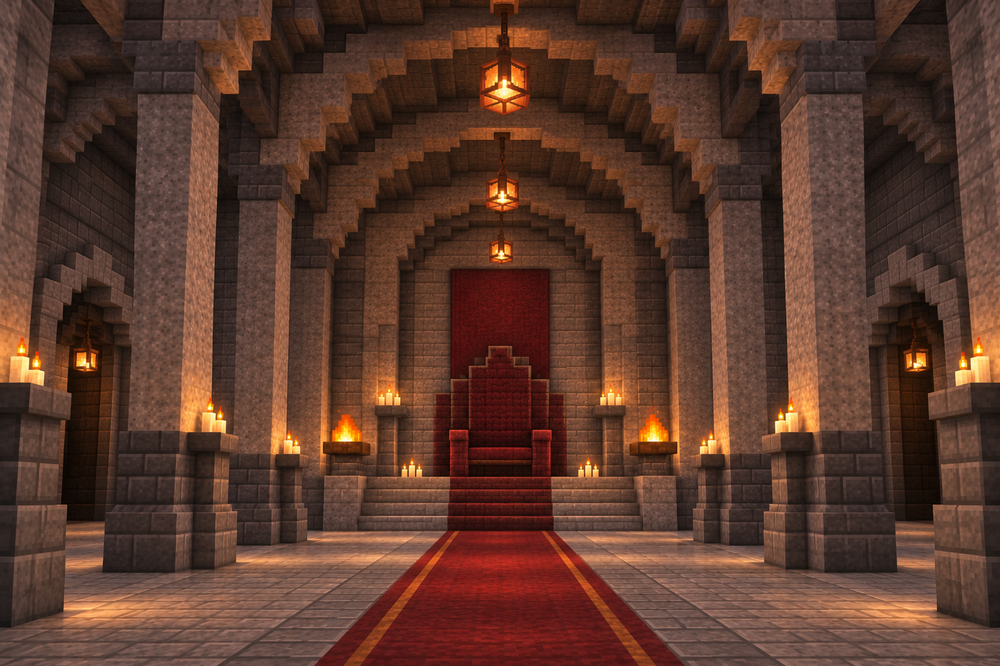

# Dwargon audience chamber / empty throne vignette (`dwargon_throne`): concept art

**R86 reservation alignment:** [current map PR74](https://github.com/Yasuke2000/ocs-two-lives/pull/74) relocates this reservation within the same setting. Original PNG and prompt are retained; this is not a geographically registered terrain render.

- **Brief:** Southern internal doorway toward a compact northern dais and empty throne. Early snapshot immediately after Kijin naming, anime S1E10.
- **Canon / source scope:** Official episode5 synopsis directly identifies a trial before King Gazel; still4 shows Gazel seated in close-up and still5 a chained Rimuru with a geometric floor. These verify court context, not the complete room plan, ceiling, colour scheme or windows.
- **Our interpretation and revision:** Retain the server's grey masonry/red-runner/copper-light palette while replacing outside mountain views with internal recesses. Remove the figure and royal banners; an empty throne avoids asserting an exact statue/NPC model. Dais, columns, vault and circulation are authored architecture, not a reproduced anime court.
- **Terrain and fit:** The radius8 spot belongs to the parent city. Exact room dimensions, roof cover and integration with the existing mod-derived hall require technical fit review. The image cannot authorize an independent outdoor palace or new mountain-view windows.
- **Current reservation:** centre(780,-1496), radius8.0, kind`clearing`, margin24. These are authored server coordinates from source SHA`355d1a338f7dccf835123ff7af6a68cfda3319363378c60f7f04359cab67d3a7`, not canon measurements.
- **Palette / approach:** Grey masonry, dark red runner/throne upholstery, restrained copper and warm practical lamps. No exterior landscape is prescribed. Camera direction, apparent dimensions and exact materials are illustrative; no mod IDs or blueprint bounding boxes are asserted. A visible entrance/viewpoint is not a newly registered site.
- **Era limits:** No fixed named early resident roster, trial reenactment, later alliance or reconstructed Tempest city is depicted. Kaijin has already left the city; the orc crisis remains unresolved. Existing place-brief references to later names/alliances do not establish initial state.
- **References:** [Official episode context](https://www.ten-sura.com/anime/tensura/story/no5) · [project place brief](../../chatgpt/places/dwargon_throne.md) · [reference review and confidence](dwargon-interior-reference-review.csv). Official episode4/5 stills were visually inspected and remain cached outside the repo; the arena uses the explicit project brief. No playback timestamp is claimed.
- **Provenance:** Built-in image_gen original generation for dwargo; edits of older original project concepts for the other three. Older candidate remains untouched; no official/anime image, mod texture or third-party map/build was supplied to image generation. Exact prompt below and in [prompt collection](dwargon-interior-prompts.json). Lossless PNG packaging preserves every decoded RGB pixel of the selected output; original/output/legacy-input hashes are in [manifest](dwargon-interior-asset-manifest.json).
- **Acceptance scope:** Representative concept only. Source fidelity of the full city/interior hall, structure fit, geometry, foundation/roof/water handling and runtime-era placement require their own review. This delivery edits no SVG, blueprint, tools, runtime or server files.

## Exact prompt

Edit this ORIGINAL project voxel throne hall into a REPRESENTATIVE INTERIOR audience chamber of Dwargon inside the Canaat mountain. Keep the compact grounded grey stone pillars, short raised dais, dark red throne/cushion, narrow red runner and restrained copper/warm lamp accents as the project's authored architectural palette. REMOVE the seated human/dwarf figure entirely: show an EMPTY throne, no NPC statue or ruler model. Replace both open side windows that currently reveal blue sky and snowy mountains with closed stone recesses and dark internal side-door arches. A continuous rock/stone vault encloses the chamber; no outdoor view, skylight, cliff, waterfall or new surface palace. REMOVE all hanging royal banners and gold emblems; a plain small dark-red textile cushion/back panel is enough. Reduce giant decorative chandeliers into modest practical hanging lamps. The official episode5 synopsis establishes Gazel's royal court and trial, but this room layout and material scheme remain our own adaptation, not a recreated anime frame. No trial participants, chains, prisoner, combat, boss arena, portal/warp pad, flags, faction emblem, later Tempest alliance or written signs. One coherent Minecraft room view, grounded walls, dry walkable floor and ceiling support, not an entire second capital. Camera from the southern door toward the northward dais, slight three-quarter depth. Preserve warm painterly voxel/block style;1536x1024 opaque RGB; no words, UI, panels, watermark or logo.
