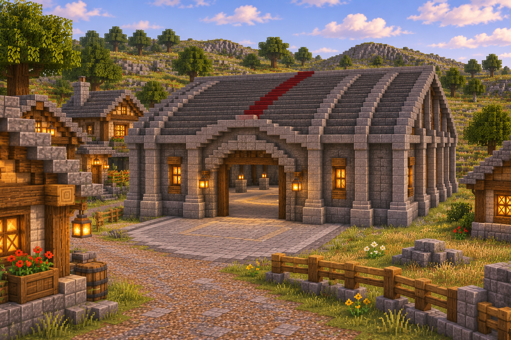

# Dwarf-village arena / explicit server adaptation (`dwarven_arena`): concept art

- **Brief:** Southwestern village lane looking northeast toward the west door of a compact grey hall. Early snapshot immediately after Kijin naming, anime S1E10.
- **Canon / source scope:** This arena is a pack adaptation of the existing Tensura hall and Yasuke's requirement to place it beside the dwarf village. The project brief/blueprint supplies the closed grey rectangular hall, plain red roof stripe and small forecourt. No inspected anime source verifies this exact arena or its early existence.
- **Our interpretation and revision:** Remove invented high cliffs, ravine, waterfall, distant fortress, snowy peaks, dragon nest/eggs and royal emblems. Put the hall on a grounded modest meadow/gravel terrace next to village cottages. All apparent terrain, palette, lane, buildings and hall rendering are our interpretation of the server brief.
- **Terrain and fit:** The radius58 reserve beside dwarf_village is a server gameplay site. The75x51 hall reference is a blueprint design dimension, not a canonical measurement. Keep it separate from the royal room: no Gazel boss, warp pad or copied combat scene is authorized by the image.
- **Current reservation:** centre(500.0,-1180.0), radius58.0, kind`clearing`, margin48. Exact coordinates/radii are server interpretations (SITE records in the main ledger), not surveyed canon. All58 site attributes match current map review`24897fa`; this art branch stacks on`464d2eb` and does not carry later map/source commits. Use [map PR74](https://github.com/Yasuke2000/ocs-two-lives/pull/74), not retired Lerfing coordinates.
- **Palette / approach:** Grey stone, plain red roof accent, simple timber doors and a dry gravel/meadow village approach. Camera direction, apparent dimensions and exact materials are illustrative; no mod IDs or blueprint bounding boxes are asserted. A visible entrance/viewpoint is not a newly registered site.
- **Era limits:** No fixed named early resident roster, trial reenactment, later alliance or reconstructed Tempest city is depicted. Kaijin has already left the city; the orc crisis remains unresolved. Existing place-brief references to later names/alliances do not establish initial state.
- **References:** [Official episode context](https://github.com/Yasuke2000/ocs-two-lives/blob/chatgpt/dwargon-interior-place-art-r27/docs/chatgpt/places/dwarven_arena.md) · [project place brief](../../chatgpt/places/dwarven_arena.md) · [reference review and confidence](dwargon-interior-reference-review.csv). Official episode4/5 stills were visually inspected and remain cached outside the repo; the arena uses the explicit project brief. No playback timestamp is claimed.
- **Provenance:** Built-in image_gen original generation for dwargo; edits of older original project concepts for the other three. Older candidate remains untouched; no official/anime image, mod texture or third-party map/build was supplied to image generation. Exact prompt below and in [prompt collection](dwargon-interior-prompts.json). Lossless PNG packaging preserves every decoded RGB pixel of the selected output; original/output/legacy-input hashes are in [manifest](dwargon-interior-asset-manifest.json).
- **Acceptance scope:** Representative concept only. Source fidelity of the full city/interior hall, structure fit, geometry, foundation/roof/water handling and runtime-era placement require their own review. This delivery edits no SVG, blueprint, tools, runtime or server files.

## Exact prompt

Edit this ORIGINAL project Minecraft hall illustration into the SERVER'S DWARF-VILLAGE ARENA, a clearly authored pack adaptation rather than a canonical royal palace. Keep a compact rectangular closed grey stone hall about75x51 blocks, barrel/gabled stone roof with a SINGLE PLAIN narrow dark-red stripe along its ridge, modest west-facing doorway and short stone-brick forecourt. Remove ALL cliff/ravine/bridge/waterfall scenery, snowy alpine mountains, distant fortress towers, royal banners, emblems, throne references, giant dragon nest, eggs and bone-like shapes. Replace the setting with a gentle dry meadow/gravel terrace immediately beside several modest timber/stone DWARF-VILLAGE COTTAGES, low ordinary rocky foothills and scattered temperate trees far behind. The forecourt should meet village ground naturally, with no raised podium over a chasm and no isolated lonely hall on a plain. Entrance at practical scale, only a few small warm lamps, no towering city gate. Visible through the doorway, a hint of a dry enclosed central practice floor and a few short pillars, no open-air stadium or grand royal throne. No characters, boss, named king, warp pad, glass forcefield, spectators, war scars or later faction flags. Original painterly voxel Minecraft buildable blocks, grounded supported masonry and simple trim. Representative server interpretation informed by the existing pack hall and owner's requirement to place it by the village, not an anime-certified arena exterior. One coherent scene, camera from southwestern village lane looking northeast to the west door,1536x1024 opaque RGB; no text/logo/UI/watermark/panels.
