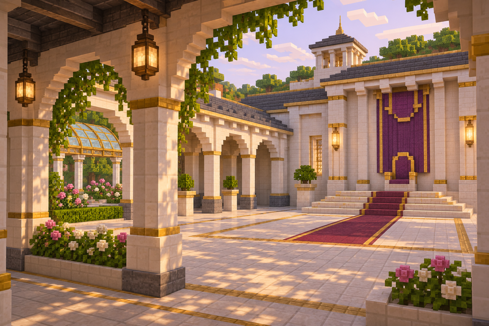

# El Dorado / representative royal court (`el_dorado`): concept art

- **Brief:** Southeastern garden arcade toward an empty white/gold/purple audience court. Early snapshot immediately after Kijin naming, anime S1E10.
- **Canon / source scope:** Official episode87/route92 synopsis names El Dorado; still1 shows pale/gold court, red aisle and purple throne, and still3 garden flowers/glazing. These later depictions supply visual cues, not the whole city or a verified S1E10 floor plan.
- **Our interpretation and revision:** Arcades, supports, garden placement, open court, roof glimpse, throne arrangement, materials and scale are our interpretation. No later visitors, named servants, active mirror/portal or political outcome is depicted. The different camera and voxel architecture are original.
- **Terrain and fit:** The radius100 reservation represents one palace precinct on the separate southwestern landmass. It does not fit or certify the entire six-pointed/spiralling canonical city described through secondary guide citations. Full city plan, approach, defensive geometry and exact early architecture remain open.
- **Current reservation:** centre(-4300,3000), radius100.0, kind`clearing`, margin64. Exact coordinates/radii are server interpretations (SITE records in the main ledger), not surveyed canon. All58 site attributes match current map review`8ea1e96`; this art branch stacks on`80f0b54` and does not carry later map/source commits. Use [map PR74](https://github.com/Yasuke2000/ocs-two-lives/pull/74), not retired Lerfing coordinates.
- **Palette / approach:** Pale masonry, restrained gold/copper proxies, purple upholstery, dark-red cloth and limited rose/glazing garden cues. Camera direction, apparent dimensions and exact materials are illustrative; no mod IDs or blueprint bounding boxes are asserted. A visible entrance/viewpoint is not a newly registered site.
- **Era limits:** No fixed named early resident roster, trial reenactment, later alliance or reconstructed Tempest city is depicted. Clayman remains in power; the orc crisis remains unresolved. Existing place-brief references to later names/alliances do not establish initial state.
- **References:** [Official episode context](https://www.ten-sura.com/anime/tensura/story/no92) · [project place brief](../../chatgpt/places/el_dorado.md) · [reference review and confidence](demon-seats-reference-review.csv). Official route45/48/86/92 stills and the secondary castle frame were visually inspected and remain cached outside the repo. No playback timestamp is claimed.
- **Provenance:** Built-in image_gen original generation from source-qualified written prompts. Existing legacy materials remain untouched; no official/anime image, mod texture or third-party map/build was supplied to image generation. Exact prompt below and in [prompt collection](demon-seats-prompts.json). Lossless PNG packaging preserves every decoded RGB pixel of the selected output; original/output/legacy-input hashes are in [manifest](demon-seats-asset-manifest.json).
- **Acceptance scope:** Representative concept only. Source fidelity of the full settlement/labyrinth, structure fit, geometry, foundation/roof/water handling and runtime-era placement require their own review. This delivery edits no SVG, blueprint, tools, runtime or server files.

## Exact prompt

Original Minecraft environment concept of LEON'S EL DORADO royal PALACE PRECINCT on the separate southwestern landmass, early post-Kijin setting. Landscape1536x1024 opaque RGB, one coherent restrained painterly voxel architectural scene, no characters, readable writing, UI/logos/watermark/panels. View from a southeastern covered garden arcade into a representative white-walled audience court: pale cream/white masonry, sparse elegant gold-toned edging, a few shallow steps to an EMPTY modest purple-backed throne and a narrow dark-red runner. A side arch gives a limited glimpse of a quiet garden with pink/white roses and a small gold-ribbed glazed canopy; no detailed ornate magic mirror. These later official anime frames supply only white/gold/purple court and garden/glazing cues, not a verified exterior or initial-era floor plan. Invent a clearly different original composition and block-built architecture, do not reproduce any shot. Keep restrained court scale and supported arches/columns, original palette of pale stone, dark grey roof hints, aged gold/copper proxy trim and simple glazed ribs. Outside the court, a little green island vegetation and warm light, but no new sea inlet, moat, grand water garden, volcanic eruption or volcano visible directly behind the throne. This is one compressed200-block-diameter palace precinct, not the whole canon six-pointed/spiral city: do not depict a full city plan or assert that all streets fit in this reserve. No later visitors, Laplace/Mariabell/Milim, Tempest banners, named servants, refugee outcomes, invasion, damaged palace or active teleportation. Original buildable grounded voxel scene, warm dignified atmosphere rather than a giant all-gold fantasy castle.

Current source decisions: [Amrita C07](https://github.com/Yasuke2000/ocs-two-lives/blob/chatgpt/world-map/world/amrita-placement-review.md) · [Frost Palace C22](https://github.com/Yasuke2000/ocs-two-lives/blob/chatgpt/world-map/world/frost-palace-source-review.md). These decisions do not change this art branch's active site attributes.
