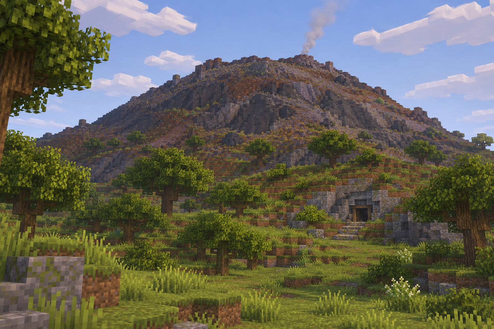

# El Dorado volcanic dome / representative flank (`el_dorado_volcano`): concept art

- **Brief:** Northeastern lower foothill looking toward the rocky dome and one restrained summit vent. Early snapshot immediately after Kijin naming, anime S1E10.
- **Canon / source scope:** The official base map shows a volcanic landform on the separate southwestern island. Indexed El Dorado/Central World wiki entries describe an active central volcano and mineral economy. These are broad visual/wiki cues; exact activity, ore distribution and mine layout have not been directly verified from the cited LN passages.
- **Our interpretation and revision:** Dome/rim detail, small plume, sparse upper scrub, greener lower slopes and a tiny rough flank adit are authored interpretation. No ore-resource map, eruptive event, mining town, dragon remains or full industrial network is asserted.
- **Terrain and fit:** The radius8 pin belongs to the larger authored dome with design peak230. It is not an8-block-wide volcano or a new full-build footprint. Actual relief polygon/ruggedness governs terrain; a pictorial vent/adit does not create a crater lake, lava river or registered mine.
- **Current reservation (R127):** centre(-3900,3200), radius8.0, kind`clearing`, margin24; designed first-air **197**. These are server interpretations, not surveyed canon. The [all58 registration audit](current-map-registration-r127.md) is pinned to [source8f8c294](https://github.com/Yasuke2000/ocs-two-lives/blob/8f8c2948bc0ef0521820f6128e2099bf2b2aa686/world/map.svg), hash`a637aa5c`; it supersedes older numerical audits. This art branch retains its older local technical files. Exact prompts below remain generation history.
- **Palette / approach:** Dark volcanic stone/tuff, brown earth, sparse upper scrub and greener lower slopes; vent/adit details are pictorial. Camera direction, apparent dimensions and exact materials are illustrative; no mod IDs or blueprint bounding boxes are asserted. A visible entrance/viewpoint is not a newly registered site.
- **Era limits:** Immediately after Kijin naming. Exact weather, vegetation, water-step details, vent activity and gallery state are authored interpretation rather than verified early close-up evidence. C03 river topology and C05 mountain bearing remain open.
- **References:** [Secondary volcano context: fan wiki](https://tensura.fandom.com/wiki/Golden_City_of_El_Dorado) · [project place brief](../../chatgpt/places/el_dorado_volcano.md) · [reference review and confidence](natural-landmark-reference-review.csv). The official broad map and cached official Ameld glossary were reinspected; no independently verified anime close-up of these exact source/mouth/volcanic precincts was found. No playback timestamp is claimed.
- **Provenance:** Built-in image_gen edits of two original project river candidates and new original volcanic-landmark generation. Existing legacy materials remain intact; no official/anime image, mod texture or third-party map/build was supplied to image generation. Exact prompt below and in [prompt collection](natural-landmark-prompts.json). Lossless PNG packaging preserves every decoded RGB pixel of the selected output; original/output/legacy-input hashes are in [manifest](natural-landmark-asset-manifest.json).
- **Acceptance scope:** Representative concept only. Source fidelity of the complete natural landform/gallery, structure fit, geometry, foundation/roof/water handling and runtime-era placement require their own review. This delivery edits no SVG, blueprint, tools, runtime or server files.

## Exact prompt

Original buildable Minecraft landscape concept of EL DORADO'S VOLCANO on the separate southwestern island. Landscape1536x1024 opaque RGB, one coherent restrained painterly voxel environment, no words, labels, signs, UI, panels, logos or watermark. View from a low northeastern foothill looking toward one broad compact dark-grey/brown VOLCANIC DOME with an irregular rocky summit/rim, sparse lichen and scrub on upper flanks, greener open woodland/grassy lower slopes. Keep the mountain at compressed server-landform scale: the source map uses a dome with crest about230 blocks, so not a world-height needle or continent-wide caldera. A thin restrained grey steam/ash wisp above one small summit vent can convey volcanic nature; no explosive eruption, lava rivers through the country, giant glowing pit, giant lake, unnatural dragon skull/bones, castle or palace on the crater. At one lower flank a tiny plain rough mine-adit opening and a couple of worn stone steps may suggest the wiki's mineral-economy premise; no mining town, machinery, rail network, named inhabitants or elaborate industrial complex. The adit position and all exact rock/vent/mineral details are our interpretation; do not paint gigantic exposed gold veins as a canonical resource map. Official broad map suggests a southwestern volcanic landmass; no verified anime close-up or surveyed mine plan is claimed. Distinct from the Eastern Empire's holy mountain. Early post-Kijin enduring geography, grounded Minecraft stone/tuff/brown earth/temperate foliage, soft daylight, no island coastline or new watercourse required in this close landscape view.
