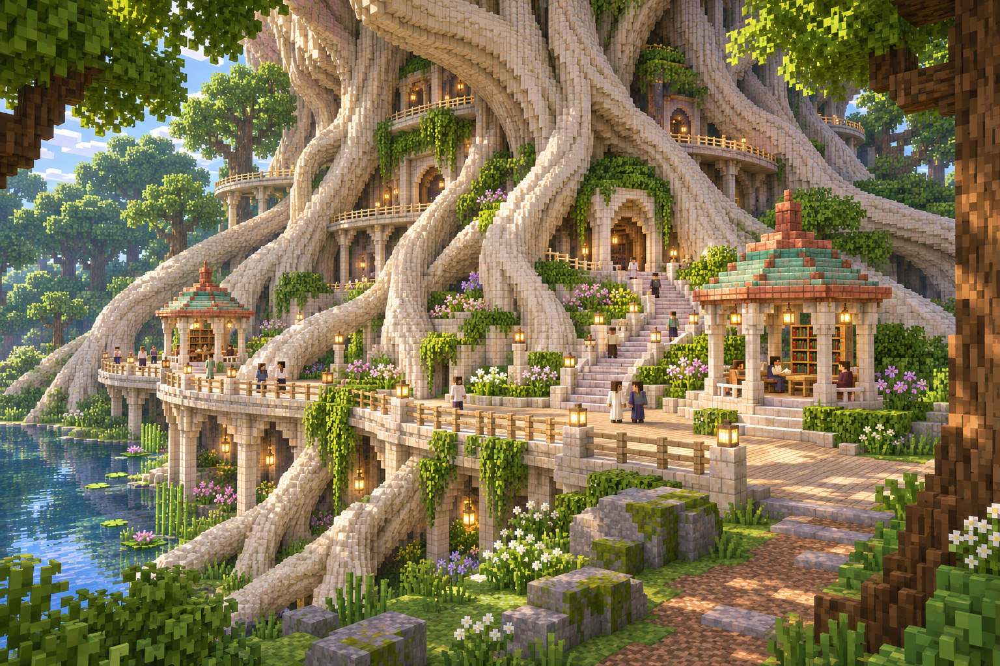

# Elmine / Divine Tree public terrace (`elmine`): concept art

- **Brief:** Southeastern forest approach looking northwest toward the lower trunk and root terraces. Initial post-Kijin geographic context; one coherent representative precinct.
- **Canon / source scope:** The selected secondary anime reference depicts an immense intertwined living tree with tiered habitation and foreground water (FAN-010). The wiki identifies Elmine as built within and upon the Divine Tree. This is a precinct vignette, not the complete canonical city or tree.
- **Our interpretation:** The embassy promenade, reading pavilions, root staircase, trunk openings, railings, rooms, palette, camera and compression are our interpretation of the existing pack terrace design. Pale timber/root tones are visual cues, not a mandate to replace living roots with masonry.
- **Block notes:** Pale wood, dark timber, restrained pale masonry, aged copper, leaves/vines and warm lanterns. The tree extends beyond frame; its full crown, branch-city and root system require their own design. Buildable block silhouettes guide translation; apparent microdetail/lighting is not a block model or a material-ID audit.
- **Terrain:** Dry root/embassy terrace in mature Sarion woodland. A separate foreground-water glimpse is pictorial; retain the actual southwest root-lake shore from the current SVG. Do not flood the site or move water to match the illustration.
- **Current reservation:** centre(-1680,1740), radius100.0, kind`clearing`, margin64. Server-authored coordinates/radii, not canonical measurements. All58 site attributes in this art branch match main map review`052f262` (terrain geometry`efa2cc8`). This branch stacks on art commit`840c26f` and does not carry the later map/source commits; use [current map PR74](https://github.com/Yasuke2000/ocs-two-lives/pull/74) for current terrain and source qualifications, not retired Lerfing coordinates.
- **Reference inspection:** Cached secondary elmine.webp was visually reinspected. It shows the broad tree/water setting, but its exact episode and playback timestamp remain unverified. No official frame is used as generation input. The existing75x60x75 terrace blueprint is not evidence that the whole Divine Tree/city is already built or fits this reservation.
- **References:** [Sarion wiki](https://tensura.fandom.com/wiki/Sorcerous_Dynasty_of_Sarion) · [official world map context](https://www.ten-sura.com/map) · [pinned secondary frame](https://git.fish/KartoffelChipss/TensuraMap/src/commit/ec4d0e3db2ba4b229d412a273bbcdd19f45425b6/public/img/locations/elmine.webp).
- **Geometry / era limit:** camera, roots, cliffs, apparent scale, vegetation, water set dressing and tiny figures do not override `world/map.svg`, validate structure fits/access grades or prove an S1E10 building/NPC roster. Whole-city/tree/cliff fidelity and runtime era gating remain open. No blueprints or technical placements changed.
- **Provenance:** original built-in image_gen output from the exact written prompt below. No official frame, map, mod texture or third-party build supplied as image input. Lossless PNG repackaging preserves every decoded RGB pixel; originals remain in the local generated-images directory.

## Exact prompt

Original buildable Minecraft environment concept for Elmine Sarion, city within and upon the Divine Tree, Tensura. Landscape1536x1024 opaque RGB PNG. One coherent three-quarter approach view, no text, writing, banners with emblems, captions, UI, logos, watermarks or inset panels. From the southeastern forest approach looking northwest, show immense pale, deeply intertwined buttress roots and the LOWER LIVING TRUNK of one gigantic ancient tree, with a representative embassy terrace gently wrapping the roots. Narrow pale-stone stairs, a wooden/birch promenade, two small copper-capped reading pavilions, discreet openings and balcony walkways integrated INTO the trunk suggest a living tree-city, not an ordinary castle sitting in front of a giant tree. The trunk and crown continue upward beyond the top of frame: the picture is a compressed public precinct, not the entire mountain-scale canonical tree in a radius100 clearing. A glimpse of separate quiet foreground water sits at the far left beyond the dry root terrace; preserve dry foundations and do not submerge the trunk or add a gigantic new lake. Mature green Sarion woodland, a few mossy rocks and root-scale gardens blend organically with the site edge. Broad visual cue from the secondary anime reference is a vast twisted pale living tree with tiered root/branch habitation and foreground water; invent an original close oblique voxel composition, never trace the anime panorama. Architecture, materials, rooms, rails and camera orientation are our interpretation of the existing pack terrace design. Early post-Kijin baseline: no later war damage, alliance ceremonies, named NPC roster or future Tempest symbols. Clearly cubic blocks, block-stepped curves, stairs/slabs, subdued natural green/pale wood/copper palette, warm dappled daylight, tiny anonymous visitors for scale. Quiet magic only, no floating stone city, no neon runes or modern devices.
