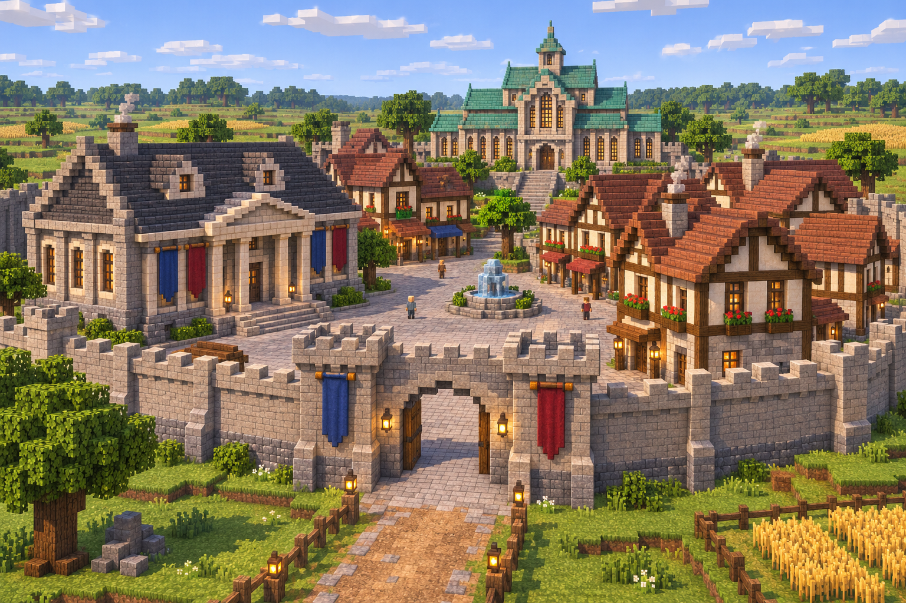

# Lura / Englassia capital precinct (`englassia`): concept art

- **Brief:** Eastern gate approach looking west over the compact academic/guild square. Post-Kijin design baseline; one coherent representative precinct.
- **Canon / context:** Englassia is the setting of the Free Guild and the school associated with Shizu and later Rimuru. Official episode20 synopsis provides that narrative context, not a campus exterior plan.
- **Our interpretation:** All architecture, court layout, building proportions, palette, banners, fountain and camera direction are our interpretation of the existing pack design. A representative precinct stands for a larger capital; this is not a canonical whole-city plan.
- **Block notes:** Stone bricks, dark oak, cream masonry/plaster proxy, slate-like dark blocks and restrained aged copper roofs; blue/crimson cloth. Cubic silhouettes and stair/slab construction; this is an illustration rather than a verified block model or light audit.
- **Terrain:** Dry gently rolling temperate country; no new lake, moat or harbour. C17 keeps the WN central-lake/castle description separate from the current dry capital reservation.
- **Current reservation:** centre(-2900,-550), radius124, kind`clearing`, margin48. Checked against [current map commit40c7833](https://github.com/Yasuke2000/ocs-two-lives/blob/40c7833/world/map.svg),source90ee15b1. These are authored server coordinates and preparation dimensions,not canonical measurements. This art branch retains older map/source files;the linked map branch governs current terrain.
- **Reference inspection:** The older local image was reviewed and replaced because it introduced a large background waterbody and a sprawling palace. All five official episode20 stills were inspected: character/interior/travel context, no independently verified capital exterior. No invented episode timestamp or roof-plan attribution.
- **References:** [Official episode20](https://www.ten-sura.com/anime/tensura/story/no20) · [Current city coverage study](../../../world/city-coverage-study.md).
- **Geometry / era limit:** perspective, apparent size, water set dressing and tiny anonymous figures do not override the SVG or prove the initial NPC roster, foundations, site fit, material IDs, lighting, access grades or runtime era gating. The reserved circle is a design core, not the full size of a canonical city.
- **Provenance:** original built-in image_gen output. No copyrighted anime frame, map, mod asset or third-party build supplied as image input. Siltrosso edits only our earlier original image. Where PNG compression was repackaged, decoded RGB pixels were verified identical to the original generated output.
- **Current terrain handoff (R73):** The [R60 measured support review](https://github.com/Yasuke2000/ocs-two-lives/blob/40c7833/world/englassia-fit-review.md) changes the preparation radius from98 to124;the current designed first-air is76. The original PNG remains a perspective/material concept,not a scaled drawing of that disc,an exact plateau footprint or proof of current runtime fit. Original generation prompt and image provenance below remain historical.

## Exact current prompt

Original buildable Minecraft environment concept of Lura, capital of Englassia/Ingrassia in Tensura. 1536x1024 landscape opaque RGB PNG, one coherent oblique town view, no text, captions, lettering, logos, watermarks or inset panels. Early baseline immediately after Kijin naming, well before Rimuru teaches here. Show a COMPACT representative capital precinct fitting roughly a 196-block diameter dry reservation, not an entire huge city. From an eastern road approach looking west, a modest crenellated stone gate opens onto a paved square, a small fountain, close timber-and-cream-plaster townhouses, a substantial guild hall with a simple columned portico and slate roof to one side, and a dignified academic hall with stepped teal copper roofs toward the back. A restrained northern-European late-medieval silhouette, grounded stone foundations following gently rolling temperate farmland, scattered oak trees and low wooded horizon. Blue and crimson plain cloth are an authored palette, not canonical heraldry. The school/guild architecture is an original interpretation of the pack blueprint; no verified anime exterior plan is claimed. No giant lake, river, moat, harbour, floating castle, towering mountain wall or new canal anywhere in frame; the current build footprint is dry and its WN lake-castle issue is unresolved. No modern machinery, festival trappings, alliance banners, Rimuru pupils or named-character roster. Cubic blocks, stair/slab roofs, a few tiny anonymous people for scale, doors roughly two blocks high, warm painterly voxel light with restrained surface detail. Keep city scale intimate enough that buildings and walls can fit the reservation.
