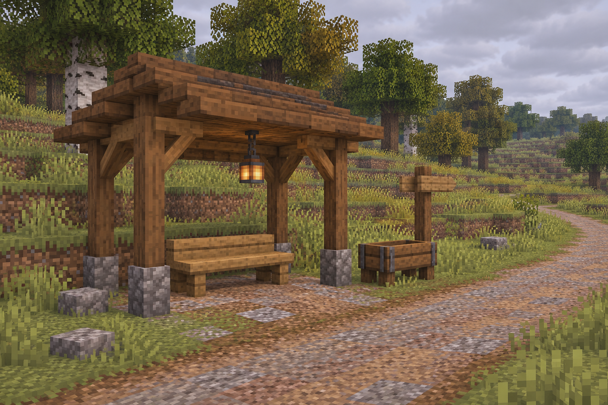

# Englassia road resting post (`englassia_road`): concept art

- **View / snapshot:** Compact timber rain roof, bench and trough on a dry lane. Immediately after Kijin naming, anime S1E10.
- **Facing / ground:** Camera faces roughly east along the country road toward Blumund; roof and bench stand on a dry gravel/earth shoulder.
- **Source scope:** This quest post is original server design. No official reference read here supplies its architecture, guard roster, location parcel or sovereign frontier.
- **Our interpretation:** Weathered timber, a dull lamp, plain unlettered sign and small trough are practical authored props. The roof is a representative small shelter, not a measured building plan.
- **Terrain and fit:** Radius8 is retained. The trough is a prop, not a new lake or channel. No new gatehouse, stable compound, river or national crest is inferred. Shelter footprint, access, water handling and actual staffing require separate acceptance.
- **Current reservation:** centre(-2650,-520),radius8.0,kind`clearing`,margin24. Coordinates/radii are authored server values, not canonical measurements. All58 attributes match map commit48b0846. This art branch stacks on558b032 and retains older map/source files; [map PR74](https://github.com/Yasuke2000/ocs-two-lives/pull/74) governs current terrain.
- **Era:** No named initial resident, later federation insignia, completed future event or fixed active encounter is depicted. Camps and roles remain server adaptations. [Era policy](../../../world/era.md).
- **References:** [Source/design review](jura-route-reference-review.csv) · [project brief](../../chatgpt/places/englassia_road.md). Imported-map coordinates/audit imagery are historical context.
- **Provenance:** Built-in image_gen new original generation from a source-qualified written brief. No copyrighted anime frame,map,texture or third-party build was an image input. The legacy original is preserved. [Exact prompts](jura-route-prompts.json) and [manifest](jura-route-asset-manifest.json) record selected output hashes. Lossless PNG packaging preserves every selected decoded RGB pixel.
- **Acceptance:** Representative visual design only; exact source/era/voxel fit,terrain/tree/shelter placement,lighting,water/roof handling,residents and runtime acceptance remain open. No world,tool,mod,pack,blueprint,apply or deploy change in this art delivery.

## Exact generation prompt

Generate an original Minecraft close landscape concept of a SMALL roadside resting/guard-post vignette in the western Englassia countryside. A roughly3x3-block open timber rain roof on simple posts, a plain wooden bench, a short unlettered direction post and a small wooden trough form one compact group beside a narrow packed-earth/gravel lane; all within a16-block-diameter quest spot. One dull practical hanging lantern under the roof. Dry rolling ground with modest mixed woodland behind, ordinary grass and a few embedded stones, realistic gentle slopes. No gatehouse, palisade, border wall, toll plaza, large stable, fort, town skyline or mountain stairway. No people, national crest, text, road signs with letters, or later federation decor. No river, lake, watercourse or new bridge; the trough is a small prop, not landscape hydrology. Soft overcast daylight, quiet practical materials. This roadside shelter is a server interpretation, not a verified anime building or sovereign frontier. Landscape 1536x1024 opaque RGB. Original polished Minecraft voxel environment concept, coherent block scale, natural atmospheric light, detailed but buildable materials. No captions, lettering, logo, UI, collage, map or frame. Baseline immediately after six Kijin are named, anime S1E10; no later Tempest metropolis or federation flags. This is a server interpretation, not a reproduction of anime art.
