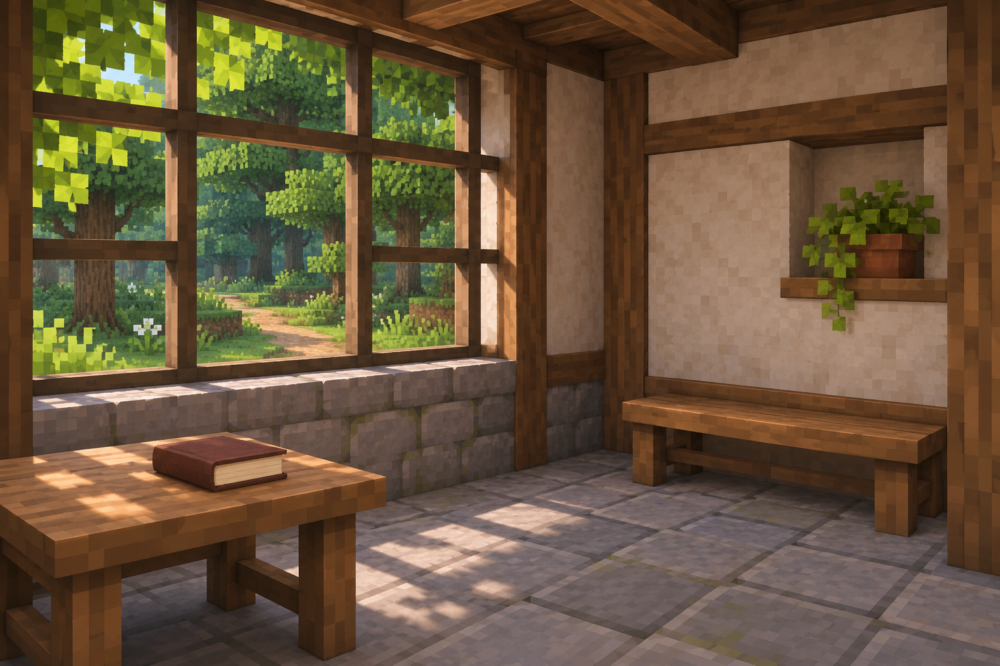

# Filtwood: modest room and forest-window interpretation (`filtwood`): concept art

- **View / ground:** Camera faces west through an authored window toward leafy forest; floor is plain stone on a dry foundation.
- **Source scope:** The official episode24 synopsis establishes Filtwood as a kingdom in a story before Rimuru reincarnates. Selected stills3–5 show a different richly decorated flashback interior; they do not verify this room, exterior or initial residents.
- **Our interpretation:** Simple plaster/timber room,bench,closed book and forest view are original neutral architecture. They do not reproduce the castle chamber or certify its post-flashback condition.
- **Terrain / fit:** C20 remains: current radius8 U pin(-1200,2750) is not evidence of a canonical Ulgracia town. The inert Jura-edge alternative exists separately. This representative close view supplies no sovereign outline or completed capital.
- **Reservation:** centre(-1200,2750),radius8.0,kind`clearing`,margin24. All58 site attributes match map1209e38. Coordinates/radii are authored server values. This art branch stacks on96e1069 and retains older map/source files; [map PR74](https://github.com/Yasuke2000/ocs-two-lives/pull/74) governs current terrain. Sainte's depicted alternative is explicitly separate.
- **Era:** Immediately after Kijin naming,S1E10. No named initial resident,late faction crest,postwar reconstruction or future outcome is shown. Enduring geography does not prove each distant building's initial condition. [Era policy](../../../world/era.md).
- **References:** [Source/design review](final-places-reference-review.csv) · [project brief](../../chatgpt/places/filtwood.md). Imported-map data and ambiguous source leads remain qualified.
- **Provenance:** Built-in image_gen new original generation from the written brief. No copyrighted frame,map,mod texture or third-party build was an image input. No older local PNG candidate existed for this ID; legacy sheets remain intact. [Exact prompt set](final-places-prompts.json) and [manifest](final-places-asset-manifest.json) record selected original/output hashes. Lossless PNG packaging preserves every selected decoded RGB pixel.
- **Acceptance:** Representative art only. Canonical geometry/country coverage,initial architecture,exact voxel dimensions,foundation/roof/water/tree handling,lighting,access and runtime acceptance remain open. No SVG,blueprint,tool,mod,pack,apply or deployment change by this art delivery.

## Exact generation prompt

Create an intimate modest room-and-window vignette for a source-qualified Filtwood kingdom concept. A low simple plaster-and-timber chamber,plain wooden bench,small table with a closed unmarked book,and a broad mullioned window open onto nearby leafy forest and a humble dry footpath. Weathered stone threshold,soft daylight from the left,quiet ordinary human-scale architecture. Frame one corner only,not a royal hall or whole capital; about5x6 blocks of foreground floor. No throne,grand church,demonic symbols,magic ritual,flags,people,city panorama or water. The official story establishes the kingdom in Shizu's earlier story but not its exact exterior or location. Therefore keep every architectural detail a neutral original interpretation,not an assertion that it is an Ulgracia town or a surveyed canonical room. The 8-radius server pin and disputed location are not depicted as national boundaries. Original Minecraft voxel environment concept,1536x1024 landscape opaque RGB. Polished broad readable block materials,soft natural light and restrained painterly detail,not photoreal noise. Natural asymmetry and practical construction. No text,lettering,UI,logos,map panels or named people. Early post-Kijin baseline S1E10; no future federation crests,railways,metropolis or later event outcome. This is original interpreted design,not a copied anime frame.
