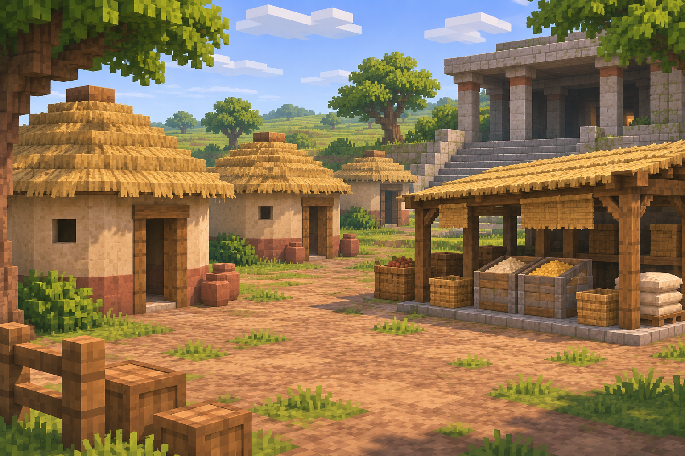

# Old Forgotten Dragon City: goods-yard precinct (`forgotten_dragon_city`): concept art

- **View / ground:** Authored approach from south,camera facing north toward a modest shared court and subordinate temple entrance; huts stand on dry fertile ground.
- **Source scope:** The official Middray profile directly establishes a temple in the City of the Forgotten Dragon. Wiki supports the old territory context and communal economy; detailed initial buildings and floor plan remain unverified.
- **Our interpretation:** Thatch/earth huts,grain bins,baskets and plain stone portico are original precinct design. No giant dragon skeleton,glowing eyes,bone throne,wyvern flock or late Laura palace is presented as verified architecture.
- **Terrain / fit:** Current radius100 reservation and existing121×44×125 blueprint box remain. That blueprint's bone avenue and larger stepped design are outside this camera and separately unverified; this art does not remove them,certify their canon basis or substitute a new technical build. Full city/source/terrain fit stays open.
- **Reservation:** centre(2650,800),radius100.0,kind`clearing`,margin64. All58 site attributes match map1209e38. Coordinates/radii are authored server values. This art branch stacks on96e1069 and retains older map/source files; [map PR74](https://github.com/Yasuke2000/ocs-two-lives/pull/74) governs current terrain. Sainte's depicted alternative is explicitly separate.
- **Era:** Immediately after Kijin naming,S1E10. No named initial resident,late faction crest,postwar reconstruction or future outcome is shown. Enduring geography does not prove each distant building's initial condition. [Era policy](../../../world/era.md).
- **References:** [Source/design review](final-places-reference-review.csv) · [project brief](../../chatgpt/places/forgotten_dragon_city.md). Imported-map data and ambiguous source leads remain qualified.
- **Provenance:** Built-in image_gen new original generation from the written brief. No copyrighted frame,map,mod texture or third-party build was an image input. No older local PNG candidate existed for this ID; legacy sheets remain intact. [Exact prompt set](final-places-prompts.json) and [manifest](final-places-asset-manifest.json) record selected original/output hashes. Lossless PNG packaging preserves every selected decoded RGB pixel.
- **Acceptance:** Representative art only. Canonical geometry/country coverage,initial architecture,exact voxel dimensions,foundation/roof/water/tree handling,lighting,access and runtime acceptance remain open. No SVG,blueprint,tool,mod,pack,apply or deployment change by this art delivery.

## Exact generation prompt

Create an original modest goods-yard precinct in Milim's OLD City of the Forgotten Dragon,prior to the later relocation or new palace at Laura. A handful of low roundish earth-plastered huts with plain thatch roofs,a simple shaded open store with baskets and small grain bins,and a dry shared earth court with sparse grass. At the back only a subordinate part of a plain weathered stone temple stair and shaded portico,not a monumental new castle or towering stepped pyramid. Warm fertile southern countryside with a few ordinary trees at the edges and softly rolling green ground; no jungle wall or dramatic red desert. No full kingdom panorama: show one believable small working precinct. Temple existence is official source context; exact architecture and redistribution-yard dressing are our interpretation. Do not show enormous dragon skulls,rib-cage arches,glowing eye sockets,bone throne,dead dragon,flying wyverns,modern machines,city walls,pink imperial flags,named clergy or citizens. The existing project's bone-avenue blueprint is outside this camera and remains separately unverified,not silently certified or replaced by this art. Original Minecraft voxel environment concept,1536x1024 landscape opaque RGB. Polished broad readable block materials,soft natural light and restrained painterly detail,not photoreal noise. Natural asymmetry and practical construction. No text,lettering,UI,logos,map panels or named people. Early post-Kijin baseline S1E10; no future federation crests,railways,metropolis or later event outcome. This is original interpreted design,not a copied anime frame.
