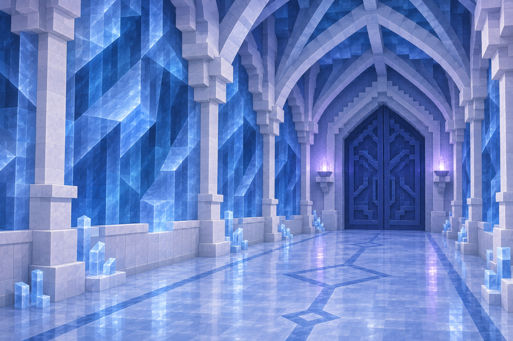

> **Current approved registration (24 November 2026):** centre x/first-air-y/z **(-2130,75,-3799)**, radius **89**, kind `clearing`. Island placement is the owner-selected larger form;exact coordinates,heights and illustrated architecture remain interpretation. [Active map and checks](../../../world/approved-islands-coast.md). The retained concept image is illustrative;earlier coordinates,fit tests and pending-choice statements below are historical and are superseded here. Its exact generation prompt remains historical evidence. No current voxel fit or complete city/palace is certified.

# White Ice Palace / inner entry corridor (`frost_palace`): concept art

- **Brief:** Blue ice-and-pale-masonry corridor ending before closed audience doors. Early snapshot immediately after Kijin naming, anime S1E10.
- **Canon / source scope:** Official episode42/route45 stills3/4 directly show blue faceted interior cues, not a full corridor plan. Original WN78 supplies corridor/door context and an inland palace relationship. WN continuity remains separate; LN6 interlude/LN16 epilogue were not directly read.
- **Our interpretation and revision:** Pale masonry under ice, vault ribs, floor seams, restrained crystals, violet cup lights and door carving are authored block translations. No named visitor, demon roster, exterior causeway, coast or exact early palace plan is asserted.
- **Terrain and fit:** The approved central snowfield has designed first-air71. The [R109 fit review](https://github.com/Yasuke2000/ocs-two-lives/blob/bf0ba98/world/frost-palace-inland-r109.md) checks all8,585 buffered entrance-column centres at that level without sampled water. This enclosed corridor depicts no shore or exterior, so its inland placement requires no image change. It does not establish the complete palace, actual voxel support, orientation or runtime acceptance. The exact prompt below is historical generation evidence; its former pending coast/inland dispute is superseded by the owner decision.
- **Current reservation:** centre(-1530,-3680), radius89, kind`clearing`, margin48. Checked against [map bf0ba98](https://github.com/Yasuke2000/ocs-two-lives/blob/bf0ba98/world/map.svg), source2463d771. Yasuke approved inland placement and adjustment of the coastal registration. Exact coordinates and the entrance preparation reserve are our interpretation; they are not a canonical survey or complete palace footprint. The linked map governs current terrain; this art branch retains older local map files.
- **Palette / approach:** Pale masonry/ice proxies, faceted blue surfaces, restrained crystals and violet cup-light accents. Camera direction, apparent dimensions and exact materials are illustrative; no mod IDs or blueprint bounding boxes are asserted. A visible entrance/viewpoint is not a newly registered site.
- **Era limits:** No fixed named early resident roster, trial reenactment, later alliance or reconstructed Tempest city is depicted. Clayman remains in power; the orc crisis remains unresolved. Existing place-brief references to later names/alliances do not establish initial state.
- **References:** [Official episode context](https://www.ten-sura.com/anime/tensura/story/no45) · [project place brief](../../chatgpt/places/frost_palace.md) · [reference review and confidence](demon-seats-reference-review.csv). Official route45/48/86/92 stills and the secondary castle frame were visually inspected and remain cached outside the repo. No playback timestamp is claimed.
- **Provenance:** Built-in image_gen original generation from source-qualified written prompts. Existing legacy materials remain untouched; no official/anime image, mod texture or third-party map/build was supplied to image generation. Exact prompt below and in [prompt collection](demon-seats-prompts.json). Lossless PNG packaging preserves every decoded RGB pixel of the selected output; original/output/legacy-input hashes are in [manifest](demon-seats-asset-manifest.json).
- **Acceptance scope:** Representative concept only. Source fidelity of the full settlement/labyrinth, structure fit, geometry, foundation/roof/water handling and runtime-era placement require their own review. This delivery edits no SVG, blueprint, tools, runtime or server files.

## Exact prompt

Original Minecraft environment concept of the WHITE ICE PALACE / Frost Palace in Tensura, a representative INNER ENTRY CORRIDOR ending before an audience hall. Landscape1536x1024 opaque RGB, one coherent original painterly voxel image. Cool dark-blue faceted ice wall bays, pale white masonry partly encased by translucent blue ice, a dry walkable reflective packed-ice floor with simple blue geometric seams, restrained small ice crystal clusters at wall bases, pointed supported vault ribs and large closed dark-blue carved double doors at the far end. Camera down a modest straight corridor toward the north door, slight side angle giving depth; restrained two soft violet cup lamps can mark the doorway. These are authored buildable cubic quartz/ice/stone proxies; no full exterior palace or exact anime reconstruction. Official later anime interiors supply blue faceted-wall cues; original web novel supplies corridor-to-carved-audience-door context, separate continuity. DO NOT show a sea, shore, causeway, coast or outdoor map position: the current coastal game reservation and a central-continent source statement are unresolved, and this interior must not settle that dispute by invention. No giant crystals impaling floor, snowstorm inside, volcanic heat, gold throne, named characters, demons, Leon's later visit, royal banners, flags, portal or modern lights. Continuous enclosed roof and stable grounded walls, no magical floating geometry. Quiet cold light, clear block silhouettes, no words/inscriptions/UI/captions/logo/panels/watermark. One representative precinct, not entire continental palace or proof of an exact early building plan.

Current source decisions: [Amrita C07](https://github.com/Yasuke2000/ocs-two-lives/blob/chatgpt/world-map/world/amrita-placement-review.md) · [Frost Palace C22](https://github.com/Yasuke2000/ocs-two-lives/blob/chatgpt/world-map/world/frost-palace-source-review.md). These decisions do not change this art branch's active site attributes.
