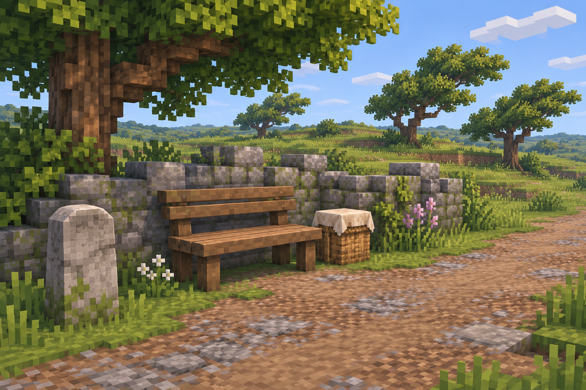

# Ghastone: interpreted country-road pause (`ghastone`): concept art

- **View / ground:** Camera faces east along a dry rolling lane; stone wall,bench,basket and milestone stand on grass/earth.
- **Source scope:** The indexed Magic Continent country list names the Kingdom of Ghastone among the western states. The direct dedicated article was inaccessible. No primary capital,bearing,border or national industry has been read here.
- **Our interpretation:** Tiny resting place and ordinary countryside are authored props,not a surveyed kingdom capital or an Englassia neighbourhood. No crest,ducal residence,encounter or new water is inferred.
- **Terrain / fit:** Radius8 is a gameplay pin inside G,not a whole country or proof of Englassia sovereignty. The national context requires separate source/placement review; the image does not resolve it.
- **Reservation:** centre(-3200,-300),radius8.0,kind`clearing`,margin24. All58 site attributes match map1209e38. Coordinates/radii are authored server values. This art branch stacks on96e1069 and retains older map/source files; [map PR74](https://github.com/Yasuke2000/ocs-two-lives/pull/74) governs current terrain. Sainte's depicted alternative is explicitly separate.
- **Era:** Immediately after Kijin naming,S1E10. No named initial resident,late faction crest,postwar reconstruction or future outcome is shown. Enduring geography does not prove each distant building's initial condition. [Era policy](../../../world/era.md).
- **References:** [Source/design review](final-places-reference-review.csv) · [project brief](../../chatgpt/places/ghastone.md). Imported-map data and ambiguous source leads remain qualified.
- **Provenance:** Built-in image_gen new original generation from the written brief. No copyrighted frame,map,mod texture or third-party build was an image input. No older local PNG candidate existed for this ID; legacy sheets remain intact. [Exact prompt set](final-places-prompts.json) and [manifest](final-places-asset-manifest.json) record selected original/output hashes. Lossless PNG packaging preserves every selected decoded RGB pixel.
- **Acceptance:** Representative art only. Canonical geometry/country coverage,initial architecture,exact voxel dimensions,foundation/roof/water/tree handling,lighting,access and runtime acceptance remain open. No SVG,blueprint,tool,mod,pack,apply or deployment change by this art delivery.

## Exact generation prompt

Create a small original countryside rest-point vignette associated with the unresolved Ghastone server pin. A short rough stone wall beside a narrow dry earth-and-gravel lane,a single modest timber bench,a simple covered basket and an unmarked weathered milestone. Soft rolling western-country ground and a few wind-shaped broadleaf trees behind,quiet daylight. Keep the usable foreground within about10 blocks across; the wider landscape continues beyond. No village panorama,castle,royal gate,palace,market,country border,river,lake or bridge. No people,ducal crest or implied encounter. Name/kingdom context does not establish a specific canon capital,industry or position; make a restrained authored travel pause without inventing these. Original Minecraft voxel environment concept,1536x1024 landscape opaque RGB. Polished broad readable block materials,soft natural light and restrained painterly detail,not photoreal noise. Natural asymmetry and practical construction. No text,lettering,UI,logos,map panels or named people. Early post-Kijin baseline S1E10; no future federation crests,railways,metropolis or later event outcome. This is original interpreted design,not a copied anime frame.
