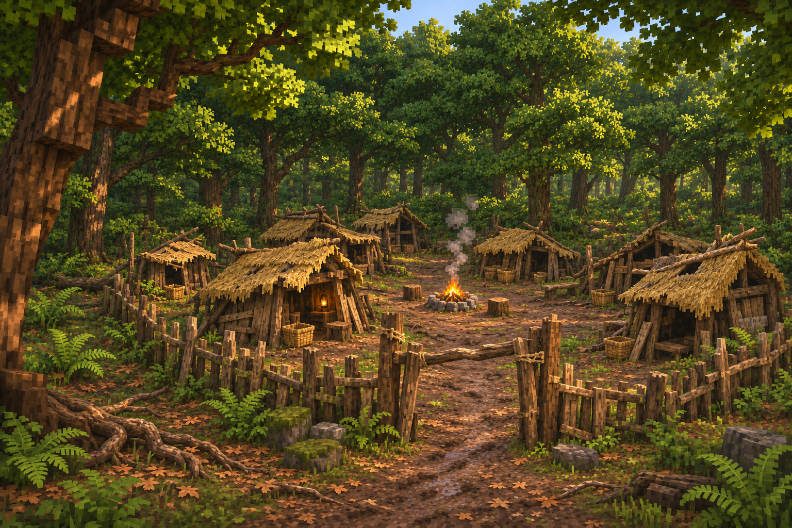

# Old goblin village / representative old forest site (`goblin_village`): concept art

- **Brief:** Dry forest approach toward several shabby, irregular wood/thatch huts and a common hearth. Early snapshot immediately after Kijin naming, anime S1E10.
- **Canon / source scope:** The project place brief and existing Tensura oak-village structure supply the poor-hut design premise. Official episode2 still5 shows goblins in an ordinary leafy forest; it does not show this village layout. Episode9 still3 supplies additional broad forest context.
- **Our interpretation and revision:** Remove the legacy tall spire, invented brook/falls and over-neat approach. Keep a lowland canopy, roots, leaf litter and humble irregular huts. The exact clearing, fence, hearth and huts are our interpretation. The lit hearth is an illustrative activity cue, not proof of a named resident at this old reserve.
- **Terrain and fit:** The current circle is a dry village reservation west-northwest of early Rimuru village. Do not add a new brook, rock spire or assumed Rigurd residence to match older docs.
- **Current reservation:** centre(-530,-220), radius56.0, kind`village`, margin48. Exact coordinates/radii are server interpretations (SITE records in the main ledger), not surveyed canon. All58 site attributes match current map review`6a66e5d`; this art branch stacks on`aa9268c` and does not carry later map/source commits. Use [map PR74](https://github.com/Yasuke2000/ocs-two-lives/pull/74), not retired Lerfing coordinates.
- **Palette / approach:** Rough timber, muted straw, soil/stone, restrained practical firelight and foliage where appropriate. Camera direction, apparent dimensions and exact materials are illustrative; no mod IDs or blueprint bounding boxes are asserted. A visible entrance/viewpoint is not a newly registered site.
- **Era limits:** No named residents, fixed early NPC roster, Gabiru coup/captivity, dragonnewt wings, later alliance, military victory or reconstructed Tempest city is depicted. The ogre attack is past; the orc crisis remains unresolved. Existing place-brief references to later names/alliances do not establish initial state.
- **References:** [Official episode context](https://www.ten-sura.com/anime/tensura/story/no2) · [project place brief](../../chatgpt/places/goblin_village.md) · [reference review and confidence](jura-marsh-reference-review.csv). Official stills and the secondary ogre-village/Siss images were visually inspected and remain cached outside the repo. No playback timestamp is claimed.
- **Provenance:** Built-in image_gen edit of the older original project concept. Older candidate remains untouched; no official/anime image, mod texture or third-party map/build was supplied to image generation. Exact prompt below and in [prompt collection](jura-marsh-prompts.json). Lossless PNG packaging preserves every decoded RGB pixel of the selected output; original/output/legacy-input hashes are in [manifest](jura-marsh-asset-manifest.json).
- **Acceptance scope:** Representative concept only. Source fidelity of the full settlement/labyrinth, structure fit, geometry, foundation/roof/water handling and runtime-era placement require their own review. This delivery edits no SVG, blueprint, tools, runtime or server files.

## Exact edit prompt

Edit this ORIGINAL project Minecraft concept into the OLD GOBLIN VILLAGE reserve at (-530,-220),radius56, in early Jura immediately after the Kijin naming. Preserve the grounded painterly voxel style, crowded shabby thatch huts, crude logs, muddy earthen footpath and canopy setting. Remove the entire tall stone spire and stepped mountain background, replacing them with dense lowland forest and gently uneven forest floor. Remove the visible left-hand stream and waterfalls; replace with dry leaf litter, roots and ferns, because the current village circle is dry and there is no mapped stream here. Simplify the over-neat houses and cobbled approach into smaller poor, irregular wood/thatch shelters and a rough dirt lane. Keep a humble broken/uneven low palisade, one common hearth, household baskets and no printed decoration. No big public buildings, kingdom flags, named characters, castle, modern technology, large new clearing or later Tempest city. This is an old site/representative remnant, not proof Rigurd or any named NPC still resides here. Several empty huts, no named inhabitants. One coherent landscape1536x1024 RGB illustration, no text, logos, watermark, captions or panels. Match original camera angle and warm forest light, but retain a plain forest backdrop and small112-block-diameter representative footprint. Do not introduce new water or giant relief.
