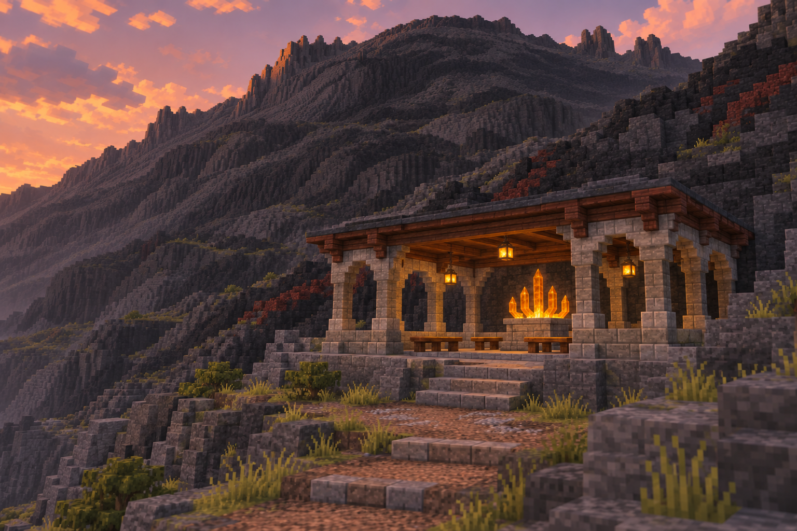

# Great Holy Mountain / interpreted votive gallery (`great_holy_mountain`): concept art

- **Brief:** Southern foothill path toward one compact gallery on a dark volcanic shoulder. Early snapshot immediately after Kijin naming, anime S1E10.
- **Canon / source scope:** The indexed Scorching God Mountain wiki describes a volcanic sacred site near Nasca associated with Velgrynd and cites LN14 chapter2. Those LN story pages remain unread. The existing project blueprint supplies the small votive-gallery premise; no exact anime close-up or canonical arcade plan is independently verified.
- **Our interpretation and revision:** Rock profile, path, cut-stone arcade, benches, amber-glass hearth and flame motif are explicit server architecture. The natural mountain dominates. No new crater lake, lava waterfall, palace, statue, dragon entity, coronation eruption or war scene is depicted.
- **Terrain and fit:** The radius80 reserve is inside the authored volcanic massif. Exact bearing to Nasca remains C05; the picture shows no capital skyline that would decide it. Gallery dimensions89x85 are a project blueprint reference, not canonical measurements. Actual slope, footing and access still need build-fit review.
- **Current reservation:** centre(3350,-1350), radius80.0, kind`clearing`, margin48. Exact coordinates/radii are server interpretations (SITE records in the main ledger), not surveyed canon. All58 site attributes match current map review`0f154fc`; this art branch stacks on`187d28d` and does not carry later map/source commits. Use [map PR74](https://github.com/Yasuke2000/ocs-two-lives/pull/74), not retired Lerfing coordinates.
- **Palette / approach:** Dark rugged volcanic stone, modest gallery masonry/timber and a local amber hearth motif; all exact architecture is server interpretation. Camera direction, apparent dimensions and exact materials are illustrative; no mod IDs or blueprint bounding boxes are asserted. A visible entrance/viewpoint is not a newly registered site.
- **Era limits:** Immediately after Kijin naming. Exact weather, vegetation, water-step details, vent activity and gallery state are authored interpretation rather than verified early close-up evidence. C03 river topology and C05 mountain bearing remain open.
- **References:** [Official episode context](https://tensura.fandom.com/wiki/Scorching_God_Mountain) · [project place brief](../../chatgpt/places/great_holy_mountain.md) · [reference review and confidence](natural-landmark-reference-review.csv). The official broad map and cached official Ameld glossary were reinspected; no independently verified anime close-up of these exact source/mouth/volcanic precincts was found. No playback timestamp is claimed.
- **Provenance:** Built-in image_gen edits of two original project river candidates and new original volcanic-landmark generation. Existing legacy materials remain intact; no official/anime image, mod texture or third-party map/build was supplied to image generation. Exact prompt below and in [prompt collection](natural-landmark-prompts.json). Lossless PNG packaging preserves every decoded RGB pixel of the selected output; original/output/legacy-input hashes are in [manifest](natural-landmark-asset-manifest.json).
- **Acceptance scope:** Representative concept only. Source fidelity of the complete natural landform/gallery, structure fit, geometry, foundation/roof/water handling and runtime-era placement require their own review. This delivery edits no SVG, blueprint, tools, runtime or server files.

## Exact prompt

Original Minecraft environment concept of the EASTERN EMPIRE'S GREAT HOLY MOUNTAIN / Scorching God Mountain, with ONE COMPACT SERVER-INTERPRETED votive gallery near a dark volcanic shoulder. Landscape1536x1024 opaque RGB, one coherent original painterly voxel scene, no words/inscriptions/signs/UI/panels/logos/watermark. View from a modest southern foothill path upward toward a broad rugged grey/dark-stone volcanic massif and broken upper rim. In the foreground a small grounded cut-stone open arcade on a safe shoulder, a few plain benches facing a quiet amber-glass hearth/small five-tongued flame motif under a supported canopy, compressed within about89x85-block blueprint precinct. That arcade, exact flame motif, stair, material palette and placement are explicit SERVER INTERPRETATION, not an anime-certified sacred temple. Make natural mountain dominate, with a short practical stepped path and sparse tough grass/shrubs; no giant royal palace, sprawling city, heroic statue, dragon body, enormous lava waterfall or crater lake. The current authored mountain has a dome/rugged volcanic mass and no mapped crater water. No lake, river, floating platform, deep bridge/chasm or gigantic glowing caldera. Exact bearing versus Nasca is unresolved (C05), so show NO capital skyline or directional geopolitical landmark that would settle it. Velgrynd's imperial association is source context, not permission to place her entity, an active encounter or later war scene. Early post-Kijin natural setting, restrained warm amber on cool dark rock, grounded block-built supports and modest scale; no faction banners, named people, soldiers or later Tempest symbols.

## Targeted cleanup

The initial original candidate added unrequested glowing flank fissures. A built-in image_gen edit removed those marks and reduced steam, preserving the gallery motif. The cleanup prompt and intermediate filename are recorded in natural-landmark-prompts.json. Bright gallery artwork does not register an actual lava flow or encounter.
