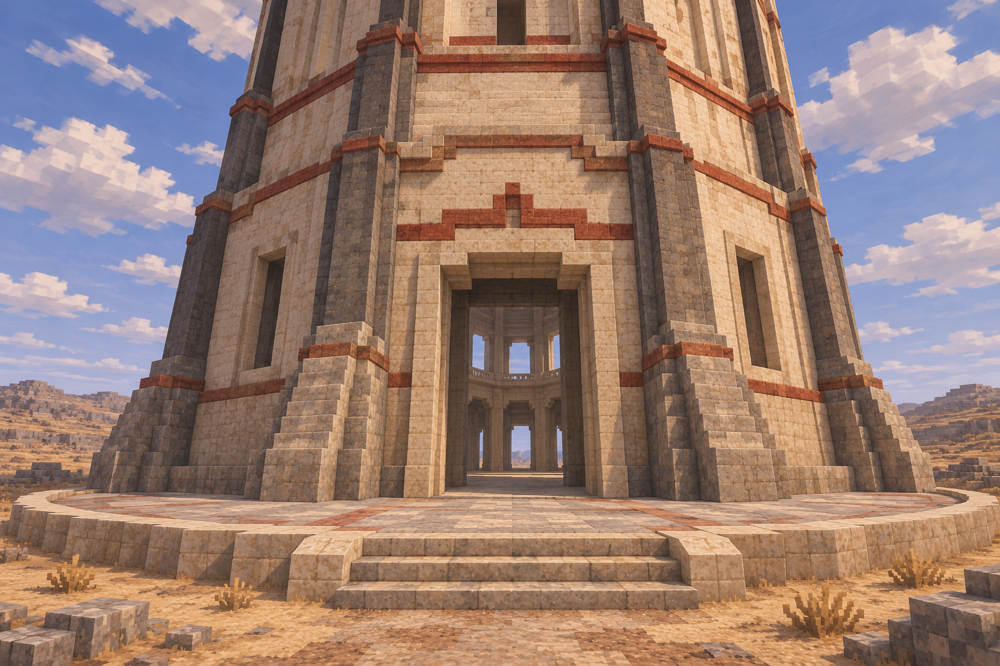

# Heaven Tower / intact lower precinct vignette (`heaven_tower`): concept art

- **Brief:** Southwestern barren approach looking upward at the lower tower and calmer dry court. Early snapshot immediately after Kijin naming, anime S1E10.
- **Canon / source scope:** Indexed Heaven Tower/Damargania wiki text identifies the western tower, Dagruel's base and the Heavenly Star Palace access role. Its LN18/19 source passages have not been directly read here; publisher/secondary citations are leads. No independently verified anime tower elevation was found. Current wiki damage state is later than the selected baseline.
- **Our interpretation and revision:** Pale stepped octagon, dark ribs, rust-red seams, architectural curb, threshold stones and representative galleries are original server design. The tower continues out of frame so the compressed precinct is not mistaken for its complete canonical height. Barrier/refuge context is not rendered as a new physical bubble or functional realm gateway.
- **Terrain and fit:** Radius84 reserves a representative precinct in the Barren Lands; the81x91 project dimensions do not measure the full canon tower. Full height, protected ground, access/interior and runtime realm linkage remain open. Heavenly Star Palace is a separate world, not an extra floating mainland castle.
- **Current reservation:** centre(-4200,-200), radius84.0, kind`clearing`, margin48. Exact coordinates/radii are server interpretations (SITE records in the main ledger), not surveyed canon. All58 site attributes match current map review`06a0323`; this art branch stacks on`7ece431` and does not carry later map/source commits. Use [map PR74](https://github.com/Yasuke2000/ocs-two-lives/pull/74), not retired Lerfing coordinates.
- **Palette / approach:** Pale stone and restrained gold for Lubelius/shrine; pale masonry, charcoal ribs and rust trim for the tower; woodland, dark masonry and warm lamps for the park. These are authored palettes. Camera direction, apparent dimensions and exact materials are illustrative; no mod IDs or blueprint bounding boxes are asserted. A visible entrance/viewpoint is not a newly registered site.
- **Era limits:** No fixed named early resident roster, later council, student visit, golem encounter, tower damage or later alliance is depicted. The orc crisis remains unresolved. Existing place-brief references to later names/alliances do not establish initial state.
- **References:** [Official episode context](https://tensura.fandom.com/wiki/Heaven_Tower) · [project place brief](../../chatgpt/places/heaven_tower.md) · [reference review and confidence](western-sanctuary-reference-review.csv). Official episode22 and50/route54 stills were inspected; public LN6 relevant passage reread. No tower elevation or exact shrine exterior verified. No playback timestamp is claimed.
- **Provenance:** Built-in image_gen original generation from source-qualified written prompts. Existing legacy materials remain untouched; no official/anime image, mod texture or third-party map/build was supplied to image generation. Exact prompt below and in [prompt collection](western-sanctuary-prompts.json). Lossless PNG packaging preserves every decoded RGB pixel of the selected output; original/output/legacy-input hashes are in [manifest](western-sanctuary-asset-manifest.json).
- **Acceptance scope:** Representative concept only. Source fidelity of the full city, shrine, tower or park, structure fit, geometry, foundation/roof/water handling and runtime-era placement require their own review. This delivery edits no SVG, blueprint, tools, runtime or server files.

## Exact original generation prompt

Original Minecraft environment concept of HEAVEN TOWER / TENTSUUKAKU in Dagruel's western Damargania, as an INTACT representative LOWER TOWER PRECINCT in the early post-Kijin baseline. Landscape1536x1024 opaque RGB, one coherent original painterly voxel image, no text/writing/UI/panels/logos/watermark. A tall pale sandstone/tuff stepped OCTAGONAL tower rises from a modest dry pale court, with dark vertical ribs, restrained rust-red masonry seams, grounded buttresses and a few deep rectangular openings. Its upper structure continues BEYOND THE TOP OF FRAME so this81x91-block compressed precinct is not mistaken for the entire canonical tower's height. Camera from the southwest sandy approach at ground level, looking upward past broad threshold stones and a low octagonal curb; a glimpse of a dry open central shaft/gallery through the door. Outer landscape is windswept barren ochre sand and weathered stone, subdued horizon; inside the architectural court the ground is calmer and stable, not a green oasis or enormous invisible bubble made visible. The barrier/refuge and realm-access roles are secondary reported setting context; exact exterior silhouette, octagon, colours, court and camera are project interpretation. No floating Heavenly Star Palace overhead, giant active portal, laser light beam, space station, named Dagruel/giants, soldiers, later heavily damaged tower, new battle scars, active teleport circle or royal banners. Quiet ancient monumental character, natural grounded dry foundations, no moat/river/lava or enormous canyon. No copied anime exterior is claimed or reproduced.
