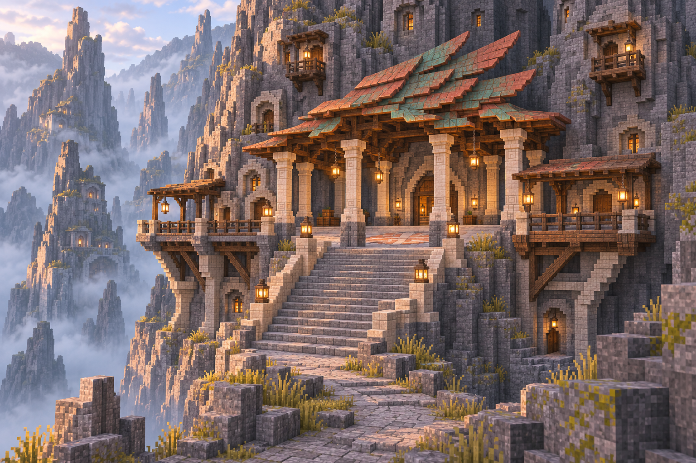

# Jia / Fulbrosia cliff landing court (`jia`): concept art

- **Brief:** Southern rocky footpath looking north and upward at one supported reception court. Initial post-Kijin geographic context; one coherent representative precinct.
- **Canon / source scope:** Official guide OFF-009 supports a cold high-mountain country; the secondary jia.webp frame shows narrow rock pillars with dwelling openings and ledges (FAN-008). The server uses Jia as its capital marker; the frame does not supply surveyed coordinates.
- **Our interpretation:** All stair routes, gallery supports, columns, feather-like copper canopy, rooms, material choices and camera direction are our interpretation. The image is one compact court/rock-face vignette, not the full cliff settlement or proof of a canonical royal building.
- **Block notes:** Grey stone/tuff, pale masonry accents, dark timber, restrained copper and lantern light. Roof curves/feathers use block stair/slab silhouettes. Buildable block silhouettes guide translation; apparent microdetail/lighting is not a block model or a material-ID audit.
- **Terrain:** A steep natural spur and irregular adjacent pillars, with small rock-cut openings and grounded buttress/timber supports. Cool sparse highland vegetation rather than tropical planting. This does not apply a new cliff profile or certify ledge foundations.
- **Current reservation:** centre(200,2450), radius68.0, kind`plateau`, margin48. Server-authored coordinates/radii, not canonical measurements. All58 site attributes in this art branch match main map review`052f262` (terrain geometry`efa2cc8`). This branch stacks on art commit`840c26f` and does not carry the later map/source commits; use [current map PR74](https://github.com/Yasuke2000/ocs-two-lives/pull/74) for current terrain and source qualifications, not retired Lerfing coordinates.
- **Reference inspection:** Cached secondary jia.webp visually reinspected; exact episode/timestamp unverified. Official guide gives climate/relief context, not this court plan. Early Frey-era setting excludes later successor flags, visiting characters or alliance ceremonies. Existing plateau/site conversion still needs build/edge support review.
- **References:** [Official world guide](https://www.ten-sura.com/map) · [pinned secondary frame](https://git.fish/KartoffelChipss/TensuraMap/src/commit/ec4d0e3db2ba4b229d412a273bbcdd19f45425b6/public/img/locations/jia.webp) · [existing server court design](../../../design/lore/jia.md).
- **Geometry / era limit:** camera, roots, cliffs, apparent scale, vegetation, water set dressing and tiny figures do not override `world/map.svg`, validate structure fits/access grades or prove an S1E10 building/NPC roster. Whole-city/tree/cliff fidelity and runtime era gating remain open. No blueprints or technical placements changed.
- **Provenance:** original built-in image_gen output from the exact written prompt below. No official frame, map, mod texture or third-party build supplied as image input. Lossless PNG repackaging preserves every decoded RGB pixel; originals remain in the local generated-images directory.

## Exact prompt

Original buildable Minecraft environment concept for Jia, harpy cliff-settlement capital of Fulbrosia in Tensura, early post-Kijin era under Frey. 1536x1024 landscape opaque RGB PNG, one coherent three-quarter scene, no words, captions, logos, lettering, UI, watermark or panels. From a southern rocky footpath looking north/uphill, show a compact landing/reception court attached to a steep NARROW grey stone mountain spur, flanked by other irregular needle-like rocky pillars receding into cool mountain mist. Small doors/windows and carved dwelling niches sit in the natural rock faces; a few short timber-supported balcony landings project from them. The core radius68-block reservation is one compressed court, not the whole city or a flat lowland fortress. A broad but short walkable stair follows the exposed rock ribs up to six pale stone columns carrying a restrained stepped copper canopy with feather-like overlapping roof forms; two modest open landing galleries are strongly rooted in buttresses and timber braces rather than floating over a void. Cold highland mood, sparse tough grasses, a little lichen, no lush tropical palms, no glacier or snow-covered world, and no new volcano. Secondary anime reference informs narrow spires with rock-cut dwellings; the exact court, stair, feather canopy, colours and gallery arrangement are original server interpretation. No ruler portraits, canon-character roster, Milim successor flags, modern aircraft or later alliance imagery. Buildable cubic stone/tuff, pale masonry accents, dark timber and aged copper, readable block stairs/slabs, warm low sunlight touching cool grey cliffs, painterly voxel aesthetic. No unsupported huge flat plaza balancing on a spike.
