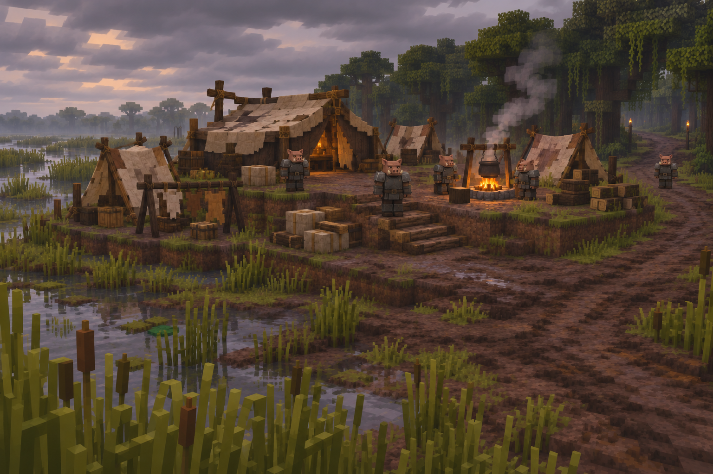

# Jura concepts: full-resolution review and ork correction

[Four visual observations](jura-full-resolution-followup.csv) · [evidence audit](jura-full-resolution-followup.json) · [exact edit prompt](orc-camp-v2-prompt.json).

The original ork-camp figures have ambiguous generic green flat faces. [Official episode10](https://www.ten-sura.com/anime/tensura/story/no10) describes pig-headed orks in plate armour;[still2](https://www.ten-sura.com/4GfGdAp7/wp-content/themes/tensura_portal/anime/tensura-portal-anime-tensura/assets/images/story/no10/img2.jpg) was freshly retrieved and inspected. No exact skin colour,roster or permanent camp layout is inferred from that fiery scene.

Version2 depicts five anonymous boar-headed armoured soldiers in the same temporary tent/marsh/dry-rise composition. This is a generative edit,not exact background-pixel retention. It introduces no combat tableau,corpses,named Geld,conquest or postwar High Orc village. Only our owned original was supplied as image input;the official still stays private. Original orc_camp.png and its prompt remain intact;the sheet/index select the versioned revision.

The stilt village,cavern chamber and destroyed ogre village were also viewed at1536x1024. Individual observations distinguish visible state from authored architecture and unresolved room/support/terrain fit. Other54concepts are not newly reviewed in this pass. R122's historical late-state screen was not acceptance of these figures' species design.

All58original PNGs and original prompt tails remain exact. Against external combined sourceef20c017/displayb48666e9,normala9b6b970,all58reservation tuples and designed first-air heights still match R127. This art branch keeps its older local technical baseline;it does not claim full current source adoption. No map,terrain,blueprint,registration coordinate,tools,mod,pack,apply,main merge or deployment changes.

Required art-branch `bash tools/check.sh` passed:462tests,26skipped,zero failures in43.628s;validation and `git diff --check` pass. This older branch is not reported as running the separate current-source472-test suite.
