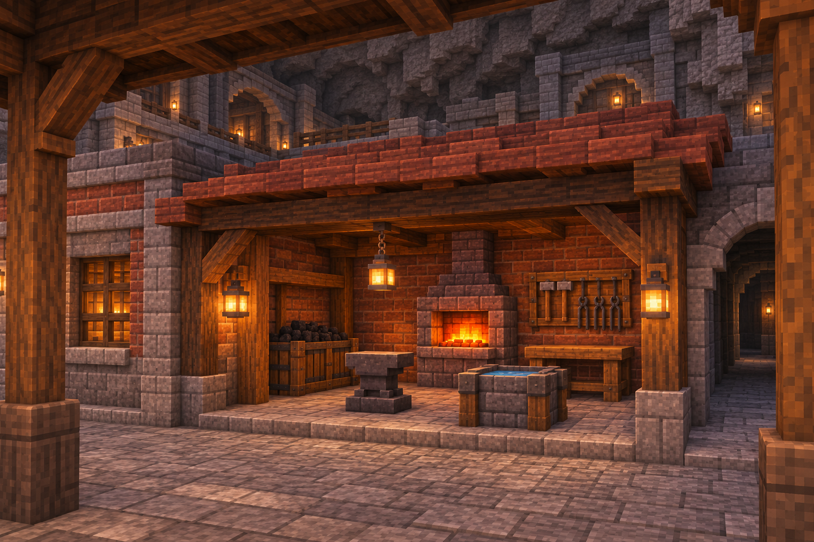

# Kaijin's former Dwargon workshop (`kaijin_smithy`): concept art

- **Brief:** Covered southern city street looking into a compact craft shop, with forge tools and dry working floor. Early snapshot immediately after Kijin naming, anime S1E10.
- **Canon / source scope:** Official episode4 synopsis introduces Kaijin as the skilled smith in Dwargon. Still4 directly supplies a warm reddish brick wall and hanging-tool context. Episode5 synopsis describes the subsequent dispute/trial. The selected era already places Kaijin with Rimuru; a named smith remaining in this old shop is not asserted.
- **Our interpretation and revision:** Remove the legacy snow panorama, ravine/waterfall, huge outdoor roof and heraldic banner. Reduce the forge to a functional brick alcove, anvil, simple workbench, tool rack, charcoal and small quench vessel. Exact equipment, interior/covered-shop arrangement, empty preserved condition and camera are our interpretation.
- **Terrain and fit:** The radius8 spot is internal to Dwargon. Only a small quench vessel contains water in the illustration; this is no mapped watercourse or new outdoor forge city. Technical roof/ventilation, dimensions and actual NPC/quest use remain open.
- **Current reservation:** centre(-12.0,-1634.0), radius8.0, kind`clearing`, margin24. Exact coordinates/radii are server interpretations (SITE records in the main ledger), not surveyed canon. All58 site attributes match current map review`24897fa`; this art branch stacks on`464d2eb` and does not carry later map/source commits. Use [map PR74](https://github.com/Yasuke2000/ocs-two-lives/pull/74), not retired Lerfing coordinates.
- **Palette / approach:** Reddish brick, grey stone, dark timber, iron-like working tools, charcoal and forge embers. Water is confined to the small quench vessel. Camera direction, apparent dimensions and exact materials are illustrative; no mod IDs or blueprint bounding boxes are asserted. A visible entrance/viewpoint is not a newly registered site.
- **Era limits:** No fixed named early resident roster, trial reenactment, later alliance or reconstructed Tempest city is depicted. Kaijin has already left the city; the orc crisis remains unresolved. Existing place-brief references to later names/alliances do not establish initial state.
- **References:** [Official episode context](https://www.ten-sura.com/anime/tensura/story/no4) · [project place brief](../../chatgpt/places/kaijin_smithy.md) · [reference review and confidence](dwargon-interior-reference-review.csv). Official episode4/5 stills were visually inspected and remain cached outside the repo; the arena uses the explicit project brief. No playback timestamp is claimed.
- **Provenance:** Built-in image_gen original generation for dwargo; edits of older original project concepts for the other three. Older candidate remains untouched; no official/anime image, mod texture or third-party map/build was supplied to image generation. Exact prompt below and in [prompt collection](dwargon-interior-prompts.json). Lossless PNG packaging preserves every decoded RGB pixel of the selected output; original/output/legacy-input hashes are in [manifest](dwargon-interior-asset-manifest.json).
- **Acceptance scope:** Representative concept only. Source fidelity of the full city/interior hall, structure fit, geometry, foundation/roof/water handling and runtime-era placement require their own review. This delivery edits no SVG, blueprint, tools, runtime or server files.

## Exact prompt

Edit this ORIGINAL project Minecraft forge into KAIJIN'S FORMER DWARGON WORKSHOP, a modest craft-room/covered shopfront in the INNER cavern city's trade street. Keep an anvil, small masonry forge, plain workbench, rack of tongs/hammers, charcoal bin and quench cauldron as compact useful objects. Replace the whole open-sky/snow-mountain/cliff/ravine/waterfall/bridge background with enclosing cavern-city masonry and grey natural rock ceiling, neighboring simple shop wall and a dark side passage at ground level. Remove the huge red/gold banner/emblem and all other faction flags. Reduce the ornate outdoor roof and two enormous furnaces into a humble reddish-brown brick forge alcove with dark timber lintel, consistent with the official episode4 still4's limited warm brick/tool-wall cue. No giant ore monuments, exposed gold piles, excessive decorative lampposts, rivers or lava. Warm ember light against neutral dim interior, safe dry walking floor, only water in the small quench vessel. Kaijin has already left Dwargon in the selected post-Kijin era: no Kaijin or named dwarf, active royal sword order, prisoner or asserted replacement occupant. Empty workshop is a representative retained-place interpretation; the source does not verify its exact later condition. One coherent compact precinct, camera from a covered southern street into the north-facing shop, an8-block pin is not a full city footprint. Grounded block-built masonry, rough timber, practical industrial scale, painterly Minecraft lighting; landscape1536x1024 RGB, no text, captions, signs, UI, panels or watermark.
