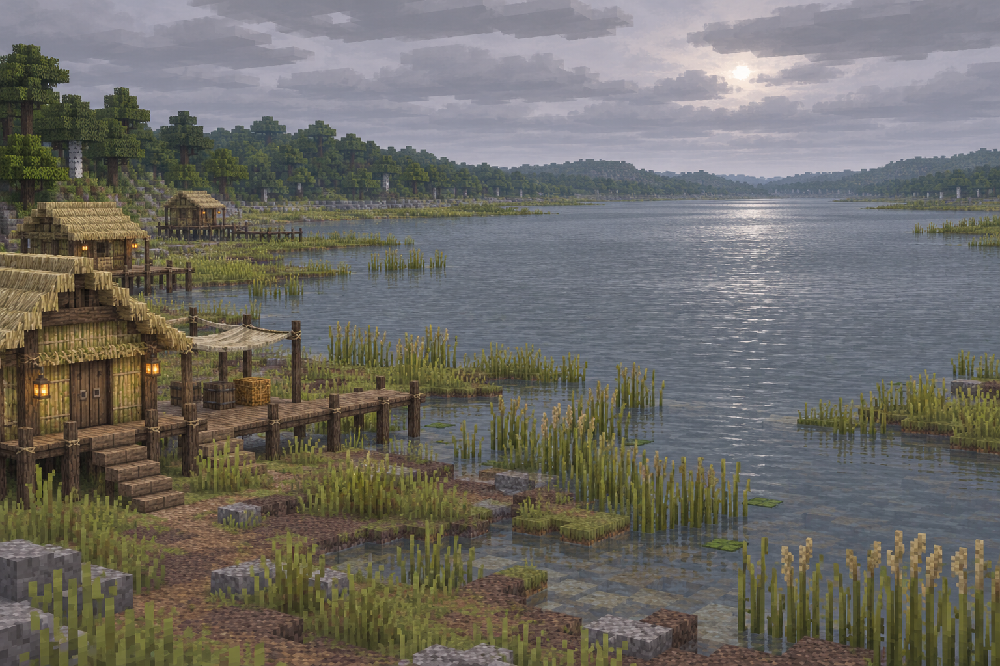

# Lake Siss southern marsh shore (`lake_siss`): concept art

- **Brief:** Southern/southwestern shore looking across the elongated basin. One coherent environment view at the post-Kijin baseline.
- **Canon / scope:** The official guide places wetlands and limestone caves around Siss; episode10 places the orc advance against the lizardmen wetlands. [Source/context1](https://www.ten-sura.com/map) · [Source/context2](https://www.ten-sura.com/anime/tensura/story/no10).
- **Our interpretation:** Exact huts, reed bays, woodwork and camera are our interpretation. The marker reserves water, not a circular arena or a whirlpool.
- **Block notes:** Mud/coarse dirt, oak, stripped logs, hay-block thatch proxy and reeds. Buildable cubic silhouettes, stairs/slabs and grounded foundations; artistic light is a cue, not verified block lighting or an in-game render.
- **Terrain:** Low, irregular reed shore and east-west water basin; nearby southern shore settlement is contextual. The SVG shoreline remains authoritative.
- **Current reservation:** centre(1100,-100), radius96.0, kind`lakeside`, margin48. These are authored server coordinates from map commit`fc36e38`, not canon measurements.
- **Facing / surroundings:** Southern/southwestern shore looking across the elongated basin. This camera and orientation are our interpretation. Read [production SVG](../../../world/map.svg), [era policy](../../../world/era.md) and the [place brief](../../chatgpt/places/lake_siss.md); legacy imported-map coordinates do not govern this image.
- **Reference inspection:** Pinned secondary lake_siss.webp was visually inspected for grey open water and reed shoreline; the official illustrated map provides the elongated basin character. Secondary reference files came from the pinned [TensuraMap commit](https://git.fish/KartoffelChipss/TensuraMap/src/commit/ec4d0e3db2ba4b229d412a273bbcdd19f45425b6). No episode or timestamp attribution is upgraded here.
- **Geometry limit:** this is original concept art, not a blueprint, surveyed site plan, generated Minecraft terrain or runtime acceptance. Perspective and nearby set dressing cannot override the SVG, dry build plates or source qualifications.
- **Provenance:** built-in image_gen, original written brief, 1536x1024 RGB PNG. No copyrighted reference image was supplied as generation input. The dwarf-village correction edits only our generated image. Lossless PNG packaging, where used, preserves every RGB pixel.

## Prompt

Create one original Minecraft-scale environment concept illustration of Lake Siss and its southern marsh shore for OCS Tensura: Two Lives. Landscape1536x1024 opaque RGB PNG. No text, captions, watermark, UI, diagrams or multi-panels. Broad low east-west lake basin, shallow irregular reed bays, muddy shelves, sedge and marsh grass, temperate forest beyond. View from the southern/southwestern shore across the long water surface; the lake reads as an elongated basin, not a circular arena. An understated cluster of a few timber/reed stilt huts and simple walkways along the southern shore suggests the lizardmen village; no grand human city or stone castle. Leave most of the scene to the water, shore and reeds. The authored map's central water marker is(1100,-100), radius96 within a basin roughly858x410 blocks; the shore settlement lies south. This is a visual setting interpretation, not a dimensioned diagram: do not print coordinates. Early timeline immediately after Kijin naming, with the Orc Lord crisis unresolved; no victory monument, battle aftermath, giant whirlpool or Charybdis in the water. Reference character: the anime's grey open water and low reed shoreline, reimagined in a new composition with original block forms. Cubic voxel terrain, block water levels with natural stepped banks, buildable 1-block posts and 2-block doors; muted olive reeds, weathered oak, grey stone, soft overcast light with a small silver reflection. Painterly Minecraft environment art, grounded scale, organic shoreline; no tropical palms.
