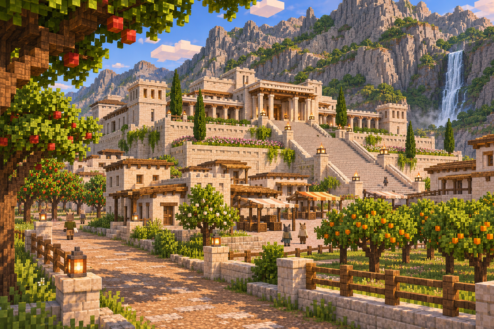

# Undestroyed old Laura / Eurazania palace precinct (`laura`): concept art

- **Brief:** Southwestern orchard road looking northeast toward the pale terraced palace and mountain backdrop. Initial post-Kijin geographic context; one coherent representative precinct.
- **Canon / source scope:** Publisher-hosted LN5 prologue directly places the town below Carrion castle with a sacred mountain behind it (LN05-001/002), then describes later destruction. OFF-008 supports warm cultivated country/fruit orchards. Secondary laura.webp supplies the pale angular palace/waterfall visual relationship (FAN-009).
- **Our interpretation:** The compressed pale-stone terraces, stairs, court architecture, houses, orchard parcels, fruit species, market shades, camera and warm palette are our interpretation. A representative precinct stands for the much larger old capital; the source does not establish this exact exterior at S1E10.
- **Block notes:** Pale masonry, ochre stone, dark timber, green orchard foliage and muted warm cloth. Small anonymous beastfolk silhouettes are scale cues, not an asserted early roster. Buildable block silhouettes guide translation; apparent microdetail/lighting is not a block model or a material-ID audit.
- **Terrain:** Warm fertile lower ground below a rugged mountain escarpment. The visible side waterfall suggests the existing authored falls outside the dry city core; it cannot override the real channel, height profile or bank position.
- **Current reservation:** centre(1500,1600), radius100.0, kind`clearing`, margin64. Server-authored coordinates/radii, not canonical measurements. All58 site attributes in this art branch match main map review`052f262` (terrain geometry`efa2cc8`). This branch stacks on art commit`840c26f` and does not carry the later map/source commits; use [current map PR74](https://github.com/Yasuke2000/ocs-two-lives/pull/74) for current terrain and source qualifications, not retired Lerfing coordinates.
- **Reference inspection:** Cached secondary laura.webp visually reinspected. Exact episode/timestamp remains unverified. The selected scene deliberately depicts an intact pale-stone old-capital precinct, not the later timber/thatch reconstruction in the existing laura.py blueprint. No destruction, ruined mountain, refugees, Tempest banners or later alliance outcome is included.
- **References:** [Legal LN5 public fragment](https://gcnovels.jp/reading/slime5.htm) · [official world-guide context](https://www.ten-sura.com/map) · [pinned secondary frame](https://git.fish/KartoffelChipss/TensuraMap/src/commit/ec4d0e3db2ba4b229d412a273bbcdd19f45425b6/public/img/locations/laura.webp).
- **Geometry / era limit:** camera, roots, cliffs, apparent scale, vegetation, water set dressing and tiny figures do not override `world/map.svg`, validate structure fits/access grades or prove an S1E10 building/NPC roster. Whole-city/tree/cliff fidelity and runtime era gating remain open. No blueprints or technical placements changed.
- **Provenance:** original built-in image_gen output from the exact written prompt below. No official frame, map, mod texture or third-party build supplied as image input. Lossless PNG repackaging preserves every decoded RGB pixel; originals remain in the local generated-images directory.

## Exact prompt

Original buildable Minecraft environment concept of UNDESTROYED OLD LAURA, Carrion's Eurazania capital in Tensura at the early post-Kijin snapshot. 1536x1024 opaque RGB PNG, one coherent original oblique city-precinct scene, no captions, words, signs with writing, logos, watermark, UI or panels. View from a southwestern orchard road looking northeast toward a compact ancient pale-stone stepped/terraced PALACE PRECINCT at the foot of a high rugged mountain escarpment. A broad but compressed central stair ascends rectangular masonry terraces to a small formal audience building; the town extends below with modest pale masonry/wood dwellings and cultivated fruit-tree plots. The secondary anime image suggests an angular pale palace below a great waterfall and jagged mountain backdrop; use that broad relationship but invent a different close approach composition and original voxel architecture, do not reproduce the frame. A single existing mountain waterfall can be seen off to the side behind the palace, its channel skirting outside the dry radius100-block city core; never send a river through the court or invent a huge lake. Lower warm fertile country and fruit orchards, tougher pale rock at height, restrained fresh greenery; small timber market shades are okay, but this must NOT be the later timber-thatch reconstruction village. No ruined buildings, blast crater, destroyed sacred mountain, refugee camp, Tempest light-blue banners or later alliance symbols. Source LN5 establishes castle/town/mountain relationship and later destruction; exact palace exterior and S1E10 building plan remain interpretation. Compact representative precinct fitting roughly200-block diameter, not an entire massive kingdom. Buildable cubic stone, stairs/slabs, a muted cream/ochre/brown/green palette, clear grounded foundations, a few tiny anonymous beastfolk silhouettes for scale, warm painterly voxel lighting. Do not include named characters, giant lion statues, modern equipment or an invented royal flag.
