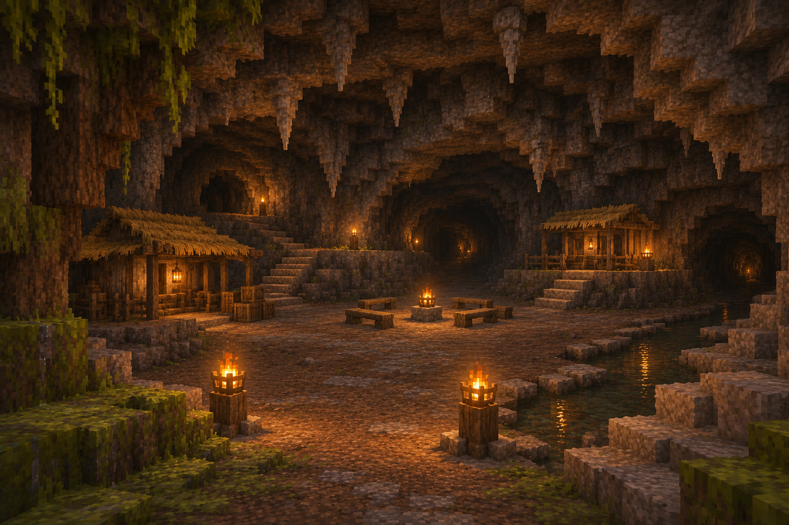

# Lizardmen labyrinth / representative meeting chamber (`lizardmen_caverns`): concept art

- **Brief:** Entrance-side view across a dry rough chamber floor toward low dwelling niches and several branching shadowy passages. Early snapshot immediately after Kijin naming, anime S1E10.
- **Canon / source scope:** The existing project underground-village brief supplies the labyrinth/government premise. Official episode12 still5 directly shows lizardmen against a warm brown irregular rocky interior with a fire-lit brazier. It supports this limited cavern/light cue, not the full labyrinth, huts, drainage, ceiling heights or meeting arrangement.
- **Our interpretation and revision:** Remove the enormous waterfall, open skylight, central underground lake and invented red emblems. A dry assembly area, two modest shelters, rough stairs, drainage strip, branching passages and low firelight are our interpretation. Foreground damp vegetation belongs to the entrance-side vignette only.
- **Terrain and fit:** The reserved carve disc is a technical footprint for a compressed chamber. Depth, roof cover, lateral labyrinth extent, water drainage and traversal still need Claude's fit/placement review. Do not carve a new Lake Siss or grant a specific royal name/room from this picture.
- **Current reservation:** centre(1300,520), radius64.0, kind`carve`, margin48. Exact coordinates/radii are server interpretations (SITE records in the main ledger), not surveyed canon. All58 site attributes match current map review`6a66e5d`; this art branch stacks on`aa9268c` and does not carry later map/source commits. Use [map PR74](https://github.com/Yasuke2000/ocs-two-lives/pull/74), not retired Lerfing coordinates.
- **Palette / approach:** Rough timber, muted straw, soil/stone, restrained practical firelight and foliage where appropriate. Camera direction, apparent dimensions and exact materials are illustrative; no mod IDs or blueprint bounding boxes are asserted. A visible entrance/viewpoint is not a newly registered site.
- **Era limits:** No named residents, fixed early NPC roster, Gabiru coup/captivity, dragonnewt wings, later alliance, military victory or reconstructed Tempest city is depicted. The ogre attack is past; the orc crisis remains unresolved. Existing place-brief references to later names/alliances do not establish initial state.
- **References:** [Official episode context](https://www.ten-sura.com/anime/tensura/story/no12) · [project place brief](../../chatgpt/places/lizardmen_caverns.md) · [reference review and confidence](jura-marsh-reference-review.csv). Official stills and the secondary ogre-village/Siss images were visually inspected and remain cached outside the repo. No playback timestamp is claimed.
- **Provenance:** Built-in image_gen edit of the older original project concept. Older candidate remains untouched; no official/anime image, mod texture or third-party map/build was supplied to image generation. Exact prompt below and in [prompt collection](jura-marsh-prompts.json). Lossless PNG packaging preserves every decoded RGB pixel of the selected output; original/output/legacy-input hashes are in [manifest](jura-marsh-asset-manifest.json).
- **Acceptance scope:** Representative concept only. Source fidelity of the full settlement/labyrinth, structure fit, geometry, foundation/roof/water handling and runtime-era placement require their own review. This delivery edits no SVG, blueprint, tools, runtime or server files.

## Exact edit prompt

Edit this ORIGINAL project Minecraft cavern image into one restrained representative entrance/meeting chamber of the LIZARDMEN UNDERGROUND LABYRINTH near Lake Siss. Keep an irregular natural rock ceiling, shadowy side tunnels and grounded rough timber dwelling niches. REMOVE the giant central waterfall, the ceiling skylight/open sky and all red banners with invented emblems. Replace the huge central lake with a broad mostly DRY dark stone-and-earth chamber floor and a narrow shallow side drainage pool only; do not create another whole Lake Siss underground. Modest rough stairs and walkable ledges connect two or three low wood/reed shelters and a plain low assembly space, not a palace or multilevel tourist resort. Low warm torch/brazier light against damp brown-grey cave rock; the official episode12 fifth still supplies only warm rocky chamber/torch context, not a surveyed layout. The full natural labyrinth continues into several dim branching passages beyond the view; no grand throne, faction flag or official room plan is asserted. Compress one128-block-diameter representative precinct rather than the entire canonical labyrinth. Avoid lush sunlit garden vegetation deep underground: only damp moss near the entrance foreground. No royal title or Avalos naming implied in the early snapshot, no Gabiru coup/captivity scenes, dragonnewt wings, Tempest flags or later alliance infrastructure. Keep one coherent original painterly Minecraft voxel environment, landscape1536x1024 opaque RGB, no characters, writing, logos, UI, captions or panels.
