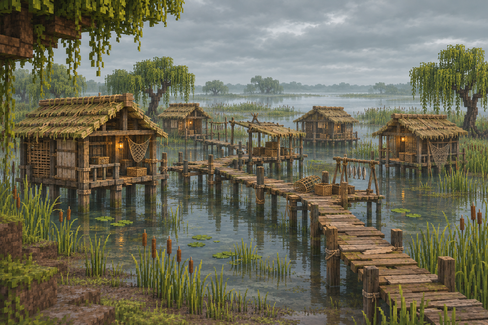

# Lake Siss marsh stilt hamlet (`lizardmen_village`): concept art

- **Brief:** Low boardwalk approaching a few functional reed-roofed pile huts in shallow marsh water, with open lake beyond. Early snapshot immediately after Kijin naming, anime S1E10.
- **Canon / source scope:** Official episode10 synopsis explicitly places lizardmen territory in wetlands around Lake Siss. The secondary lake_siss.webp frame supplies a subdued reed-lined open-water atmosphere, with episode/timestamp unverified. The surface stilt-hamlet design comes from the project/mod water-village brief; these inspected anime references do not establish this exact architectural type or plan.
- **Our interpretation and revision:** Remove invented turquoise emblems, the immense white cliff/cave wall and resort-like lamp procession. Hut construction, fish/net racks, boardwalks, willows and exact banks are our interpretation of the server water-village adaptation.
- **Terrain and fit:** Keep piles grounded below water and narrow walkways above it. This water-designated reserve is intentionally wet. The underground headquarters is a distinct reserve; no giant cave facade immediately behind these huts is prescribed.
- **Current reservation:** centre(1100,265), radius60.0, kind`lakeside`, margin48. Exact coordinates/radii are server interpretations (SITE records in the main ledger), not surveyed canon. All58 site attributes match current map review`6a66e5d`; this art branch stacks on`aa9268c` and does not carry later map/source commits. Use [map PR74](https://github.com/Yasuke2000/ocs-two-lives/pull/74), not retired Lerfing coordinates.
- **Palette / approach:** Rough timber, muted straw, soil/stone, restrained practical firelight and foliage where appropriate. Camera direction, apparent dimensions and exact materials are illustrative; no mod IDs or blueprint bounding boxes are asserted. A visible entrance/viewpoint is not a newly registered site.
- **Era limits:** No named residents, fixed early NPC roster, Gabiru coup/captivity, dragonnewt wings, later alliance, military victory or reconstructed Tempest city is depicted. The ogre attack is past; the orc crisis remains unresolved. Existing place-brief references to later names/alliances do not establish initial state.
- **References:** [Official episode context](https://www.ten-sura.com/anime/tensura/story/no10) · [project place brief](../../chatgpt/places/lizardmen_village.md) · [reference review and confidence](jura-marsh-reference-review.csv). Official stills and the secondary ogre-village/Siss images were visually inspected and remain cached outside the repo. No playback timestamp is claimed.
- **Provenance:** Built-in image_gen edit of the older original project concept. Older candidate remains untouched; no official/anime image, mod texture or third-party map/build was supplied to image generation. Exact prompt below and in [prompt collection](jura-marsh-prompts.json). Lossless PNG packaging preserves every decoded RGB pixel of the selected output; original/output/legacy-input hashes are in [manifest](jura-marsh-asset-manifest.json).
- **Acceptance scope:** Representative concept only. Source fidelity of the full settlement/labyrinth, structure fit, geometry, foundation/roof/water handling and runtime-era placement require their own review. This delivery edits no SVG, blueprint, tools, runtime or server files.

## Full-resolution follow-up — 22 November 2026

Full-resolution view: small thatched stilt huts,water supports,net racks,baskets and rough boardwalk among reeds. No named ruler,Gabiru,winged dragonnewt or later Tempest banner is depicted. This remains an authored mod/server hamlet,not a verified canonical stilt-village plan. Water access and support geometry need build review.

## Exact edit prompt

Edit this ORIGINAL project Minecraft stilt-hut village image for Lake Siss's MARSH water reserve (1100,265),radius60. Keep modest reed-roofed timber huts standing on visible piles in shallow marsh water, connected by narrow uneven boardwalks and surrounded by reeds/willows. Remove ALL turquoise banners and invented emblems. Remove the enormous white cliff wall and huge cave mouths behind the village, replacing them with a LOW reed-covered lakeshore, scattered swamp trees and broad Lake Siss visible beyond toward a subdued distant flat horizon. Do not put the underground headquarters directly behind these huts or invent a new adjacent mountain wall: it is a distinct registered location. Reduce mansion-like architecture to poor functional small wooden/thatch shelters, net racks, baskets and fishing gear, no formal marketplace or lamp-lined resort boardwalk. A few small practical warm lights are okay. Slightly overcast grey-green marsh light, calm water, reeds and muddy banks, inspired by the anime's misty Lake Siss atmosphere without copying its frame. The water footprint is intentional: keep supports reaching water/ground, do not make the site dry or floating. No king, Gabiru, named characters, dragonnewt wings, later Tempest flags, conquests or battle aftermath. No giant flower garden, new waterfall or extra island. Original painterly block-built Minecraft scene, landscape1536x1024 RGB, no text/captions/logos/panels.
