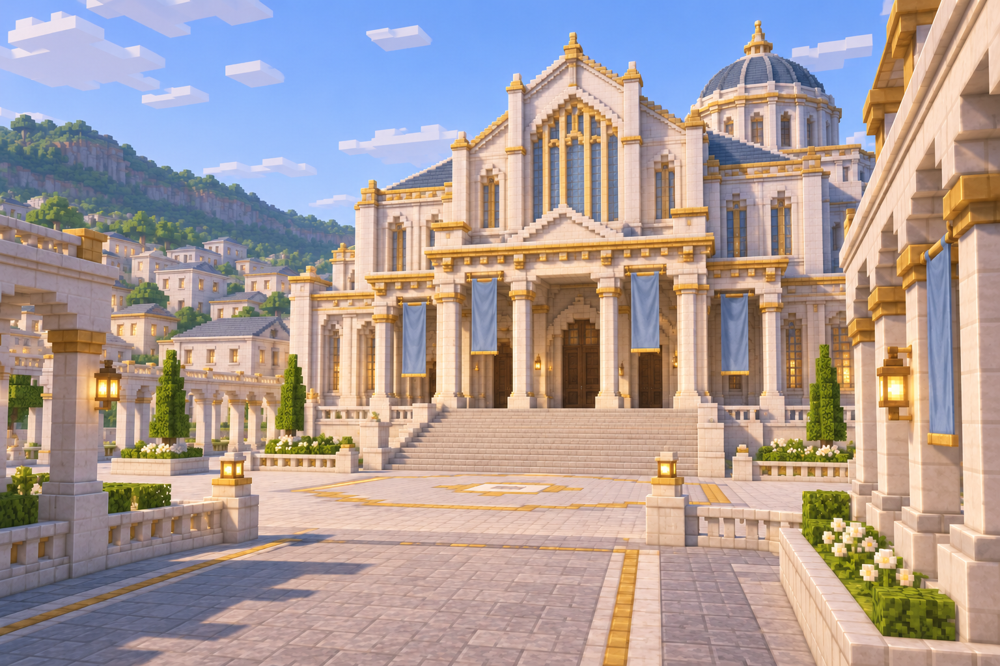

# Lune / Lubelius cathedral precinct (`lubelius`): concept art

- **Brief:** Southeastern paved approach into a representative human surface cathedral district. Early snapshot immediately after Kijin naming, anime S1E10.
- **Canon / source scope:** Directly read public LN6 establishes the Church's Lubelius base and contrasts its cathedral with the smaller summit shrine. Official episode50/route54 synopsis places a later council there; still5 supplies white/gold clothing and court decoration. It does not survey the cathedral exterior or exact early city plan.
- **Our interpretation and revision:** The white/gold precinct, muted plain blue cloth, facade, square, steps, planting and exact camera follow the owner's requested city character as original architecture. No real-world religious emblem, invented royal crest or named resident model is asserted.
- **Terrain and fit:** Radius97 reserves one compressed194-block-diameter precinct, not the full holy city or a surveyed underground Night Garden. Site foundations, skyline/roof heights, city extent and any inner-city features remain subject to source/build review.
- **Current reservation:** centre(-3600,-1300), radius97.0, kind`plateau`, margin48. Exact coordinates/radii are server interpretations (SITE records in the main ledger), not surveyed canon. All58 site attributes match current map review`06a0323`; this art branch stacks on`7ece431` and does not carry later map/source commits. Use [map PR74](https://github.com/Yasuke2000/ocs-two-lives/pull/74), not retired Lerfing coordinates.
- **Palette / approach:** Pale stone and restrained gold for Lubelius/shrine; pale masonry, charcoal ribs and rust trim for the tower; woodland, dark masonry and warm lamps for the park. These are authored palettes. Camera direction, apparent dimensions and exact materials are illustrative; no mod IDs or blueprint bounding boxes are asserted. A visible entrance/viewpoint is not a newly registered site.
- **Era limits:** No fixed named early resident roster, later council, student visit, golem encounter, tower damage or later alliance is depicted. The orc crisis remains unresolved. Existing place-brief references to later names/alliances do not establish initial state.
- **References:** [Official episode context](https://gcnovels.jp/reading/slime6.htm) · [project place brief](../../chatgpt/places/lubelius.md) · [reference review and confidence](western-sanctuary-reference-review.csv). Official episode22 and50/route54 stills were inspected; public LN6 relevant passage reread. No tower elevation or exact shrine exterior verified. No playback timestamp is claimed.
- **Provenance:** Built-in image_gen original generation followed by a targeted edit of our own output to remove unsupported cross finials. Existing legacy materials remain untouched; no official/anime image, mod texture or third-party map/build was supplied to image generation. Exact prompt below and in [prompt collection](western-sanctuary-prompts.json). Lossless PNG packaging preserves every decoded RGB pixel of the selected output; original/output/legacy-input hashes are in [manifest](western-sanctuary-asset-manifest.json).
- **Acceptance scope:** Representative concept only. Source fidelity of the full city, shrine, tower or park, structure fit, geometry, foundation/roof/water handling and runtime-era placement require their own review. This delivery edits no SVG, blueprint, tools, runtime or server files.

## Exact original generation prompt

Original Minecraft environment concept of LUNE / LUBELIUS'S HUMAN SURFACE CATHEDRAL PRECINCT in Tensura, immediately after the Kijin naming. Landscape1536x1024 opaque RGB, one coherent painterly voxel scene, no words/lettering/UI/panels/logos/watermark. View from a southeastern paved city approach into one compact pale white-and-gold ceremonial square and a dignified cathedral facade. A broad but compressed central stair, supported pale columns, restrained gold-toned cornices and a few pale-blue PLAIN cloth hangings; no invented heraldic emblems. The owner requested a Vatican-like white/gold holy-city character, but this exact precinct plan/roofline is ORIGINAL server interpretation, not a surveyed anime exterior. Cathedral is visibly a substantial civic religious building; distant ordinary pale houses and the foot of a single western ridge can suggest surroundings without a giant second mountain chain. One representative194-block-diameter precinct, not all Lubelius or the complete underground city. Maintain dry grounded paving, original cubic stairs/slabs/arches, a little restrained planting, warm clear daylight. No giant water garden, moat, new river, erupting mountain, sky palace, statue of named deity, modern technology or flag of another kingdom. No people, Hinata/Luminous/Louis/Roy models, later council/battle/trial, Tempest alliance symbols or claimed initial NPC roster. Do not show the underground Night Garden as a separately surveyed surface place. Original building architecture and camera, broad canon church-centre context only. Elegant restrained pale stone with muted blue cloth and modest gold/copper proxy accents, not a gold-covered fantasy castle.

## Exact targeted correction

Edit this original Minecraft cathedral concept. Remove both gold crosses on the front gable and distant dome; replace each with a plain short gold finial without horizontal arms. Preserve the entire building, stonework, camera, court, lighting, colors and all other details. No new emblem or text. Keep landscape 1536x1024, opaque RGB.
