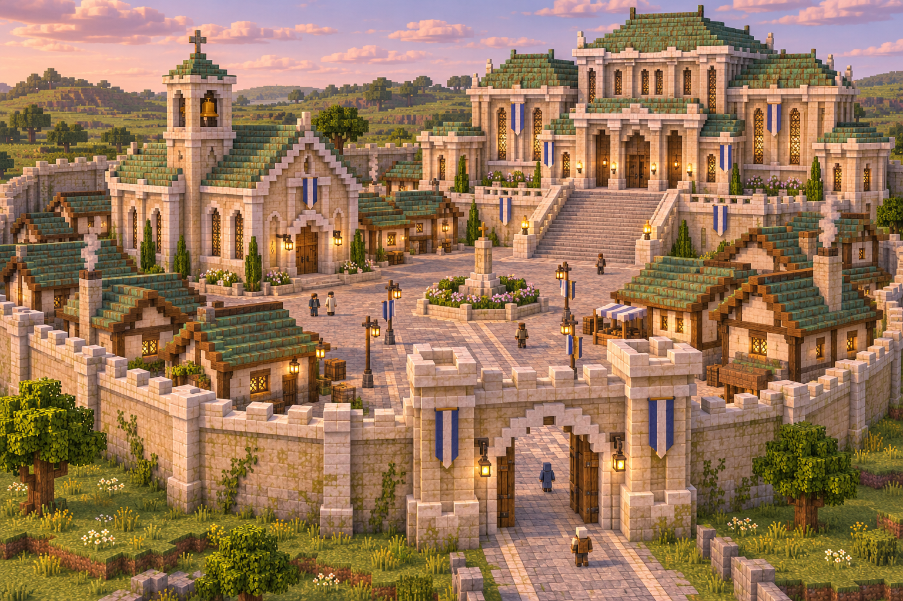

# Marris / Falmuth royal precinct (`marris`): concept art

- **Brief:** Southeastern gate approach looking northwest over a compact royal square. Post-Kijin design baseline; one coherent representative precinct.
- **Canon / context:** The initial-era reference is Falmuth under Edmaris; the later Farmenas succession and war outcomes are not depicted.
- **Our interpretation:** The opposing compact audience palace/church, court, fountain/monument, dwellings, verdigris roofs and neutral blue/white cloth follow the pack design as our interpretation. No canonical heraldry or royal/cathedral floor plan is asserted.
- **Block notes:** Pale stone, white masonry accents, aged copper, dark timber and plain blue/white cloth; warm lantern light. Cubic silhouettes and stair/slab construction; this is an illustration rather than a verified block model or light audit.
- **Terrain:** Dry low rolling country with restrained wooded horizon. The concept adds no ocean panorama, snowy range, waterfall or moat to the map.
- **Current reservation:** centre(-1800,-1650), radius101.0, kind`clearing`, margin48. These are server-authored coordinates. All58 site attributes in this art branch were compared with map commit`a997f81` and are identical. Active geography is the reviewed`fc36e38` geometry; this branch does not incorporate the later inert-comment/source review.
- **Reference inspection:** The older local candidate was replaced: its vast coastal panorama and snow peaks were unsupported for this compact reservation. All five official episode28/no30 stills were inspected; character/interior shots do not verify the proposed Falmuth palace exterior. The synopsis is later story context, not an initial-state building survey.
- **References:** [Official episode28, route no30](https://www.ten-sura.com/anime/tensura/story/no30) · [Falmuth wiki context](https://tensura.fandom.com/wiki/Kingdom_of_Falmuth).
- **Geometry / era limit:** perspective, apparent size, water set dressing and tiny anonymous figures do not override the SVG or prove the initial NPC roster, foundations, site fit, material IDs, lighting, access grades or runtime era gating. The reserved circle is a design core, not the full size of a canonical city.
- **Provenance:** original built-in image_gen output. No copyrighted anime frame, map, mod asset or third-party build supplied as image input. Siltrosso edits only our earlier original image. Where PNG compression was repackaged, decoded RGB pixels were verified identical to the original generated output.

## Exact current prompt

Original buildable Minecraft environment concept of Marris, early Falmuth royal capital in Tensura, immediately after Kijin naming, under Edmaris before the later war or Farmenas. 1536x1024 landscape opaque RGB PNG. One coherent elevated three-quarter view of a COMPACT representative royal precinct within roughly a 202-block diameter reserved site, not a panoramic recreation of an entire kingdom. From a southeastern street entrance looking northwest, show a pale-stone gate and short avenue into a royal square, a compact royal audience palace with broad stairs to the right/back, and one dignified church with a modest single bell tower opposite it, surrounded by a few tightly packed ordinary houses. Cream stone, restrained white masonry accents, stepped aged copper green roofs, small plain blue/white banners; these details are the server's original blueprint/palette interpretation, not verified anime architectural canon. Let rough-grass verges and a few low trees meet the low rolling countryside naturally beyond the walls. Keep the background simple, no ocean panorama, snow peaks, new waterfall, giant moat or extra watercourse, and no gigantic metropolis spilling miles off frame. No Yohm succession imagery, Tempest symbols, destruction or late-story residents. Buildable cubic silhouettes with stairs/slabs, weathered grounded masonry, readable two-block doors, a handful of tiny anonymous travelers for scale, warm late-afternoon painterly voxel lighting, restrained texture. No words, captions, lettered signs, UI, watermark, panels or copied official frame composition.
