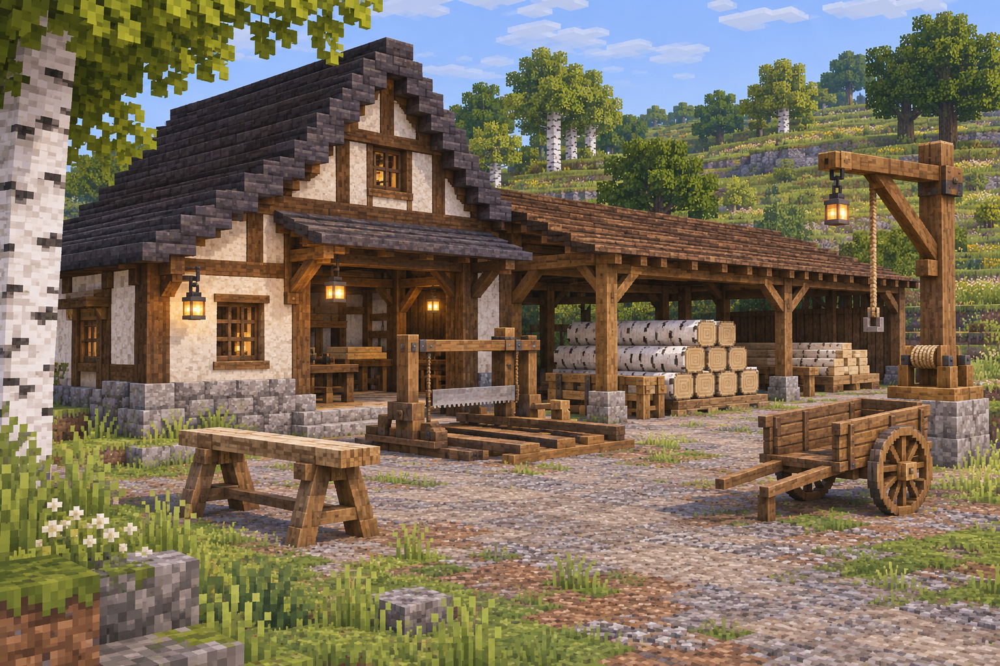

# Morgdahl / timber-workshop frontage (`morgdahl`): concept art

- **View / snapshot:** Dry work court in mixed rolling countryside. Immediately after Kijin naming, anime S1E10.
- **Source scope:** A secondary comparison of the later council map reports Morgdahl among four western states. Its industry, capital, settlement plan and early buildings are not established by that comparison. The official episode76 still selection does not independently show the named map.
- **Our interpretation:** Timber landing/workshop, birch stock, hand-saw carriage, loading jib, shelter and palette are project design. The wheel/headpond/millrace described by the wider blueprint are outside this frontage view; no new river or hydraulic connection is inferred.
- **Terrain and fit:** The69×61 project box and radius61 clearing are current authored reservations. Water features in existing blueprints still require source/era/fit review; this camera neither removes them nor certifies their placement.
- **Current reservation:** centre (-3200, 330), radius 61.0, kind `clearing`, margin 48. These are server coordinates/radii, not canon measurements. All58 site attributes match main map `13f4cfb`. This art branch stacks on `f335f38` and retains older map/source files; [PR74](https://github.com/Yasuke2000/ocs-two-lives/pull/74) governs current geography.
- **Era:** No named character, liberation memorial, post-film cure, later federation insignia, event outcome or fixed initial resident is shown. Project roles/props are not proof of S1E10 country development.
- **References:** [Source/design review](western-states-reference-review.csv) · [project place brief](../../chatgpt/places/morgdahl.md) · [era policy](../../../world/era.md). Retired imported-map coordinates do not govern this concept.
- **Provenance:** Built-in image_gen new original generation from source-qualified written brief. No copyrighted frame,texture,third-party map/build was an image input. Existing legacy materials remain untouched. [Exact prompts](western-states-prompts.json) and [manifest](western-states-asset-manifest.json) record current instruction,selected output hashes. Lossless packaging preserves every selected decoded RGB pixel.
- **Acceptance:** Representative visual reference only. Whole-country/source/early-state/structure fit,ground/roof/water/lighting and runtime placement remain open. This art delivery changes no SVG,blueprint,technical tool,runtime or deployment.

## Exact generation prompt

Original Minecraft painterly voxel environment concept, MORGDAHL representative timber-yard FRONTAGE, early post-Kijin snapshot. Landscape1536x1024 opaque RGB, one scene, no words/UI/logos/panels. Low eye-level oblique view across a compact DRY work court on gently rolling mixed grass/birch/oak western countryside, not a capital panorama. A small white-lime-plastered timber-framed saw workshop with steep dark roof and a long open-sided log shelter; stacked modest birch trunks, a simple timber trestle, hand-framed saw carriage, restrained wooden loading jib and one plain wood cart. Rough light-grey stone footings blend into earth/gravel/grass; asymmetrical natural edges. A wheel/millrace belongs to the wider authored project brief but is OUTSIDE THIS FRONTAGE CAMERA VIEW: do not depict a river, channel, lake, harbour, waterfall, millpond, waterwheel or invented hydraulic connection. The timber industry and all buildings are explicitly original server interpretation of an uncertain later-map country name, not a canon-established national industry or a verified anime town plan. No grand walls/castle, fortress, other city, industrial factory, big machinery, smoke stacks, active log operation, people, named residents, flags, crests or writing. Muted flax/cream plaster, dark oak framing, pale birch stock, weathered grey stone and soft warm practical lamps, natural daylight.
