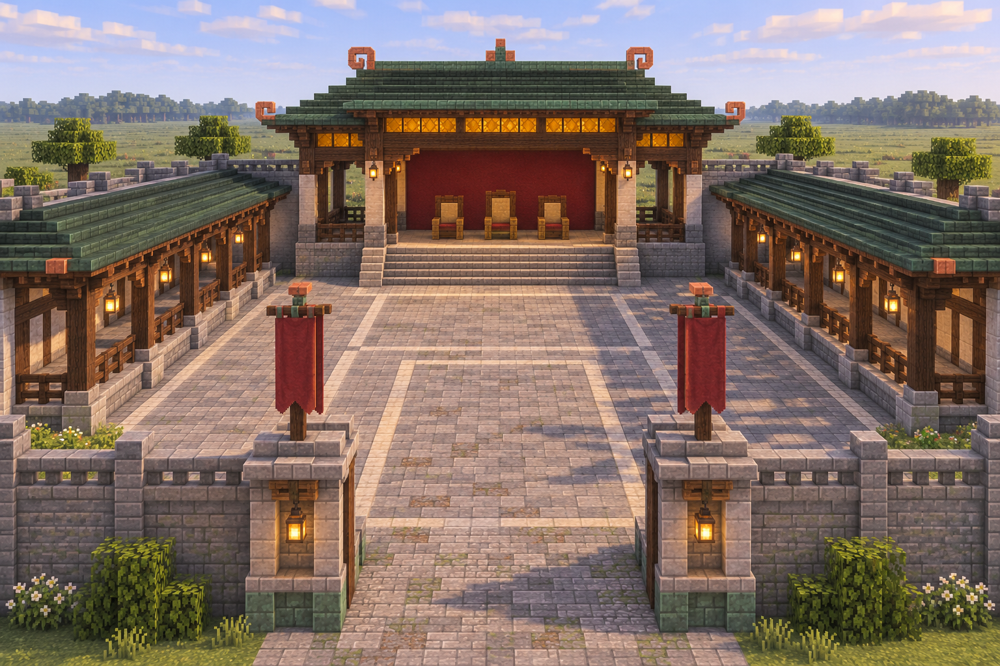

# Nasca / interpreted Imperial audience court (`nasca`): concept art

- **Brief:** Southern entry approach looking north across a restrained dry representative court. Initial post-Kijin geographic context; one coherent representative precinct.
- **Canon / source scope:** The Eastern Empire is present in the official world map; this site is the server's Nasca capital reservation. No independently verified plan or anime exterior of this court was found. Existing Empire city/interior and initial-era evidence gaps remain open.
- **Our interpretation:** The entire pavilion/gallery plan, paving marks, three empty chairs, red screen, standards, green roof, copper scrolls, materials and camera are server interpretation. Three seats do not assert a canonical trio, ruler arrangement or a particular audience scene. This is not a canonical whole-palace reconstruction.
- **Block notes:** Grey/pale stone, dark timber, muted green roof blocks, restrained copper, amber glass and deep red cloth; softly weathered grounded edges. Buildable block silhouettes guide translation; apparent microdetail/lighting is not a block model or a material-ID audit.
- **Terrain:** Dry low eastern country; no identifiable sacred mountain, crater, volcano, lake, river or coast is added. C05 retains the unresolved mountain/capital bearing; omitting that backdrop from the court concept does not resolve it.
- **Current reservation:** centre(3200,-1800), radius90.0, kind`plateau`, margin48. Server-authored coordinates/radii, not canonical measurements. All58 site attributes in this art branch match main map review`052f262` (terrain geometry`efa2cc8`). This branch stacks on art commit`840c26f` and does not carry the later map/source commits; use [current map PR74](https://github.com/Yasuke2000/ocs-two-lives/pull/74) for current terrain and source qualifications, not retired Lerfing coordinates.
- **Reference inspection:** The existing nasca.py design/lore were inspected. Generic episode17 still links in the old sheet do not verify an Imperial exterior and are not reused as architectural evidence. The court remains an interpretation with no claimed anime-frame fidelity. No named occupants, later technology, successor imagery, arms or war damage are depicted.
- **References:** [Official Eastern Empire context](https://www.ten-sura.com/map) · [Empire evidence gaps](https://github.com/Yasuke2000/ocs-two-lives/blob/chatgpt/world-map/docs/research/tensura-world-2026-11-19/eastern-empire-followup.md) · [existing original court brief](../../../design/lore/nasca.md).
- **Geometry / era limit:** camera, roots, cliffs, apparent scale, vegetation, water set dressing and tiny figures do not override `world/map.svg`, validate structure fits/access grades or prove an S1E10 building/NPC roster. Whole-city/tree/cliff fidelity and runtime era gating remain open. No blueprints or technical placements changed.
- **Provenance:** original built-in image_gen output from the exact written prompt below. No official frame, map, mod texture or third-party build supplied as image input. Lossless PNG repackaging preserves every decoded RGB pixel; originals remain in the local generated-images directory.

## Exact prompt

Original buildable Minecraft environment concept for a REPRESENTATIVE IMPERIAL AUDIENCE COURT at Nasca, Eastern Empire, Tensura, early post-Kijin era context under Rudra. Landscape1536x1024 opaque RGB PNG, one coherent three-quarter view, no words, captions, lettered signs, kanji, logos, watermarks, UI or panels. This is an EXPLICIT SERVER ARCHITECTURAL INTERPRETATION from the existing pack blueprint; no independently verified anime palace exterior or capital plan is known. Do not copy or invent a canonical palace silhouette. Show a restrained compact formal stone court within roughly a radius90-block dry reservation: southern entry standards without insignia, simple pale lines in paving, two facing covered guard galleries, a five-step rise to an open audience pavilion with THREE EMPTY CHAIRS against one plain deep-red screen, amber-glass clerestory, a dark muted green stair/slab roof with small copper scroll details. Grounded block-built masonry and timber, modest human architectural height and proportions, disciplined symmetry softened by weathered paths and a few clipped trees beyond the walls. From a southern approach looking north across the court. Background is broad low eastern grassland with distant indistinct woodland; omit any identifiable holy mountain, crater, volcano, coast, harbour, large lake or new river, since the mountain/capital bearing is unresolved against server constraints. No soldiers with firearms, tanks, airships, modern imperial technology, procession, named residents, successor ruler, war damage or Tempest alliance imagery. No giant sprawling city outside frame or floating platform. Court, chairs, colours, motifs and orientation are authored design choices rather than official heraldry or a particular canon trio. Buildable cubic shapes with stairs/slabs, readable2-block doors, soft morning painterly voxel light, subdued stone/wood/green/copper/red palette.
