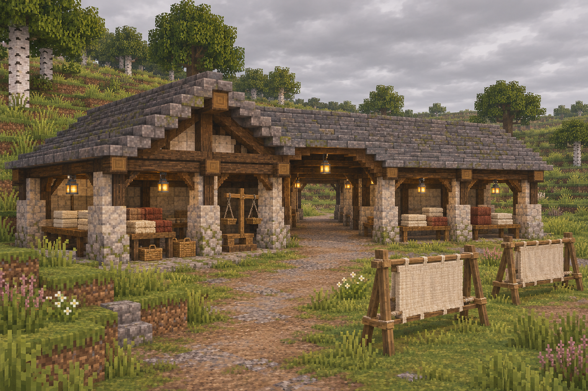

# Nostraille / interpreted wool-hall precinct (`nostraille`): concept art

- **View / snapshot:** Compact hall on a gently grassy western hill. Immediately after Kijin naming, anime S1E10.
- **Source scope:** The later-map name and broad sequence come from a secondary comparison, not an independently read LN description of a capital. The supplied project lore explicitly identifies wool trade and hall architecture as interpretation.
- **Our interpretation:** Two roofs, five open bays, cart aisle, balance, fleeces and cloth frames are original project design. They do not establish a canonical principal industry or copy a surveyed anime street.
- **Terrain and fit:** The72×64 project box and radius66 clearing reserve one precinct. Exact country borders,capital plan,early industry/buildings,foundation and runtime trade activity remain unverified.
- **Current reservation:** centre (-2550, 330), radius 66.0, kind `clearing`, margin 48. These are server coordinates/radii, not canon measurements. All58 site attributes match main map `13f4cfb`. This art branch stacks on `f335f38` and retains older map/source files; [PR74](https://github.com/Yasuke2000/ocs-two-lives/pull/74) governs current geography.
- **Era:** No named character, liberation memorial, post-film cure, later federation insignia, event outcome or fixed initial resident is shown. Project roles/props are not proof of S1E10 country development.
- **References:** [Source/design review](western-states-reference-review.csv) · [project place brief](../../chatgpt/places/nostraille.md) · [era policy](../../../world/era.md). Retired imported-map coordinates do not govern this concept.
- **Provenance:** Built-in image_gen new original generation from source-qualified written brief. No copyrighted frame,texture,third-party map/build was an image input. Existing legacy materials remain untouched. [Exact prompts](western-states-prompts.json) and [manifest](western-states-asset-manifest.json) record current instruction,selected output hashes. Lossless packaging preserves every selected decoded RGB pixel.
- **Acceptance:** Representative visual reference only. Whole-country/source/early-state/structure fit,ground/roof/water/lighting and runtime placement remain open. This art delivery changes no SVG,blueprint,technical tool,runtime or deployment.

## Exact generation prompt

Original Minecraft painterly voxel environment concept, NOSTRAILLE small original wool-market HALL PRECINCT, early post-Kijin time. Landscape1536x1024 opaque RGB, one coherent view, no text/UI/logos/panels. A low compact covered market hall on a gentle grassy western hill: two adjoining simple pitched stone/slate roofs supported on rough pale stone piers and dark timber beams, five modest open bays and one central cart-width aisle. A small timber beam balance, plain baskets and folded muted cream/russet wool bales sit under shelter; two restrained wood tenter frames with undyed cloth across a narrow earth/gravel lane. No people, creatures, flags, heraldry, royal throne, palace, castle, cathedral, large industrial mill, city panorama or water. The wool industry and exact architecture are project invention; the later-map name does not establish a canon capital plan. Ground is continuous natural earth/grass, gentle low ridges and scattered birch/oak beyond, no giant valley cliff, square raised platform or invented stream/lake. Warm restrained practical lamps, overcast soft daylight, natural modest wear and irregular planted edges, grounded cubic blocks/stairs/slabs; not a copy of a historic building or anime shot.
