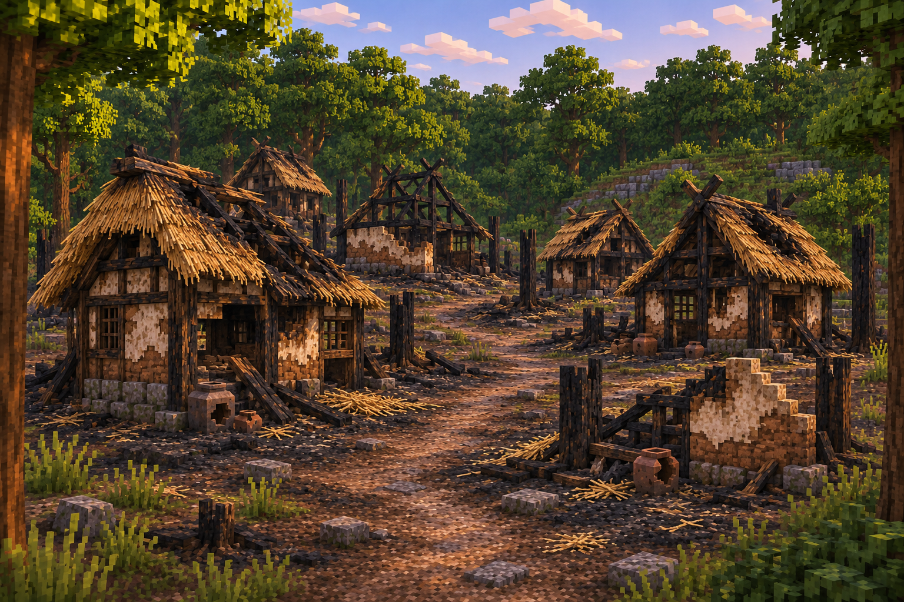

# Recently destroyed ogre village (`ogre_village_ruin`): concept art

- **Brief:** Narrow forest track into a small group of recently burned steep-roofed timber dwellings. Early snapshot immediately after Kijin naming, anime S1E10.
- **Canon / source scope:** The official episode10 synopsis identifies the six ogres as survivors of the orc attack; still2 directly depicts the destructive attack context. The pinned secondary ogre_village.webp shows a small steep-thatched village surrounded by woodland; its precise episode/timestamp and village attribution remain unverified.
- **Our interpretation and revision:** Remove the wizard tower, shrine gate, graves, stream/falls and ornamental blossom/red-flower garden. Charred posts, ash, broken straw roofs, pots and partial plaster walls are authored ruin details. No landscaped memorial or old overgrown castle is implied.
- **Terrain and fit:** Centre southeast of Rimuru village is an approved server placement, not a measured canonical homeland coordinate. Radius32 reserves a compressed64-block-diameter representative ruin, not the complete original settlement.
- **Current reservation:** centre(500,300), radius32.0, kind`village`, margin48. Exact coordinates/radii are server interpretations (SITE records in the main ledger), not surveyed canon. All58 site attributes match current map review`6a66e5d`; this art branch stacks on`aa9268c` and does not carry later map/source commits. Use [map PR74](https://github.com/Yasuke2000/ocs-two-lives/pull/74), not retired Lerfing coordinates.
- **Palette / approach:** Rough timber, muted straw, soil/stone, restrained practical firelight and foliage where appropriate. Camera direction, apparent dimensions and exact materials are illustrative; no mod IDs or blueprint bounding boxes are asserted. A visible entrance/viewpoint is not a newly registered site.
- **Era limits:** No named residents, fixed early NPC roster, Gabiru coup/captivity, dragonnewt wings, later alliance, military victory or reconstructed Tempest city is depicted. The ogre attack is past; the orc crisis remains unresolved. Existing place-brief references to later names/alliances do not establish initial state.
- **References:** [Official episode context](https://www.ten-sura.com/anime/tensura/story/no10) · [project place brief](../../chatgpt/places/ogre_village_ruin.md) · [reference review and confidence](jura-marsh-reference-review.csv). Official stills and the secondary ogre-village/Siss images were visually inspected and remain cached outside the repo. No playback timestamp is claimed.
- **Provenance:** Built-in image_gen edit of the older original project concept. Older candidate remains untouched; no official/anime image, mod texture or third-party map/build was supplied to image generation. Exact prompt below and in [prompt collection](jura-marsh-prompts.json). Lossless PNG packaging preserves every decoded RGB pixel of the selected output; original/output/legacy-input hashes are in [manifest](jura-marsh-asset-manifest.json).
- **Acceptance scope:** Representative concept only. Source fidelity of the full settlement/labyrinth, structure fit, geometry, foundation/roof/water handling and runtime-era placement require their own review. This delivery edits no SVG, blueprint, tools, runtime or server files.

## Exact edit prompt

Edit this ORIGINAL project Minecraft ruin concept to be a compact, RECENTLY BURNED OGRE VILLAGE in Jura immediately after the six survivors are named Kijin. Keep the grounded voxel materials and composition but remove the entire stone wizard tower, hill-fort and long monumental approach stairs from the background; replace with enclosing ordinary forest and a low local hillside. Remove the red shrine gate, graveyard, ornamental red flowers and pink blossom tree: these are unverified cultural/set dressing claims, and the recent attack should not look like an old landscaped memorial. Remove the stream and waterfalls at left; replace with scorched forest floor and broken timber. Make the scene 5 or 6 modest steep-thatched timber house remains over a roughly64-block-diameter footprint, charred posts, collapsed roof frames, dark ash patches, scattered burnt straw, broken household jars, partially standing earth/plaster walls. The referenced secondary anime village suggests simple steep thatch roofs nestled in forest, not a surviving medieval tower. Fresh destruction, no decades of mossy regrowth, no active flames or battle, no bodies/gore, no new military camp or later reconstruction. Restrained somber daylight, mature green forest outside the burnt clearing. The ogres' precise homeland location is unverified; this is an original authored ruin vignette. Keep view down a narrow rough dirt track, no huge stone plaza. No people, banners, writing, symbols, modern equipment or named characters. Landscape1536x1024 RGB; painterly Minecraft blocks, one coherent image, no captions or panels.
