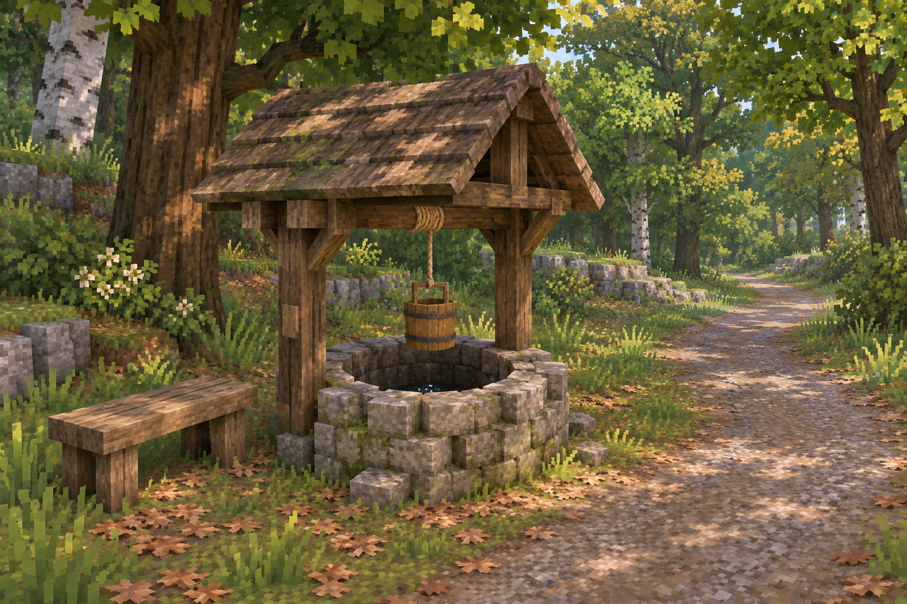

# Old well: small western Jura quest stop (`old_well`): concept art

- **View / ground:** Camera faces east along the worn road; rough stone well and timber roof stand on a dry rooted verge.
- **Source scope:** The old well is an authored side-quest spot. No official source read here establishes it as a named canonical monument or dates its construction.
- **Our interpretation:** Low rubble rim,roof,rope,bucket and bench are original practical props. The dark water glint is confined to the shaft; no surface stream,pool or drainage route is added.
- **Terrain / fit:** Current radius8 pin(-1000,-340) lies outside the dark core. Exact well depth,groundwater,placement,player access and water/roof handling require technical acceptance; concept perspective is not an engineered section.
- **Reservation:** centre(-1000,-340),radius8.0,kind`clearing`,margin24. All58 site attributes match map1209e38. Coordinates/radii are authored server values. This art branch stacks on96e1069 and retains older map/source files; [map PR74](https://github.com/Yasuke2000/ocs-two-lives/pull/74) governs current terrain. Sainte's depicted alternative is explicitly separate.
- **Era:** Immediately after Kijin naming,S1E10. No named initial resident,late faction crest,postwar reconstruction or future outcome is shown. Enduring geography does not prove each distant building's initial condition. [Era policy](../../../world/era.md).
- **References:** [Source/design review](final-places-reference-review.csv) · [project brief](../../chatgpt/places/old_well.md). Imported-map data and ambiguous source leads remain qualified.
- **Provenance:** Built-in image_gen new original generation from the written brief. No copyrighted frame,map,mod texture or third-party build was an image input. No older local PNG candidate existed for this ID; legacy sheets remain intact. [Exact prompt set](final-places-prompts.json) and [manifest](final-places-asset-manifest.json) record selected original/output hashes. Lossless PNG packaging preserves every selected decoded RGB pixel.
- **Acceptance:** Representative art only. Canonical geometry/country coverage,initial architecture,exact voxel dimensions,foundation/roof/water/tree handling,lighting,access and runtime acceptance remain open. No SVG,blueprint,tool,mod,pack,apply or deployment change by this art delivery.

## Exact generation prompt

Create an original small old roadside WELL in western Jura,an authored quest stop rather than a named canonical monument. A simple low circular-ish square-voxel rubble-stone well rim,a modest weathered timber gable roof with a single plain wooden bucket and rope,and one short bench beside a narrow worn earth/gravel road. Well structure about4 blocks across; whole prop cluster within12 blocks. Dry leaf-litter and grass verge,irregular mixed old trees and light understory; soft dappled late-morning light. The well throat may be dark with a subtle water glint far below, but NO surface stream,pool,lake,waterfall,canal or drainage feature. No town,cottage compound,fence enclosure,portal,runes,magical glow,huge statues,flags or people. Humble useful travel scenery at the existing 8-radius pin,outside the dark core; no new settlement or verified anime event inferred. Original Minecraft voxel environment concept,1536x1024 landscape opaque RGB. Polished broad readable block materials,soft natural light and restrained painterly detail,not photoreal noise. Natural asymmetry and practical construction. No text,lettering,UI,logos,map panels or named people. Early post-Kijin baseline S1E10; no future federation crests,railways,metropolis or later event outcome. This is original interpreted design,not a copied anime frame.
