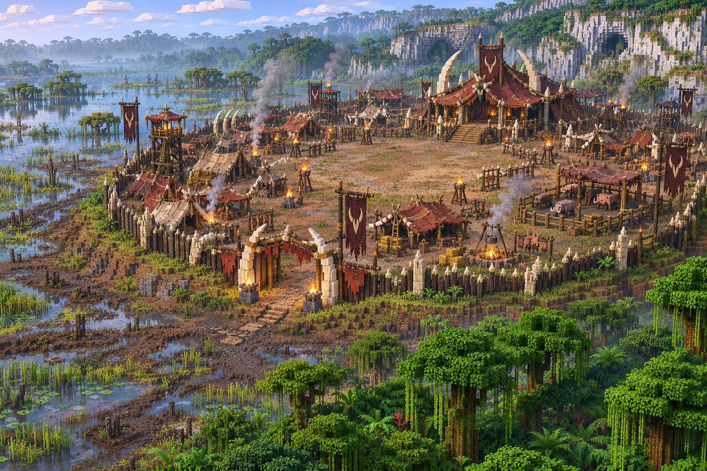

# Orc War battlefield

## Designed site

- Anchor: `orc_camp`; region `W`; proposed centre **(1750, 550)**; SVG y is Minecraft z.
- Site kind: `village`; reserved radius **60 blocks**, diameter 120; exclusion margin 48 blocks.
- Relief footprint: lowland / local designed terrace; woodland: open ground / habitat from region book.
- Approach / facing: **north**. This is our interpretation unless the lore specifies it. Underground rooms use local interior approaches, not separate surface gates.
- The site disc is not a measured blueprint bounding box. Final ground y, cliff cover, lake rim and build fit belong to Claude’s converter and site overrides.

## Scene and terrain integration

Wanted: a huge sprawling orc camp on the marsh edge. Suggestion: trampled mud, crude tents and pens, bone piles, skull banners, smoke, a command pavilion for the Orc Lord. Tensura's own orc village structure is the current stand-in and its placement failed (see current state). **Open blueprint task** (a pack-owned `orc_camp` build instead of Tensura's jigsaw).

Surroundings and the view across the boundary follow [W in the region book](../../../world/regions.md). Keep the build on the reserved dry plate (except the designated water arena), let roots, buttresses, paths and vegetation blend into the local terrain, and keep the designed road corridor open. No isolated square platform or floating foundation. Buildings, palettes and local layout in the concept are **our interpretation**, not a replacement blueprint.

## Block palette

`minecraft:mud`, `minecraft:mangrove_log`, `minecraft:oak_fence`, `minecraft:hay_block`, `minecraft:bone_block`. These are existing vanilla Minecraft 1.21.1 IDs; decorative variants must be verified before implementation. Use a restrained three-to-six-material palette per building.

## Sources and interpretation

- [Place brief](../../chatgpt/places/orc_camp.md) and [existing lore](../../../design/lore/world.md). Legacy imported-world positions in those documents are not this map’s coordinates.
- [official world guide](https://www.ten-sura.com/map), [episode 10, still 1](https://www.ten-sura.com/4GfGdAp7/wp-content/themes/tensura_portal/anime/tensura-portal-anime-tensura/assets/images/story/no10/img1.jpg), [episode 10, still 2](https://www.ten-sura.com/4GfGdAp7/wp-content/themes/tensura_portal/anime/tensura-portal-anime-tensura/assets/images/story/no10/img2.jpg).
- Concept produced with the built-in image-generation tool from an original written brief; no official frame, mod texture or paid map was used as image input.

EN: Concept of Orc War battlefield in its designed terrain.
NL: Concept van Orc War battlefield in het ontworpen landschap.
