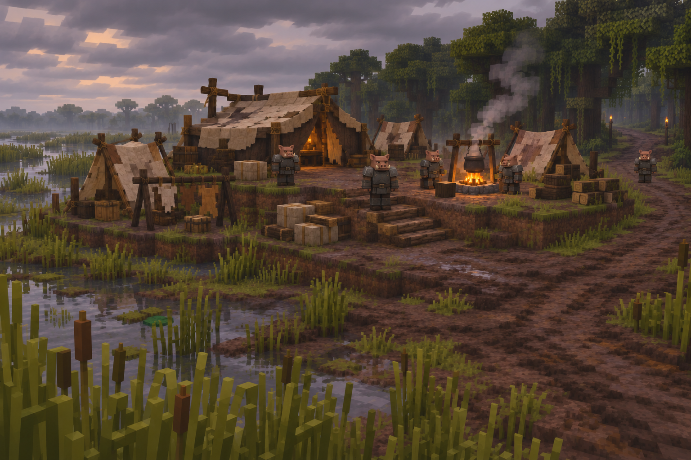

# Orc advance camp — encounter reservation (`orc_camp`): concept art

- **Brief:** Northern reed edge looking south-southeast toward a firm muddy rise. One coherent environment view at the post-Kijin baseline.
- **Canon / scope:** The orc advance threatens the lizardmen wetlands at the selected era; the conflict is unresolved. [Source/context1](https://www.ten-sura.com/anime/tensura/story/no10) · [Source/context2](https://www.ten-sura.com/anime/tensura/story/no11).
- **Our interpretation:** Tents, command shelter, supplies, figures and track layout are our interpretation. This small reservation is not the whole horde, a settled postwar village, or Orbic homeland.
- **Block notes:** Mud/coarse dirt, dark oak/stripped logs, dull tan wool/hide proxy and campfire light. Buildable cubic silhouettes, stairs/slabs and grounded foundations; artistic light is a cue, not verified block lighting or an in-game render.
- **Terrain:** Dry small nucleus beside reed marsh; a rough southern track suggests approach. No victory monument or large fortified city is implied.
- **Current reservation:** centre(1750,550), radius60.0, kind`village`, margin48. These are authored server coordinates from map commit`fc36e38`, not canon measurements.
- **Facing / surroundings:** Northern reed edge looking south-southeast toward a firm muddy rise. This camera and orientation are our interpretation. Read [production SVG](../../../world/map.svg), [era policy](../../../world/era.md) and the [place brief](../../chatgpt/places/orc_camp.md); legacy imported-map coordinates do not govern this image.
- **Reference inspection:** Official episode10 still1/2 were inspected for the crisis context; they do not depict or establish this camp layout. Secondary reference files came from the pinned [TensuraMap commit](https://git.fish/KartoffelChipss/TensuraMap/src/commit/ec4d0e3db2ba4b229d412a273bbcdd19f45425b6). No episode or timestamp attribution is upgraded here.
- **Geometry limit:** this is original concept art, not a blueprint, surveyed site plan, generated Minecraft terrain or runtime acceptance. Perspective and nearby set dressing cannot override the SVG, dry build plates or source qualifications.
- **Provenance:** built-in image_gen, original written brief, 1536x1024 RGB PNG. No copyrighted reference image was supplied as generation input. The dwarf-village correction edits only our generated image. Lossless PNG packaging, where used, preserves every RGB pixel.

## Full-resolution follow-up — 22 November 2026

Original figures have generic flat green faces without clear boar snouts. Version2 makes five anonymous soldiers recognizably pig-headed and armoured,retaining the temporary tent/marsh/dry-rise composition. No named leader,peaceful High Orc state or completed battle is depicted. Camp layout and exact roster remain authored.

Current reference: [version2](orc_camp-v2.png),made with built-in image_gen from our owned original only;[exact edit prompt](orc-camp-v2-prompt.json). [Original](orc_camp.png) and original prompt below remain historical. [Official episode10](https://www.ten-sura.com/anime/tensura/story/no10) describes pig-headed orks in plate armour;its [second still](https://www.ten-sura.com/4GfGdAp7/wp-content/themes/tensura_portal/anime/tensura-portal-anime-tensura/assets/images/story/no10/img2.jpg) was freshly inspected. Combat,victims and attack flames are not transferred into this camp. No source pixels were supplied to the editor or committed.

## Prompt

One original Minecraft environment concept illustration for OCS Tensura Two Lives: a SMALL ORC ADVANCE-CAMP / ENCOUNTER RESERVATION on a firm muddy rise at the southeastern edge of Lake Siss's wetlands, immediately after the Kijin naming while the Orc Lord crisis remains unresolved. Landscape1536x1024 opaque RGB PNG. No text, labels, insignia writing, UI, watermark or panels. A low improvised hide command tent and several crude canvas/hide shelters, rough timber racks, a smoky cooking fire, battered supplies, trampled paths and a few indistinct stocky orc silhouettes create a temporary horde staging point. It is not an established peaceful High Orc village, not a victory monument or postwar camp, and not the depleted homeland Orbic. No blood, corpses, piles of human remains, gore or dramatic boss portrait. A broader muddy track continues south into woodland, while reed marsh and shallow wet channels extend north/northwest toward the unseen wider lake. View from the northern reed edge looking south-southeast at the rise, showing a dry buildable nucleus and wet ground to either side; no shelters floating on water. The site reservation is only radius60 blocks: do not squeeze the whole200000-strong horde into this footprint or invent a massive fortified city. The exact camp layout and tents are authored server interpretation; the source-backed point is the orc advance against the lizardmen wetlands. Material palette dark oak, stripped logs, mud/coarse dirt, dull tan hide/wool, restrained orange campfire light. Painterly cubic Minecraft voxel environment, overcast late-afternoon sky, organic trampled ground and restrained ominous mood, original design with block-scale stairs/posts and believable 1.8-block figure scale.
