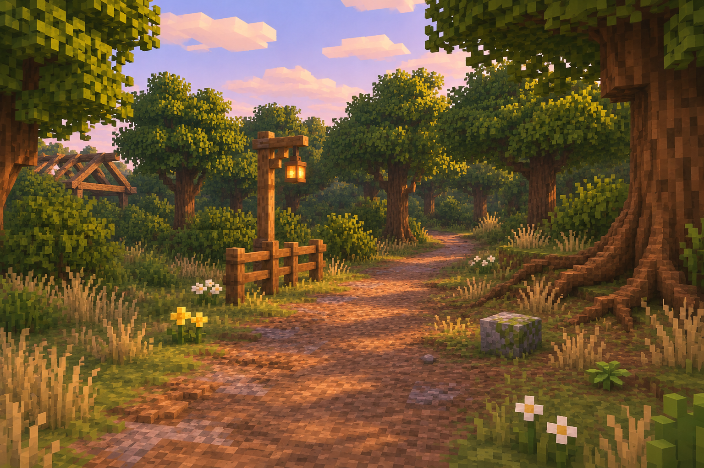

# Quiet contact corner near the early village (`outcast_road`): concept art

- **View / snapshot:** Empty dusk path under a tree, with one subordinate unfinished timber roof in the distance. Immediately after Kijin naming, anime S1E10.
- **Facing / ground:** Camera faces north/northwest toward the nearby early-village edge; the roof fragment is authored context,not a full town layout.
- **Source scope:** The Outcast Society and its contact role are project fiction. Official episode9 shows modest early interiors and forest surroundings; it does not establish this faction or a canonical contact site.
- **Our interpretation:** The hooded resident, water, fortress, flags, huge hill and staircase are removed. One lamp, short fence remnant, mossy stone, dry path and tiny roof fragment are authored village-edge props.
- **Terrain and fit:** The centre(0,52) lies inside Tempest's radius148 parent reservation. It is a sub-location, not a detached settlement or a new full camp. No fixed initial NPC or faction insignia is implied; player traffic, shelter fit and residents require runtime review.
- **Current reservation:** centre(0.0,52.0),radius8.0,kind`clearing`,margin24. Coordinates/radii are authored server values, not canonical measurements. All58 attributes match map commit48b0846. This art branch stacks on558b032 and retains older map/source files; [map PR74](https://github.com/Yasuke2000/ocs-two-lives/pull/74) governs current terrain.
- **Era:** No named initial resident, later federation insignia, completed future event or fixed active encounter is depicted. Camps and roles remain server adaptations. [Era policy](../../../world/era.md).
- **References:** [Source/design review](jura-route-reference-review.csv) · [project brief](../../chatgpt/places/outcast_road.md). Imported-map coordinates/audit imagery are historical context.
- **Provenance:** Built-in image_gen edit of our earlier original; its first-generation prompt is unavailable. No copyrighted anime frame,map,texture or third-party build was an image input. The legacy original is preserved. [Exact prompts](jura-route-prompts.json) and [manifest](jura-route-asset-manifest.json) record selected output and own-input hashes. Lossless PNG packaging preserves every selected decoded RGB pixel.
- **Acceptance:** Representative visual design only; exact source/era/voxel fit,terrain/tree/shelter placement,lighting,water/roof handling,residents and runtime acceptance remain open. No world,tool,mod,pack,blueprint,apply or deploy change in this art delivery.

## Exact current edit prompt

Edit our original purple-hooded roadside concept. Preserve the warm dusk voxel style, forest framing and close roadside camera. Remove the hooded person completely, replace that space with dry grass and the natural tree root behind it. Remove every water surface, creek and bank, the distant fortified city, tower, wall, blue flags, mountain cliffs and long grand staircase. Show a tiny quiet stopping place in a shaded edge of an EARLY modest forest village: narrow worn packed-earth path, one unmarked small mossy stone and sparse ground plants. At far left only a partially obscured fragment of a SINGLE low unfinished timber roof may suggest nearby early houses; no compound or broad skyline. No river, shore, beach, paved highway or temple. The contact pin is only52 blocks south of the early village centre and inside its wider reserved footprint, so do not isolate it beyond a mountain pass. Keep the scene empty: no fixed initial NPC, faction insignia, star emblem, later event or named person. Landscape 1536x1024 opaque RGB. Original polished Minecraft voxel environment concept, coherent block scale, natural atmospheric light, detailed but buildable materials. No captions, lettering, logo, UI, collage, map or frame. Baseline immediately after six Kijin are named, anime S1E10; no later Tempest metropolis or federation flags. This is a server interpretation, not a reproduction of anime art.
