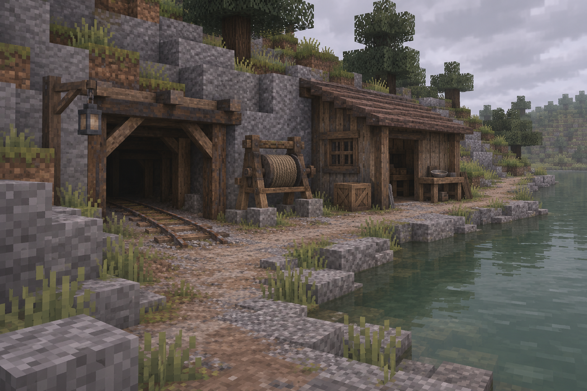

# Raja / old lakeside mine approach (`raja`): concept art

- **View / snapshot:** Quiet grey-rock shore shoulder and representative mine threshold. Immediately after Kijin naming, anime S1E10.
- **Source scope:** Bandai Namco Filmworks release sheet page2 places Raja west of Tempest and describes former gold prosperity and mine-poisoned lake during Scarlet Bond. Official notice7828 identifies miners under Towa. These are film-era sources; they do not date every condition/person to the post-Kijin instant.
- **Our interpretation:** Mine portal, rails, sheave/drum, small assay shed and precise inlet are original project design. Muted water is not proof of either contamination or a cure. Crown tribute/window, later crisis resolution and named cast are excluded.
- **Terrain and fit:** The80×70 project box and radius71 lakeside reservation are retained. Exact initial mine operation/water chemistry and royal state remain unverified; shoreline,building-water handling and full mine fit need their own review.
- **Current reservation:** centre (-2850, 360), radius 71.0, kind `lakeside`, margin 48. These are server coordinates/radii, not canon measurements. All58 site attributes match main map `13f4cfb`. This art branch stacks on `f335f38` and retains older map/source files; [PR74](https://github.com/Yasuke2000/ocs-two-lives/pull/74) governs current geography.
- **Era:** No named character, liberation memorial, post-film cure, later federation insignia, event outcome or fixed initial resident is shown. Project roles/props are not proof of S1E10 country development.
- **References:** [Source/design review](western-states-reference-review.csv) · [project place brief](../../chatgpt/places/raja.md) · [era policy](../../../world/era.md). Retired imported-map coordinates do not govern this concept.
- **Provenance:** Built-in image_gen new original generation from source-qualified written brief. No copyrighted frame,texture,third-party map/build was an image input. Existing legacy materials remain untouched. [Exact prompts](western-states-prompts.json) and [manifest](western-states-asset-manifest.json) record current instruction,selected output hashes. Lossless packaging preserves every selected decoded RGB pixel.
- **Acceptance:** Representative visual reference only. Whole-country/source/early-state/structure fit,ground/roof/water/lighting and runtime placement remain open. This art delivery changes no SVG,blueprint,technical tool,runtime or deployment.

## Exact generation prompt

Original Minecraft painterly voxel environmental concept for RAJA's representative OLD LAKESIDE MINE APPROACH, early post-Kijin world, no post-film restoration scene. Landscape1536x1024 opaque RGB, coherent single scene, no text/UI/logos/panels. Close low oblique view of a modest weathered grey-rock shore shoulder beside a small subdued grey-green natural inlet, shown only as quiet water at the side, not a vast dramatic lake/capital vista. A low dark timber-set mine portal enters a small rocky bank; a short piece of rusty rail, plain timber sheave/drum and one small worn assay shed with restrained workbench/crate outside. The mine opening is shadowed and quiet; don't assert an active production event, total shutdown or magical cure. No crown-shaped window, royal insignia, Towa/Hiiro/Rimuru, celebration, memorial, healed crystal-blue water, glowing poison, tiara ritual, eruption, corpses or active disaster. Exact contamination/state at S1E10 is unverified: neutral subdued material colors should not certify a precise chemical state or a film outcome. No palace, great tower, huge headframe, waterfall, extra river/tributary or large new terrain excavation. Rough footpaths follow the existing low shore and meet earth naturally; modest useful props over grand decoration. Gold-mining/lake context comes from the film sources; exact portal, shed and water outline are our server interpretation, not a surveyed film set. Muted grey/timber/earth, slightly overcast diffuse daylight.
