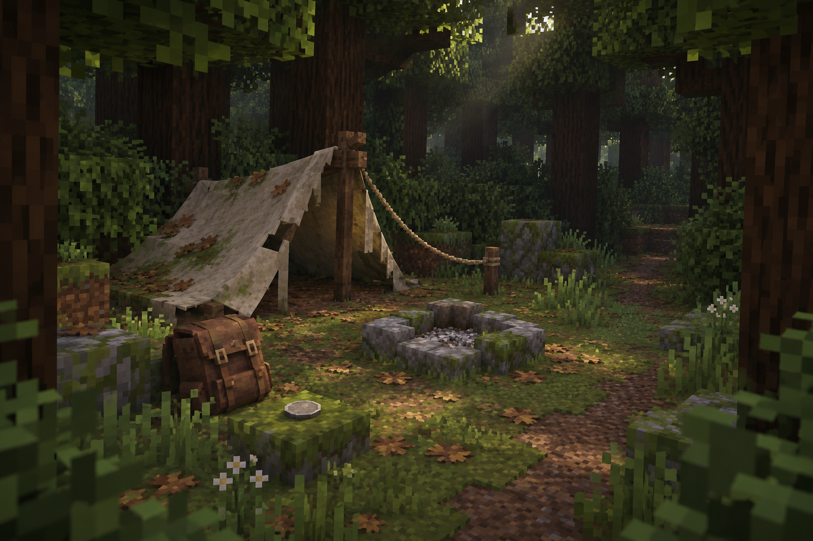

# Abandoned rookie camp in the dark band (`rookie_camp`): concept art

- **View / snapshot:** Small torn canvas shelter, cold hearth, pack and blank token beneath closed forest canopy. Immediately after Kijin naming, anime S1E10.
- **Facing / ground:** Approach from south,camera looking north/northwest through the dark woodland; tent and hearth stand on dry rooted forest ground.
- **Source scope:** The missing rookie party is a project quest premise, not a canonical event. The current pin(-120,-560) is about573 blocks from Tempest, inside the authored outer dark band; the legacy safe-rim/meadow description is obsolete.
- **Our interpretation:** Leaf accumulation, slack rope, worn tent and token are original set dressing. No bodies, battle evidence, perpetrator or future event outcome is asserted.
- **Terrain and fit:** Radius8 is retained. This is not the northern arrival clearing or a certified safe zone. Exact prop layout, lighting, navigation, encounter state and player protection remain runtime/design work.
- **Current reservation:** centre(-120,-560),radius8.0,kind`clearing`,margin24. Coordinates/radii are authored server values, not canonical measurements. All58 attributes match map commit48b0846. This art branch stacks on558b032 and retains older map/source files; [map PR74](https://github.com/Yasuke2000/ocs-two-lives/pull/74) governs current terrain.
- **Era:** No named initial resident, later federation insignia, completed future event or fixed active encounter is depicted. Camps and roles remain server adaptations. [Era policy](../../../world/era.md).
- **References:** [Source/design review](jura-route-reference-review.csv) · [project brief](../../chatgpt/places/rookie_camp.md). Imported-map coordinates/audit imagery are historical context.
- **Provenance:** Built-in image_gen new original generation from a source-qualified written brief. No copyrighted anime frame,map,texture or third-party build was an image input. The legacy original is preserved. [Exact prompts](jura-route-prompts.json) and [manifest](jura-route-asset-manifest.json) record selected output hashes. Lossless PNG packaging preserves every selected decoded RGB pixel.
- **Acceptance:** Representative visual design only; exact source/era/voxel fit,terrain/tree/shelter placement,lighting,water/roof handling,residents and runtime acceptance remain open. No world,tool,mod,pack,blueprint,apply or deploy change in this art delivery.

## Exact generation prompt

Generate an original intimate Minecraft environment concept of an empty ABANDONED tiny rookie traveller camp under the dark canopy of Jura. One partly collapsed plain canvas lean-to, a cold small ash-and-stone fire ring, a weathered pack and one small blank worn metal token lie in a mossy patch about8 blocks across. Subtle leaf accumulation and a slack tent rope imply absence; no bodies, blood, skeletons, weapons, arrows, staged battle or identifiable cause. Dark oak trunks, thick understory and a faint narrow approach enclose all sides, with restrained soft daylight filtering through the high leaves. This pin lies about573 blocks from the early village centre, within the current forest's outer dark band: it is NOT an open safe meadow or the northern arrival clearing. No river, lake, shoreline, lava, portal, lantern boulevard, large lodge or skyline. Quiet melancholy, original believable small-scale set dressing, not a documented canonical missing-party event. Landscape 1536x1024 opaque RGB. Original polished Minecraft voxel environment concept, coherent block scale, natural atmospheric light, detailed but buildable materials. No captions, lettering, logo, UI, collage, map or frame. Baseline immediately after six Kijin are named, anime S1E10; no later Tempest metropolis or federation flags. This is a server interpretation, not a reproduction of anime art.
